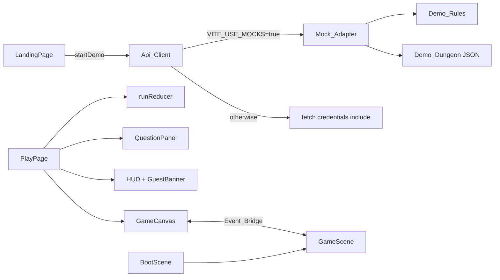
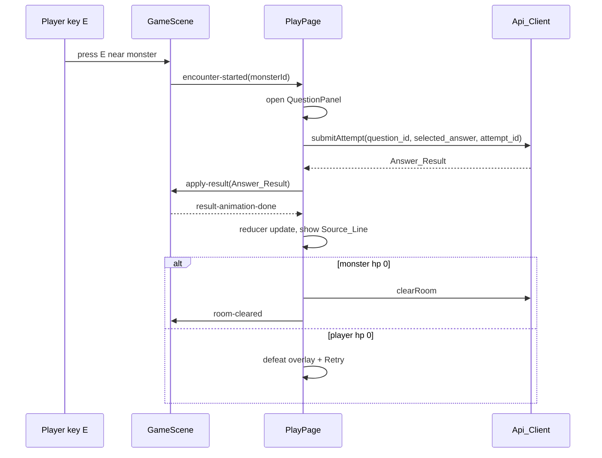

# Design Document: frontend-00-playable-slice

## Overview

This design delivers the first playable vertical slice: Try the Demo, then move in one room, meet a monster, answer a question, see animated damage, clear the room (or be defeated and retry). It is written in TypeScript (strict) on React 19, Vite 8, Tailwind 4 and Phaser 3.90.0 (pinned exact, Phaser 3 only).

Key decisions:

- React owns network, auth state, HUD and panels. Phaser owns the world, movement, sprites and effects. A typed event bridge is the only coupling.
- The backend is authoritative. In this slice the Mock_Adapter stands in for it, and only the Mock_Adapter imports the Demo_Rules. Phaser and React components never compute damage, HP, XP or streak.
- All art is procedural (Phaser Graphics). No external assets, so no licensing work yet.
- Contract shapes come from the master roadmap and are recorded in `docs/handoff/B-to-A.md`. They are replaced by `.kiro/steering/api-contract.md` when Person A publishes it.
- Agreed demo balance values (final, must stay consistent with the backend contract, which remains authoritative): player HP 100, monster HP 60, Rusty Dagger damage 20, wrong-answer player damage 10, 100 score and 10 XP per correct answer.

Research summary: the roadmap says to keep one Phaser canvas mounted in one component and talk through typed events. React 19 strict mode double-mounts effects in development, so the Game_Canvas must make creation idempotent and destroy with `game.destroy(true)` in cleanup.

## Architecture



Combat sequence:



Folder layout:

```
frontend/src/
  main.tsx, App.tsx, index.css
  types/api.ts
  api/ client.ts, errors.ts, index.ts, mock/ mockAdapter.ts
  demo/ demoDungeon.json, rules.ts
  state/ runReducer.ts, SessionContext.tsx
  pages/ LandingPage.tsx, LoginPlaceholder.tsx, PlayPage.tsx
  components/ Button.tsx, Spinner.tsx, QuestionPanel.tsx, Hud.tsx,
              GuestBanner.tsx, PauseMenu.tsx, DefeatOverlay.tsx, SourceLine.tsx
  game/ GameCanvas.tsx, events.ts, config.ts
        scenes/ BootScene.ts, GameScene.ts
        entities/ Player.ts, Monster.ts, Gate.ts
        systems/ MovementSystem.ts, InteractionSystem.ts, EffectsSystem.ts
```

Tooling additions: ESLint (flat config, typescript-eslint, react-hooks), Vitest with jsdom, @testing-library/react, and fast-check, all pinned to exact versions. Scripts: `lint`, `test` (`vitest --run`). Add `frontend/.env.example` with `VITE_API_BASE_URL=` and `VITE_USE_MOCKS=true`. Tailwind tokens go in `index.css` via `@theme` using CSS variables; `index.html` classes `bg-crypt-950 text-bone-100` are renamed to `bg-background text-parchment`.

## Components and Interfaces

### API types (`src/types/api.ts`)

```ts
export interface User { id: string; username: string; is_guest: boolean }
export interface DemoSessionResponse { user: User; dungeon_id: string; expires_at: string }
export type QuestionType = 'mcq' | 'true_false'
export interface Question {
  id: string; type: QuestionType; prompt: string; options: string[]
  // correct answer and explanation are never part of this type
}
export interface Monster { id: string; name: string; max_hp: number; question_ids: string[] }
export interface Room { id: string; label: string; monster: Monster }
export interface Dungeon { id: string; name: string; rooms: Room[]; questions: Question[] }
export interface Run { id: string; dungeon_id: string; player_hp: number; monster_hp: number }
export interface AttemptRequest { question_id: string; selected_answer: string; attempt_id: string }
export interface AnswerResult {
  correct: boolean; damage_dealt: number; monster_hp_remaining: number
  player_hp_remaining: number; score_delta: number; xp_delta: number; streak: number
  source: { page: number; chunk_id: string }
  review_status: 'due' | 'not_due'
  explanation?: string // optional, see handoff
}
export interface ClearRoomResponse { xp_delta: number }
```

`explanation` is optional. The Source_Line shows the explanation when present and shows only the page when absent, without error. The attempt request stays `question_id`, `selected_answer`, `attempt_id`; the response determines correctness and damage.

### Api_Client (`src/api`)

```ts
export interface ApiClient {
  startDemoSession(): Promise<DemoSessionResponse>
  getDungeon(id: string): Promise<Dungeon>
  startRun(dungeonId: string): Promise<Run>
  submitAttempt(runId: string, req: AttemptRequest): Promise<AnswerResult>
  clearRoom(runId: string, roomId: string): Promise<ClearRoomResponse>
}
export class ApiError extends Error { constructor(public status: number, message: string) }
export const api: ApiClient // chosen once from import.meta.env.VITE_USE_MOCKS
```

The real client maps to `POST /demo/session`, `GET /dungeons/{id}`, `POST /runs`, `POST /runs/{id}/attempts`, `POST /runs/{id}/rooms/{room_id}/clear`, all with `credentials: "include"`. The mock module is loaded through a dynamic import guarded by the flag so the Demo_Rules are tree-shaken out of non-mock builds.

### Demo_Rules (`src/demo/rules.ts`)

```ts
export interface RulesState { playerHp: number; monsterHp: number; streak: number }
export const INITIAL_STATE: RulesState // { 100, 60, 0 }
export const WEAPON_DAMAGE = 20, WRONG_ANSWER_DAMAGE = 10 // agreed demo values; backend is authoritative
export function applyAnswer(state: RulesState, correct: boolean):
  { next: RulesState; result: Omit<AnswerResult, 'source' | 'explanation'> }
```

Pure and deterministic. Correct: `damage = min(20, monsterHp)`, `score_delta = 100`, `xp_delta = 10`, `streak + 1`. Wrong: `playerDamage = min(10, playerHp)`, streak 0, `review_status = 'due'`.

### Mock_Adapter (`src/api/mock/mockAdapter.ts`)

Holds per-run `RulesState` and a map of `attempt_id` to stored `AnswerResult`. Correct answers live in a private table inside the mock module, keyed by question id, never in the `Question` type. Demo session returns `{ user: { is_guest: true }, dungeon_id: 'demo-dungeon', expires_at: now + 24h }`.

### Event_Bridge (`src/game/events.ts`)

```ts
export type ToGameEvent =
  | { type: 'load-room'; room: Room }
  | { type: 'set-phase'; phase: Phase }
  | { type: 'apply-result'; result: AnswerResult }
  | { type: 'room-cleared' }
  | { type: 'reset' }
  | { type: 'set-reduced-motion'; value: boolean }
export type FromGameEvent =
  | { type: 'ready' }
  | { type: 'encounter-started'; monsterId: string }
  | { type: 'result-animation-done' }
  | { type: 'pause-requested' }
export interface GameBridge {
  send(e: ToGameEvent): void
  on(handler: (e: FromGameEvent) => void): () => void
}
```

The bridge is a small typed emitter created by `GameCanvas` and passed to the scene through Phaser's `registry`/scene data. Events sent before `ready` are queued and flushed on `ready`.

### Run_State reducer (`src/state/runReducer.ts`)

```ts
export type Phase = 'exploring' | 'encounter' | 'resolving' | 'cleared' | 'defeated' | 'paused'
export interface RunState {
  runId: string | null; phase: Phase; playerHp: number; monsterHp: number
  xp: number; streak: number; lastResult: AnswerResult | null
}
type Action =
  | { type: 'run-started'; run: Run }
  | { type: 'encounter-started' }
  | { type: 'result-received'; result: AnswerResult }
  | { type: 'result-settled' }
  | { type: 'room-cleared'; xpDelta: number }
  | { type: 'pause' } | { type: 'resume' } | { type: 'reset' }
```

`result-received` copies `player_hp_remaining`, `monster_hp_remaining`, `streak` and adds `xp_delta`; it only copies values and never derives damage. `result-settled` moves to `defeated` if player HP is 0, `cleared` pending if monster HP is 0, else `exploring`.

### Phaser modules

- GameCanvas: `useEffect` creates `new Phaser.Game` with `Phaser.Scale.FIT`, scenes `[BootScene, GameScene]`; cleanup calls `destroy(true)` and nulls a ref. A ref guard prevents double creation under strict mode.
- BootScene: draws a loading bar using Graphics bound to the loader `progress` event, then starts GameScene on `ready`.
- GameScene: builds the room from the `load-room` event, handles events, hosts systems.
- MovementSystem: reads WASD and cursor keys, normalizes the vector so diagonal speed equals straight speed, applies arcade physics velocity, collides with a static walls group, and is disabled unless phase is `exploring`.
- InteractionSystem: each frame checks distance (Interaction_Range 64) to the living Monster, shows a "Press E" prompt and emits `encounter-started` on E or Space.
- EffectsSystem: attack projectile, damage number, hit flash, monster attack lunge, camera shake of 120 ms, HP bar tweens. When reduced motion is set, shake and flash are skipped and bars snap.
- Monster: procedural shape, idle bob tween, HP bar drawn above it. Gate: rectangle that tweens open.

### React UI

- LandingPage: hero, three steps, Try_Demo_Button, Login_Button, `aria-live="polite"` status.
- PlayPage: loads the dungeon and run, owns the reducer, bridges events, renders Hud, GuestBanner, QuestionPanel, DefeatOverlay, PauseMenu and GameCanvas. Esc is handled here during `exploring`.
- QuestionPanel: `role="dialog"`, `aria-modal`, `aria-labelledby` pointing at the prompt, focus moves in on open, 1 to 4 keys map to options, options disabled while pending, fresh `attempt_id` per question and reused on retry after an error.
- Hud: progress bars with `role="progressbar"`.
- Reduced motion: a `useReducedMotion` hook reads `matchMedia` and sends `set-reduced-motion`.

## Data Models

Demo_Dungeon JSON (`src/demo/demoDungeon.json`): one room "Chamber of Basics", one monster "Skeleton Scribe" with `max_hp` 60, and four to five multiple-choice questions of placeholder content (the real seeded dungeon arrives from Person A). The correct-answer table and per-question explanation and source page live in `src/api/mock/answerKey.ts`, separate from the public Dungeon shape.

Session state (`SessionContext`) holds `user`, `dungeonId` and `expiresAt` in memory only. Nothing is written to `localStorage` or `sessionStorage`.

Design tokens in CSS:

```css
:root {
  --color-background: #100D18; --color-panel: #1D1728; --color-parchment: #F2E8D5;
  --color-purple: #7546A8; --color-blood: #B83D4A; --color-amber: #E9A23B;
  --color-mint: #68C9A5; --color-muted: #A79CB5;
}
```

## Correctness Properties

*A property is a characteristic or behavior that should hold true across all valid executions of a system-essentially, a formal statement about what the system should do. Properties serve as the bridge between human-readable specifications and machine-verifiable correctness guarantees.*

Reflection: the prework items for correct damage, wrong damage, review status and score/XP deltas are consolidated into a per-answer result property. HP bounds and monster monotonicity are merged into one sequence invariant. Reducer properties are separate because they test a different module.

### Property 1: Correct answer result

For any valid rules state and any correct answer, the result has `correct` true, `damage_dealt` equal to the lesser of 20 and the monster HP, `score_delta` 100, `xp_delta` 10, `review_status` `not_due`, streak increased by 1 and player HP unchanged.

**Validates: Requirements 5.2, 5.5, 5.8**

### Property 2: Wrong answer result

For any valid rules state and any wrong answer, the result has `damage_dealt` 0, monster HP unchanged, player HP reduced by the lesser of 10 and the player HP, `score_delta` 0, `xp_delta` 0, `review_status` `due` and streak 0.

**Validates: Requirements 5.3, 5.6, 5.8**

### Property 3: Rules state invariants over sequences

For any sequence of boolean answers applied from the initial state, player HP stays within 0 to 100, monster HP stays within 0 to 60, monster HP never increases, and `damage_dealt` is never negative.

**Validates: Requirements 5.4, 15.5**

### Property 4: Rules determinism

For any sequence of answers, applying it twice from the initial state yields identical results and final states.

**Validates: Requirements 5.7**

### Property 5: Mock attempt results conform to the contract

For any question of the Demo_Dungeon and any selected answer string, the Mock_Adapter returns an object whose fields have the types declared by `AnswerResult`, with HP values in range.

**Validates: Requirements 4.5**

### Property 6: Attempt idempotence

For any attempt request, submitting it twice with the same `attempt_id` returns equal results and leaves the mock run state equal to the state after the first submission.

**Validates: Requirements 4.6**

### Property 7: Reducer copies authoritative values

For any valid run state and any Answer_Result, applying `result-received` sets player HP, monster HP and streak equal to the result values and increases XP by exactly `xp_delta`.

**Validates: Requirements 10.6, 12.2**

### Property 8: Reducer sequence invariants and terminal phases

For any sequence of Answer_Results generated by the Demo_Rules, the reducer keeps monster HP non-increasing and player HP within 0 to 100, and after `result-settled` the phase is `defeated` when player HP is 0, otherwise `cleared` when monster HP is 0, otherwise `exploring`.

**Validates: Requirements 12.1, 12.4, 15.5**

## Error Handling

- Demo session failure: LandingPage shows an error with `role="alert"` and re-enables the button. The 8-second waking and offline fallback UX is out of scope.
- Attempt failure: QuestionPanel shows an error, re-enables options and retries with the same `attempt_id`.
- Non-success HTTP status: `ApiError` carries the status; callers map 401, 429 and 5xx to simple messages.
- Missing dungeon data: PlayPage shows an error state with a link back to `/`.
- Phaser failure to create (no WebGL): GameCanvas falls back to `Phaser.CANVAS` through `type: Phaser.AUTO` and shows a message if creation throws.
- Direct visit to `/play` without a session: redirect to `/`.
- Events before `ready` are queued, never dropped.

## Testing Strategy

Property-based testing applies to the Demo_Rules, Mock_Adapter and Run_State reducer, which are pure or in-memory logic. It does not apply to Phaser rendering, React layout or tooling, which use example-based tests and manual checks.

Libraries: Vitest, fast-check, jsdom and Testing Library.

Property tests:
- Each correctness property above is implemented as a single fast-check test with at least 100 runs.
- Each test carries a comment tag: `Feature: frontend-00-playable-slice, Property N: <text>`.

Unit and component tests:
- Rules starting values (Requirement 5.1).
- Mock demo session shape, typed `ApiError` on non-success, attempt body contains no damage field, mocks flag selects the Mock_Adapter.
- LandingPage: pending state, success navigates to `/play`, failure shows an alert.
- QuestionPanel: dialog roles, number keys submit once, options disabled while pending, retry reuses `attempt_id`.
- Hud progressbar attributes and exact Guest_Banner text.
- GameCanvas strict-mode double mount leaves one Phaser game (Phaser mocked).
- Required integration smoke test: render App with the Mock_Adapter and Phaser mocked at the GameCanvas/bridge boundary, click Try the Demo, land on `/play`, simulate `encounter-started`, answer a question, assert HUD HP and XP come from the Answer_Result and `apply-result` was sent to the game.
- Required tests: Demo_Rules, reducer (including HP boundary cases) and API layer property tests. Extensive React component tests remain optional.
- Import boundary check: a test or lint rule that `src/game` imports nothing from `src/demo` or `src/api`.

Manual walkthrough (recorded in the verification task): move, interact, correct and wrong answers, room clear, defeat and retry, pause, reduced motion on, at 1366x768.

Verification: `npm run typecheck`, `npm run lint`, `npm run test`, `npm run build` with real output.
