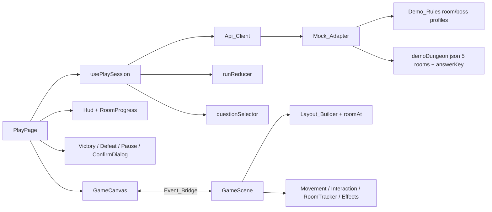
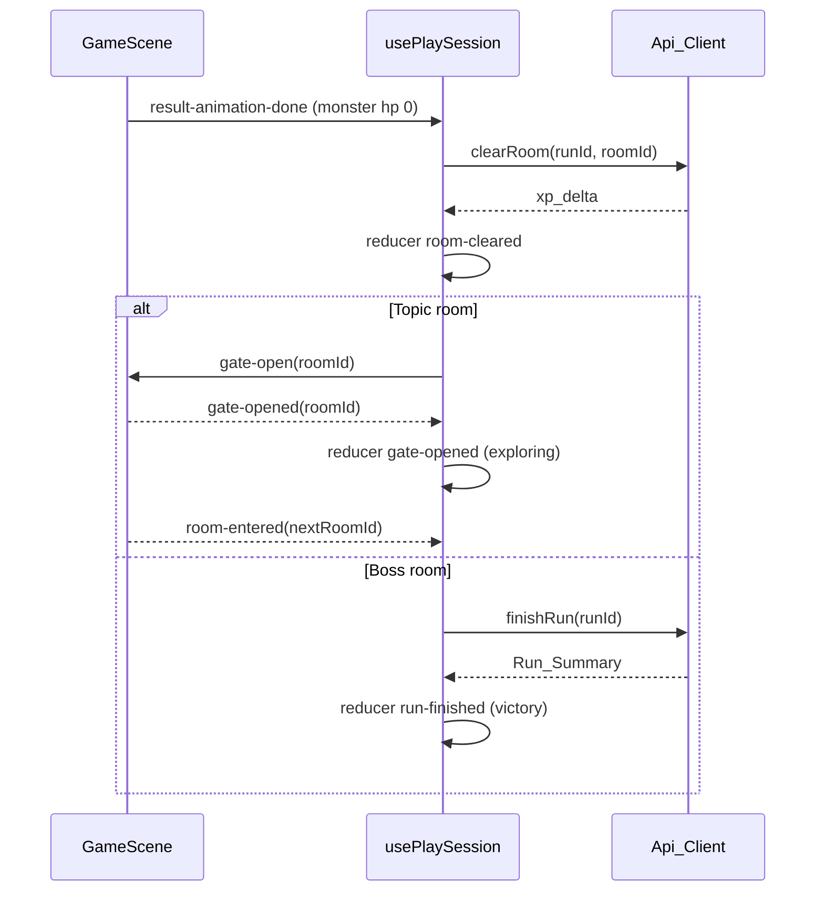

# Design Document: frontend-03-phaser-core

## Overview

This design grows the single-room slice into a five-room dungeon (four Topic_Rooms and one Boss_Room) inside the existing TypeScript (strict), React 19, Vite 8, Tailwind 4 and Phaser 3.90.0 application. It keeps the architecture of `frontend-00-playable-slice`: React owns network, state, HUD and overlays; Phaser owns world, movement, sprites and effects; the typed Event_Bridge is the only coupling.

Key decisions:

- **Linear vertical chain layout.** Rooms are stacked bottom to top in ascending `order`. Each room reuses the existing 1280 by 800 room size, so the world is 1280 wide and `N * 800` tall. A pure Layout_Builder computes room bounds, Gates, spawn and world bounds. This is deterministic, trivial to test and needs no procedural generation.
- **Gate geometry.** The Gate of room k sits in the top wall of room k. Room k+1 has a matching passage opening in its bottom wall at the same x. The two walls are adjacent, so a Player who passes an open Gate walks straight into the next room.
- **Gates open only on server-confirmed clear.** The Game never opens a Gate by itself. React calls `clearRoom`, then sends `gate-open`.
- **Current room is derived from position** by the pure `roomAt(layout, point)` and reported to React as `room-entered`. The reducer accepts a room change only when the previous room is cleared, as a second line of defence behind the physical Gate.
- **Boss ends the run through `finishRun`.** After the Boss `clearRoom`, React calls `finishRun` and shows a victory overlay from the returned Run_Summary. The frontend never computes score, XP or accuracy for the summary.
- **Backend authoritative.** Boss balance (120 HP, 20 damage per correct answer so exactly 6 correct answers defeat the Boss, 12 wrong-answer damage, 100 clear XP) lives only in Demo_Rules and the Mock_Adapter, and is documented in the Handoff_Doc for Person A to confirm.
- **No audio yet.** Mute is stored as state and sent to the Game, which stores the flag for the later audio spec.

Research summary: no external research was needed. Decisions follow the roadmap (4 to 6 rooms, boss wrong damage 12, boss clear XP 100) and the approved boss balance of 120 HP, which supersedes the roadmap HP range and the existing code: `events.ts`, `runReducer.ts`, `mockAdapter.ts`, `RoomLayout.ts`.

## Architecture



Flow from clearing a room to entering the next:



Module layout (new or changed files marked):

```
src/types/api.ts            changed: Room, Monster, Run, RunSummary
src/api/ApiClient.ts        changed: finishRun
src/api/client.ts           changed: finishRun -> POST /runs/{id}/finish
src/api/mock/mockAdapter.ts changed: multi-room run record, finishRun
src/api/mock/answerKey.ts   changed: all questions
src/demo/demoDungeon.json   changed: 5 rooms
src/demo/rules.ts           changed: RulesProfile (room, boss)
src/state/runReducer.ts     changed: multi-room state
src/state/questionSelector.ts            new
src/game/events.ts          changed: load-dungeon, gate-open, set-muted, room-entered, gate-opened
src/game/world/DungeonLayout.ts          new (pure)
src/game/world/RoomLayout.ts             changed: room-origin helpers
src/game/entities/monsterStyles.ts       new (pure data)
src/game/entities/Monster.ts, Gate.ts    changed
src/game/systems/RoomTracker.ts          new
src/game/systems/InteractionSystem.ts    changed: current-room target
src/game/scenes/GameScene.ts             changed: orchestrates
src/components/RoomProgress.tsx, VictoryOverlay.tsx, ConfirmDialog.tsx  new
src/components/PauseMenu.tsx, Hud.tsx    changed
src/pages/PlayPage.tsx, usePlaySession.ts changed
```

`src/game` imports only `@/types/api` and its own modules. It does not import `@/api`, `@/demo` or `@/state`.

## Components and Interfaces

### Contract changes (`src/types/api.ts`)

```ts
export type MonsterKind = string // visual type id, e.g. 'paper_wraith'
export interface Monster { id: string; name: string; max_hp: number; question_ids: string[]; kind: MonsterKind }
export interface Room { id: string; label: string; order: number; is_boss: boolean; monster: Monster }
export interface Run { id: string; dungeon_id: string; player_hp: number; monster_hp: number; current_room_id: string }
export interface RunSummary { score: number; xp: number; correct: number; total: number; accuracy: number }
// AnswerResult and AttemptRequest unchanged.
```

`Run.monster_hp` is the HP of the monster in `current_room_id`. `MonsterKind` is a plain string so the backend can add kinds without breaking the frontend; unknown kinds get a default style.

### Api_Client

`ApiClient` gains `finishRun(runId: string): Promise<RunSummary>`. The http client maps it to `POST /runs/{id}/finish` with `credentials: "include"`, like the other calls.

### Demo_Rules (`src/demo/rules.ts`)

```ts
export interface RulesProfile { weaponDamage: number; wrongAnswerDamage: number }
export const ROOM_PROFILE: RulesProfile = { weaponDamage: 20, wrongAnswerDamage: 10 }
export const BOSS_PROFILE: RulesProfile = { weaponDamage: 20, wrongAnswerDamage: 12 }
export function applyAnswer(state: RulesState, correct: boolean, profile: RulesProfile = ROOM_PROFILE): { next: RulesState; result: ... }
```

The default parameter keeps the existing call sites and tests valid. `INITIAL_STATE` stays `{ 100, 60, 0 }`. `RulesState.monsterHp` carries the HP of whichever monster is being fought.

### Mock_Adapter run record

```ts
interface RunRecord {
  dungeonId: string
  playerHp: number; streak: number
  monsterHp: Map<string, number>   // room id -> hp, initialized from max_hp
  cleared: Set<string>
  attempts: Map<string, AnswerResult>
  correct: number; total: number; score: number; xp: number
  finished: boolean
}
```

- `roomOfQuestion` is built once from the dungeon: question id to room. Boss question ids are unique to the boss, so the mapping is unambiguous.
- `submitAttempt`: idempotent on `attempt_id`; unknown question gives 422; if the room monster HP is 0 or player HP is 0 gives 409; otherwise build `RulesState` from the run player HP and that room's HP, pick `BOSS_PROFILE` when `room.is_boss`, call `applyAnswer`, write back player HP, streak and that one room's HP, update counters, score and XP.
- `clearRoom`: unknown room 404; monster HP above 0 gives 409; first success adds the clear XP (25 for a Topic_Room, 100 for the Boss_Room, mock values) to the record XP; repeated calls return the same `xp_delta` with no further change.
- `finishRun`: 409 unless the Boss_Room is cleared; returns `{ score, xp, correct, total, accuracy }` with `accuracy = total === 0 ? 0 : correct / total`; sets `finished`. The reducer XP equals the summary XP because both add answer XP and clear XP.
- `startRun`: record with player HP 100, all room HPs at `max_hp`, `current_room_id` of the lowest `order`, `monster_hp` of that room.
- The mock does not enforce room order on attempts. The Gate and the reducer guard order on the client; the real backend decides server-side.

### Question_Selector (`src/state/questionSelector.ts`)

```ts
export function pickQuestionId(pool: readonly string[], askedCount: number): string | undefined
// pool.length === 0 -> undefined; otherwise pool[askedCount % pool.length]
```

`usePlaySession` keeps an `askedCount` per monster id (a ref map cleared on every new run), increments it when a question opens, and resolves the id against `dungeon.questions`.

### Layout_Builder (`src/game/world/DungeonLayout.ts`, pure)

```ts
export interface RoomInput { id: string; order: number; is_boss: boolean }
export interface RoomBounds { id: string; order: number; isBoss: boolean; rect: Rect }
export interface GateSpec { afterRoomId: string; toRoomId: string; rect: Rect; passage: Rect }
export interface DungeonLayout { rooms: RoomBounds[]; gates: GateSpec[]; world: Rect; spawn: Point }
export type LayoutResult = { ok: true; layout: DungeonLayout } | { ok: false; error: 'empty' | 'duplicate-order' }
export function buildDungeonLayout(rooms: readonly RoomInput[]): LayoutResult
export function roomAt(layout: DungeonLayout, p: Point): string | null
```

Algorithm: sort by `order` (ties rejected as `duplicate-order`); room index k of N gets `rect = { x: 0, y: (N-1-k) * ROOM_H, w: ROOM_W, h: ROOM_H }`; for k below N-1 a `GateSpec` with `rect` in the top wall of room k (4 tiles wide, centered) and `passage` in the bottom wall of room k+1 at the same x; `world = { 0, 0, ROOM_W, N * ROOM_H }`; `spawn` is the bottom-center of room 0, 3 tiles above its bottom wall. `roomAt` returns the id of the room whose rect contains the point (half-open intervals so boundary points belong to exactly one room). The Boss_Room is the last room; Dungeon_Data validation in `GameScene` logs and shows an error when the boss is not the highest `order`.

`RoomLayout.ts` helpers (`borderWallTiles`, pillars, torches) take a room origin and flags for "has exit gate" and "has entry passage" so each room draws its own walls with the right gaps.

### Event_Bridge changes (`src/game/events.ts`)

```ts
export type GamePhase = 'exploring' | 'encounter' | 'resolving' | 'cleared' | 'defeated' | 'paused' | 'victory'
export type ToGameEvent =
  | { type: 'load-dungeon'; rooms: Room[] }      // replaces load-room
  | { type: 'set-phase'; phase: GamePhase }
  | { type: 'apply-result'; result: AnswerResult }
  | { type: 'gate-open'; roomId: string }        // replaces room-cleared
  | { type: 'reset' }
  | { type: 'set-reduced-motion'; value: boolean }
  | { type: 'set-muted'; value: boolean }
export type FromGameEvent =
  | { type: 'ready' }
  | { type: 'encounter-started'; monsterId: string }
  | { type: 'result-animation-done' }
  | { type: 'pause-requested' }
  | { type: 'room-entered'; roomId: string }
  | { type: 'gate-opened'; roomId: string }
```

Existing queue-until-ready behavior is unchanged. `events.test.ts` is updated deliberately for the renamed and new events.

### Phaser modules

- **GameScene**: on `load-dungeon` runs the Layout_Builder, sets physics world bounds and camera bounds to `layout.world`, builds walls, Gates, monsters and labels for every room, places the Player at `layout.spawn`, starts camera follow. On `reset` destroys and rebuilds from the stored rooms.
- **Gate** (one per `GateSpec`): closed collider plus a drawn barrier. `open()` tweens the barrier away, disables the collider and emits `gate-opened`.
- **RoomTracker**: each frame calls `roomAt` for the Player position; when the result changes it emits `room-entered`. It emits the starting room once after `load-dungeon`.
- **InteractionSystem**: considers only the monster of the Current_Room reported by RoomTracker; keeps the 64 px range and the E or Space key.
- **Monster** and **monsterStyles**: `getMonsterStyle(kind, isBoss)` returns `{ shape, tint, scale }`. Known kinds: `paper_wraith`, `toxic_slime`, `gear_golem`, `memory_eater`, `exam_warden`. Unknown kinds return the default style. The boss scale is 1.8 and its style is distinct from all others. Each monster draws an HP bar from `max_hp` and the latest `monster_hp_remaining`. On `apply-result` the scene targets the monster of the active encounter; when remaining HP is 0, the monster fades out after the existing result animation and then `result-animation-done` is emitted.
- **EffectsSystem**: unchanged API; new effects respect the reduced-motion flag.
- **Muted flag**: stored on the scene; no audio is played yet.

### Run_Reducer (`src/state/runReducer.ts`)

```ts
export interface RunState {
  // existing: runId, phase, playerHp, monsterHp, maxPlayerHp, maxMonsterHp, xp, score, streak, lastResult, prevPhase
  currentRoomId: string | null
  roomOrder: string[]                 // ids by ascending order
  bossRoomId: string | null
  roomHp: Record<string, number>      // remembered monster HP per room
  roomMaxHp: Record<string, number>
  clearedRoomIds: string[]
  summary: RunSummary | null
}
type RunAction =
  | { type: 'run-started'; run: Run; rooms: Room[] }
  | { type: 'room-entered'; roomId: string }
  | { type: 'room-cleared'; roomId: string; xpDelta: number }
  | { type: 'gate-opened' }
  | { type: 'run-finished'; summary: RunSummary }
  // plus existing: encounter-started, result-received, result-settled, pause, resume, reset
```

Rules: `run-started` stores the order, boss id, `roomMaxHp` from `max_hp`, `roomHp` equal to `roomMaxHp`, and sets the Current_Room to `run.current_room_id`. `room-entered` is accepted only for the first room or a room whose predecessor is in `clearedRoomIds`, and then sets `monsterHp` and `maxMonsterHp` from the remembered values. `result-received` keeps copying the Answer_Result values and also writes `monster_hp_remaining` into `roomHp[currentRoomId]`. `room-cleared` is accepted only when `roomHp[roomId]` is 0, appends the id once and adds `xpDelta` (a repeated clear adds nothing). `gate-opened` moves `cleared` to `exploring`. `run-finished` sets `summary` and phase `victory` only when the boss id is in `clearedRoomIds`. The reducer never computes damage, HP, XP or score.

### React UI

- **RoomProgress** (in `Hud`): ordered markers with states `cleared`, `current`, `upcoming` and a boss marker; text "Room X of N: label" plus `aria-label`; state is never conveyed by color alone (icon or text per state).
- **VictoryOverlay**: `role="dialog"`, shows score, XP, correct, total and accuracy as a percentage from the Run_Summary, with "Play again" (new run from room 1) and "Exit" buttons, and an error state with retry when `finishRun` fails.
- **PauseMenu**: Resume, Mute toggle (`aria-pressed`), Restart, Exit.
- **ConfirmDialog**: `role="alertdialog"`, focus moves to the cancel button on open, used for Exit. Confirm navigates to the landing page using the app's existing navigation mechanism.
- **usePlaySession**: loads the dungeon, starts the run, sends `load-dungeon`, routes `encounter-started` through the Question_Selector, orchestrates `clearRoom`, `gate-open`, `finishRun`, retry and restart, owns `muted`. Clear and finish failures expose a retry action while the Gate stays closed.

## Data Models

Demo_Dungeon (`demoDungeon.json`), original placeholder content:

| order | Room id | Label | Monster (kind) | HP | Questions |
| --- | --- | --- | --- | --- | --- |
| 1 | room-1 | Entry Hall | Paper Wraith (`paper_wraith`) | 60 | 4 (keep existing ids first) |
| 2 | room-2 | Alchemist's Lab | Toxic Slime (`toxic_slime`) | 60 | 4 |
| 3 | room-3 | Clockwork Crypt | Gear Golem (`gear_golem`) | 60 | 4 |
| 4 | room-4 | Forgotten Wing | Memory Eater (`memory_eater`) | 60 | 4 |
| 5 | room-5 | Boss Room | The Exam Warden (`exam_warden`, `is_boss`) | 120 | 8 boss-only questions, two from each topic |

Boss damage arithmetic: 120 HP at 20 per hit needs exactly 6 correct answers; the 8-question pool (two per topic) is larger than the 6 needed, and the Question_Selector keeps cycling after wrong answers, so the pool never runs out. Player HP 100 allows up to 8 wrong answers at 12 damage (or 10 at 10 damage in rooms), which keeps defeat reachable but the dungeon winnable. Question ids are unique across the dungeon. `answerKey.ts` contains an entry for every question id (correct answer, page, chunk id, optional explanation). The public `Dungeon` shape still contains no answers.

Clear XP (mock only, roadmap-consistent): 25 for Topic_Rooms and 100 for the Boss_Room. Both are listed in the handoff.

## Correctness Properties

*A property is a characteristic or behavior that should hold true across all valid executions of a system-essentially, a formal statement about what the system should do. Properties serve as the bridge between human-readable specifications and machine-verifiable correctness guarantees.*

Reflection: layout structure, spawn and reachability criteria are merged into one invariant property; determinism stays separate because it quantifies over input order. Mock HP criteria are merged into one sequence property; clear-only-at-zero is separate because it targets a different operation. Reducer ordering and victory are two properties because they cover different actions.

### Property 1: Layout structural invariants

For any non-empty list of rooms with distinct `order` values, the built layout has pairwise non-overlapping room interiors, exactly one Gate between each pair of consecutive rooms with the Gate inside the earlier room and its passage inside the later room, every room reachable from the first room through the Gates, a spawn point inside the lowest-order room, and world bounds containing every room.

**Validates: Requirements 2.1, 2.2, 2.3, 2.4, 2.6**

### Property 2: Layout determinism and input-order independence

For any list of rooms and any permutation of it, building the layout twice yields equal layouts.

**Validates: Requirements 2.5**

### Property 3: Room lookup consistency

For any layout and any point inside the bounds of room R, `roomAt` returns the id of R, and for any point outside the world bounds it returns null.

**Validates: Requirements 3.5, 5.1, 5.3**

### Property 4: Question selection stays in the pool and cycles

For any non-empty question pool and any ask count, the selected id is a member of the pool, and the selection at count `n + pool.length` equals the selection at count `n`.

**Validates: Requirements 5.4, 5.5, 5.6**

### Property 5: Room and boss damage values

For any rules state and any answer, a correct answer deals the lesser of 20 and the monster HP under both profiles, and a wrong answer reduces player HP by the lesser of 10 (room profile) or 12 (boss profile) and the player HP.

**Validates: Requirements 6.6, 6.7, 6.8, 6.9**

### Property 6: Mock run invariants across rooms

For any sequence of attempts over the questions of any rooms, player HP stays within 0 to 100 and changes only on wrong answers, each room's monster HP stays within 0 to its `max_hp` and never increases, an attempt changes only the HP of the room that owns the question, and an attempt on a monster with HP 0 is rejected with status 409.

**Validates: Requirements 6.1, 6.2, 6.3, 6.4, 6.5, 6.11**

### Property 7: Clear succeeds only at zero monster HP

For any sequence of attempts and any room, `clearRoom` for that room succeeds if and only if that room's monster HP is 0, otherwise it fails with status 409.

**Validates: Requirements 7.2, 12.6**

### Property 8: Run summary consistency

For any sequence of attempts that defeats the boss, `finishRun` returns a summary whose `correct` and `total` equal the counted attempts, whose `accuracy` equals `correct / total` within 0 to 1, and calling `finishRun` before the boss is defeated is rejected with status 409.

**Validates: Requirements 8.5, 8.6**

### Property 9: Reducer room ordering

For any sequence of reducer actions, the Current_Room changes only through an accepted `room-entered`, a `room-entered` for a room other than the first is accepted only when its predecessor is in `clearedRoomIds`, and a room is added to `clearedRoomIds` only when its remembered monster HP is 0.

**Validates: Requirements 12.1, 12.2, 12.3, 12.6**

### Property 10: Reducer copies authoritative values and gates victory

For any sequence of Answer_Results and actions, after each `result-received` the player HP, monster HP, streak equal the result values, XP increases by exactly `xp_delta`, and the phase is `victory` only if the boss room is cleared and a Run_Summary has been stored.

**Validates: Requirements 12.4, 12.5, 12.7**

### Property 11: Boss falls after exactly 6 correct answers

For any interleaving of up to 8 wrong answers with correct answers submitted for the Boss from full HP (120), the Boss HP is greater than 0 after any 5 correct answers and equals 0 after the 6th correct answer, and each wrong answer reduces player HP by 12 while player HP is at least 12.

**Validates: Requirements 6.8, 6.9, 6.10, 6.12**

## Error Handling

- **Clear room failure**: show an error with retry; the Gate stays closed and the phase stays `cleared`.
- **Finish run failure**: the victory area shows an error and a retry button.
- **Attempt failure**: unchanged from the baseline (same `attempt_id` on retry).
- **Invalid dungeon data** (empty rooms, duplicate `order`, boss not last): the layout result is an error and PlayPage shows an error state with a link to the landing page.
- **Unknown monster kind**: default style, no error.
- **Empty question pool**: the Question_Selector returns undefined; PlayPage shows an error state instead of opening an empty panel.
- **409 on attempt or clear**: mapped to a short message; the state is not changed.
- **Events before ready** remain queued.

## Testing Strategy

Property-based testing applies to the pure and in-memory logic: Layout_Builder, `roomAt`, Question_Selector, Demo_Rules profiles, Mock_Adapter and Run_Reducer. It does not apply to Phaser rendering, gate animations or React layout, which use example-based tests, a mocked bridge and the manual walkthrough.

Libraries: Vitest, fast-check, jsdom and Testing Library (already installed).

Property tests:
- Each of Properties 1 to 11 is one fast-check test with at least 100 runs.
- Each carries a comment tag: `Feature: frontend-03-phaser-core, Property N: <text>`.

Unit tests:
- Room routing: an encounter for a monster in room k selects ids from that monster's `question_ids` only.
- `finishRun` mock: summary after boss defeat; 409 before.
- `getMonsterStyle` fallback for an unknown kind and a distinct boss style.
- Demo_Dungeon integrity: every question has an answer key entry, ids are unique, the boss pool covers all topics, 5 rooms with the expected labels, monsters and HP.
- `client.test.ts`: `finishRun` calls `POST /runs/{id}/finish`.
- Import boundary: `src/game` does not import `@/api`, `@/demo` or `@/state`.
- Existing tests (`events.test.ts`, `mockAdapter.test.ts`, `runReducer.test.ts`, `rules.test.ts`, `PlayFlow.smoke.test.tsx`) are updated deliberately for the new shapes.

Integration smoke test: render the app with the Mock_Adapter and Phaser mocked at the bridge, clear room 1 through answers, observe `gate-open` sent, simulate `gate-opened` and `room-entered` for room 2, and assert the HUD room indicator shows room 2.

Component tests (RoomProgress, VictoryOverlay, ConfirmDialog) are optional.

Verification: `npm run typecheck`, `npm run lint`, `npm run test`, `npm run build` with real output, plus the manual browser walkthrough at 1366x768.
