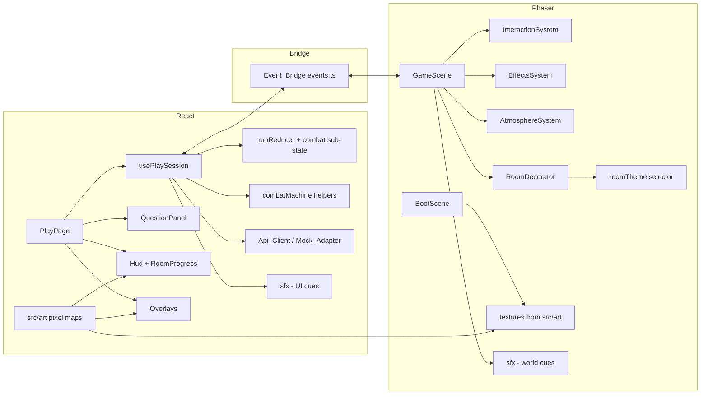
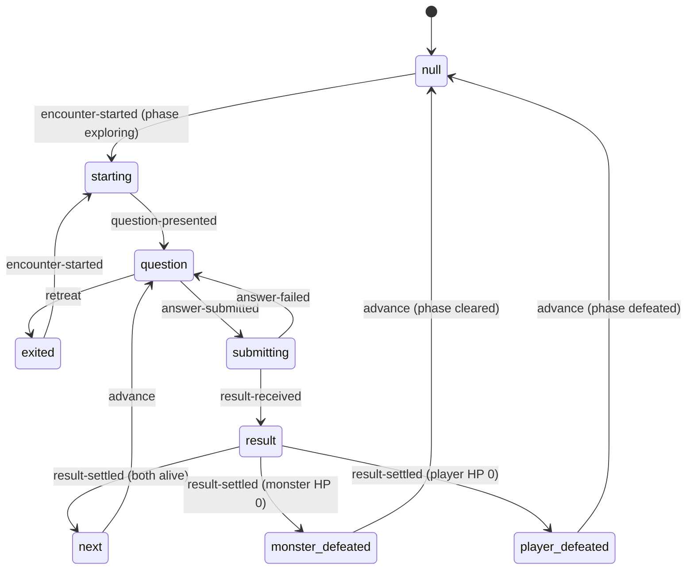

# Design Document: frontend-04-rpg-ui-combat-flow

## Open decisions for user confirmation

Each item lists the recommended default. The spec is written against the defaults. Reply to change any of them before implementation.

| ID | Decision | Recommended default | Alternative |
| --- | --- | --- | --- |
| D1 | Rooms | Keep the existing five rooms and data. Room 1 merges the haunted castle entrance and the haunted library. Theme is chosen by `monster.kind` and `is_boss`, never by room index or label. | Add a sixth room to the demo data (changes the contract fixtures and mock rules tests). |
| D2 | Combat state machine | Keep the top-level `GamePhase` for Phaser. Add a React-side `combat` sub-state in the existing reducer: `starting`, `question`, `submitting`, `result`, `next`, `monster_defeated`, `player_defeated`, `exited`. Phaser only needs "in combat (movement locked)" vs exploring. | A separate combat reducer outside `runReducer`. |
| D3 | Retreat | Allowed only in `question`. Monster HP persists as reported. Retreat button in the panel, and Esc in `question` opens pause with "Retreat from battle". | No retreat (fight to the end). |
| D4 | Timing | Next question after animation done AND reducer settled, then a Read_Delay of 1200 ms (correct) or 2000 ms (wrong). Next button or Enter skips the wait. Reduced motion removes animation but keeps the delay. | Fixed delay for both outcomes, or manual Continue only. |
| D5 | Art | Original code-authored pixel art as palette-indexed maps (16 to 32 px) in `src/art/`, rendered into Phaser textures at boot and into inline SVG in React. Frames other than the base sprite are derived programmatically. | CC0 Kenney packs (download plus license file). |
| D6 | Fonts | `@fontsource` packages, exact pinned: Pirata One (display), Cinzel (labels), Inter (body). Latin subset, two weights at most. | Cinzel Decorative for headings, Lora for body. |
| D7 | Sound | Original Web Audio synthesis in `src/audio/sfx.ts` (no Phaser, no `@/api`, `@/demo`, `@/state` imports), so both React and `src/game` may import it. Phaser plays world sounds (footstep, growl, attack and hit, gate open). React plays UI sounds (correct, wrong, stingers). Mute is applied in one place. | Sound only from React on bridge events. |
| D8 | Level | Backend owns level. Add `getProgress()` to Api_Client and compute values only in the Mock_Adapter. Document in `B-to-A.md` as not yet implemented by Person A. | Omit level this milestone. |
| D9 | Palette | Replace tokens in `index.css` with the ten palette colors and semantic names. Update all usages. Check WCAG AA contrast by test. | Keep old tokens and add new ones. |
| D10 | Landing page | Restyled to the new identity. One-click "Try the Demo" unchanged. | Leave unchanged. |
| D11 | Git precondition | Not a coding task. Commit frontend-03 on `feature/frontend-phaser-core`, push, open a PR, merge to `main`, then create `feature/frontend-rpg-polish` from updated `main`. Stated in `tasks.md`. | Work on the current branch. |
| D12 | Verification | Automated tests in jsdom with Phaser mocked at the bridge. Visual checks at 1366x768, 1920x1080 and 1280x720 are manual (the user). Each phase ends with a checkpoint (typecheck, lint, test, build, short browser checklist). | Add Playwright (new dependency, not recommended). |
| D13 | Deprecated events | Remove `load-room` and `room-cleared` (events.ts, GameScene legacy path, events.test.ts) in phase 1. | Keep until a later spec. |
| D14 (new) | Panel placement | Question_Panel docked to the bottom, at most 45% of canvas height, answers in a 2x2 grid. A new display-only bridge event `set-view-inset` shifts the camera so player and monster stay visible above the panel. | Side panel (shrinks the canvas) or centered modal (covers gameplay, current behavior). |
| D15 (new) | Damage received | `AnswerResult` has no player-damage field. The panel shows `previous player HP - player_hp_remaining` as a display difference only. No combat math. | Ask Person A to add `damage_taken` to `AnswerResult`. |
| D16 (new) | Terminal results | After a result that ends the fight the panel stays open for the Read_Delay (or Next), then closes and the monster-defeat or defeat flow continues. | Close the panel immediately on terminal results. |
| D17 (new) | Space key | Keep Space as an alias of E for engaging (existing behavior). | Remove Space. |
| D18 (new) | Pixel rendering | Set `pixelArt: true` in the Phaser config so art stays crisp when scaled. The 960x540 canvas size is unchanged. | Keep `pixelArt: false` (blurry scaling). |
| D19 (new) | Retreat and question cycle | The question counter advances when a question is presented, so after a retreat the next E shows the next question in the cycle (skipping an unanswered one). | Advance the counter only after an answer is submitted. |
| D20 (new) | Level fetch timing | `getProgress()` is called once after the run starts and once after each monster defeat. A failure hides the level and nothing else. | Poll after every answer. |

## Overview

This design adds (1) a continuous combat flow and (2) a dark-fantasy RPG identity to the existing React + TypeScript + Phaser 3 client. It extends the architecture of `frontend-03-phaser-core`; nothing is rewritten.

Key points:

- Combat becomes a state machine inside the existing `runReducer`. One E press starts an Encounter. Questions then advance automatically until the monster HP or player HP reaches zero, or the player retreats from the `question` state.
- Phaser stays a display layer. It receives `apply-result` and plays animations from `AnswerResult` values only. It never computes outcomes.
- The reducer copies values from `AnswerResult` and never derives damage.
- Art is original code-authored pixel art in a pure module, shared by Phaser (textures) and React (SVG). Sound is original Web Audio synthesis.
- All room and monster visuals are data-driven by `monster.kind` and `is_boss`.

Research notes (from the code inspection and general knowledge, no external sources needed):

- `InteractionSystem` already uses `JustDown` and an `armed` flag. The cause of repeated E presses is the React flow: `onContinue` dispatches `result-settled`, which returns the phase to `exploring`, and the panel closes. The fix is in the reducer and hook, plus a stricter engage rule.
- `MovementSystem` is gated by `phase === 'exploring'`, so keeping `phase = 'encounter'` for the whole fight locks movement without new Phaser code.
- `EffectsSystem` opens only the `gate` passed in its targets; after removing the legacy gate (D13) only the `gate-open` event opens gates, which is already the backend-confirmed path.
- `Phaser.Scale.FIT` is already used, so canvas scaling needs CSS sizing work only.
- `@fontsource/*` packages bundle `woff2` files and CSS, so no runtime request goes to a font host.

## Architecture



### Combat state machine

`RunState` gains `combat: CombatState | null` (null while exploring). Top-level `phase` values are unchanged; the mapping is:

| combat | phase | Question_Panel | Notes |
| --- | --- | --- | --- |
| null | exploring | closed | normal exploration |
| starting | encounter | opening | transient, same dispatch batch as `question` |
| question | encounter | open, answers enabled | retreat allowed |
| submitting | encounter | open, all controls disabled | one request in flight |
| result | resolving | open, feedback shown | waiting for `result-animation-done` |
| next | resolving | open, feedback and Next | Read_Delay timer running |
| monster_defeated | resolving | open, feedback | Read_Delay, then `advance` closes the panel |
| player_defeated | resolving | open, feedback | Read_Delay, then `advance` shows the defeat Overlay |
| exited | exploring | closed | after retreat |



`result-settled` requires that the reducer already holds the result (state `result`) and is dispatched when `result-animation-done` arrives. If the monster HP and player HP are both zero in the same result, `player_defeated` wins (matches the existing reducer order).

Reducer rules:

- `encounter-started` is accepted only when `phase === 'exploring'` and `combat` is `null` or `exited`; otherwise the state is returned unchanged.
- `answer-submitted` is accepted only from `question`. This is the single guard that prevents a second submission.
- `result-received` is accepted only from `submitting` and copies `player_hp_remaining`, `monster_hp_remaining`, `streak`, `xp_delta`, `score_delta` and stores `lastResult` and `prevPlayerHp`.
- `advance` is accepted only from `next`, `monster_defeated` or `player_defeated`.
- `retreat` is accepted only from `question`.
- `pause` is accepted from `exploring`, or from `encounter` with `combat === 'question'`. `resume` restores the previous phase and leaves `combat` unchanged.

The Read_Delay timer lives in `usePlaySession` (a `useEffect` keyed on `combat`), using the pure helper `readDelayMs(correct)`. The timer is cleared on unmount, retreat is impossible during it, and the Next button or Enter dispatches `advance` immediately.

### Interaction rule

A new pure function `shouldEngage({ phase, inRange, alive, pressed, armed })` in `src/game/systems/interaction.ts` returns true only when `phase === 'exploring'`, the monster is alive and in range, E or Space was just pressed and the system is armed. `InteractionSystem.update()` calls it. The system disarms after emitting and re-arms when the phase is not `exploring` or when no engage key is held. Because the reducer ignores `encounter-started` while a combat is active, a duplicated event cannot create a second encounter.

### Sound location (D7)

`src/audio/sfx.ts` has no imports from `@/api`, `@/demo`, `@/state`, so `src/game` can import it without breaking the Import_Boundary test. It exports a singleton `sfx` with `unlock()`, `setMuted()`, `play(cue)`. An injectable context factory makes the engine testable without a browser audio device.

### Camera inset (D14)

New `ToGameEvent`: `{ type: 'set-view-inset'; bottomFraction: number }` (clamped to 0 to 0.45). `GameScene` applies it with `cameras.main.setFollowOffset(0, -inset * GAME_HEIGHT / 2)`. React sends `0.45` while the panel is open and `0` otherwise. The event is display only.

## Components and Interfaces

### Reducer and helpers (`src/state/`)

```ts
export type CombatState =
  | 'starting' | 'question' | 'submitting' | 'result' | 'next'
  | 'monster_defeated' | 'player_defeated' | 'exited'

// added to RunState
combat: CombatState | null
prevPlayerHp: number            // player HP before the latest result (for display only)

// added to RunAction
| { type: 'question-presented' }
| { type: 'answer-submitted' }
| { type: 'answer-failed' }
| { type: 'advance' }
| { type: 'retreat' }
// 'result-received' and 'result-settled' keep their names; guards change as described above
```

`src/state/combatMachine.ts` (pure):

```ts
export const READ_DELAY_CORRECT_MS = 1200
export const READ_DELAY_WRONG_MS = 2000
export function readDelayMs(correct: boolean): number
export function isCombatActive(c: CombatState | null): boolean   // false for null and 'exited'
export function canRetreat(c: CombatState | null): boolean       // true only for 'question'
export function canAnswer(c: CombatState | null): boolean        // true only for 'question'
export function damageReceived(prevPlayerHp: number, result: AnswerResult): number // max(0, prev - remaining), display only
```

### Session hook (`src/pages/usePlaySession.ts`)

- `encounter-started` handler: guard on reducer state, dispatch `encounter-started`, pick the question (Question_Selector, counter per monster id), `setQuestion`, dispatch `question-presented`.
- `onAnswer`: return early unless `canAnswer(stateRef.current.combat)`; dispatch `answer-submitted` before the request; `attempt_id` is created per question presentation and reused on retry; on failure dispatch `answer-failed`.
- On success dispatch `result-received` and send `apply-result`. `result-animation-done` dispatches `result-settled` (only meaningful from `result`).
- Effect on `state.combat`: for `next`, `monster_defeated`, `player_defeated`, start a timer of `readDelayMs(lastResult.correct)` that dispatches `advance`; clear it on change or unmount.
- `advance` from `next`: pick the next question and dispatch `question-presented` through the `next -> question` transition. From `monster_defeated`: `setQuestion(null)`, then `clear(roomId)` (existing). From `player_defeated`: `setQuestion(null)`; the reducer sets phase `defeated`.
- `retreat()`: only if `canRetreat`; dispatch `retreat`, `setQuestion(null)`, focus the game.
- Esc: pauses from `exploring` or from `encounter` with `combat === 'question'`; ignored otherwise.
- Level: `getProgress()` after run start and after `monster_defeated`, stored in local state, errors ignored.
- `bridge.send({ type: 'set-view-inset', ... })` follows panel visibility.

### Question_Panel (`src/components/QuestionPanel.tsx`)

Presentational. New props: `combat`, `result`, `damageReceived`, `onNext`, `onRetreat`, `keysEnabled`. It stays mounted for the whole Encounter, animates between questions (keyed by `question.id`, Framer Motion, disabled for reduced motion), moves focus to the first option when a new question appears, disables all options unless `canAnswer(combat)`, and shows the Retreat control only in `question`. The old "Continue" button becomes "Next". Enter triggers Next when feedback is shown.

### Interaction and Effects (Phaser)

- `InteractionSystem`: prompt text "Press E to engage", uses `shouldEngage`.
- `EffectsSystem`: unchanged contract (`apply(result)` and one `result-animation-done`). It gains pooled damage numbers, monster animation calls (`playAttack`, `playHit`, `playDeath`) and sound cues. `combatPlan.ts` stays pure and is extended only with step names for animations.
- `GameScene`: legacy path removed; new handlers for `set-view-inset`; new `RoomDecorator` and `AtmosphereSystem` created from `layout` and the room theme.

### Art (`src/art/`, pure, no Phaser import)

```ts
export const PALETTE: readonly string[]              // index 0 is transparent
export interface PixelMap { name: string; width: number; height: number; rows: readonly string[] } // one char per pixel, '.' transparent, '0'..'9','a'..'z' palette index
export function validatePixelMap(map: PixelMap): string[]    // error messages naming the sprite; [] when valid
export function pixelMapToRgba(map: PixelMap): Uint8ClampedArray   // width*height*4
export function pixelMapToRuns(map: PixelMap): Run[]          // merged horizontal runs for SVG
export function deriveFrames(base: PixelMap, kind: FrameKind): PixelMap[] // idle, attack, hit, death derived by offsets, recolor and erosion
```

React `PixelSprite` renders `pixelMapToRuns` as inline SVG with `shape-rendering="crispEdges"`. Phaser `registerArtTextures(scene)` in `src/game/textures/registerArt.ts` converts `pixelMapToRgba` output to a canvas texture and adds frames. Sprite sets: 5 monsters, player, UI characters (ghost, vampire, skeleton, bat, black cat, portrait), decorations, heart and crown icons.

### Themes (`src/game/world/roomTheme.ts`, pure)

```ts
export type ThemeId = 'entry' | 'library' | 'lab' | 'workshop' | 'crypt' | 'throne'
export interface RoomTheme { id: ThemeId; floorPalette: [number, number]; decor: DecorSpec[]; particles: ParticleSpec; light: LightSpec }
export function selectTheme(kind: string | undefined, isBoss: boolean): RoomTheme
```

Mapping: `is_boss` -> `throne`; `paper_wraith` -> `library` (merges entry hall and library, D1); `toxic_slime` -> `lab`; `gear_golem` -> `workshop`; `memory_eater` -> `crypt`; unknown -> `entry` (default). The `entry` decor (cobwebs, candles, paintings, lanterns) is also layered onto the `library` theme near the room entrance so the merged first room covers both briefs. `RoomDecorator` places decor from `DecorSpec` along walls in a non-colliding layer, so `DungeonLayout` invariants and tests are untouched.

### Fonts and tokens

`index.css` `@theme` defines `--color-bg`, `--color-surface-2`, `--color-panel`, `--color-deep`, `--color-magic`, `--color-accent`, `--color-ink`, `--color-danger`, `--color-health`, `--color-gold`, plus `--font-display`, `--font-label`, `--font-body`. Old Tailwind class names (`bg-background`, `text-parchment`, `text-amber`, `text-mint`, `text-purple`, `border-blood`, `text-muted`) are replaced throughout. Fonts are imported in `main.tsx` from `@fontsource/pirata-one/latin-400.css`, `@fontsource/cinzel/latin-400.css` and `latin-700.css`, `@fontsource/inter/latin-400.css` and `latin-600.css`. Phaser text creation awaits `document.fonts.ready` with a 1500 ms cap and falls back to a `serif` stack.

### Small pure helpers

- `src/components/hudHelpers.ts`: `isLowHealth(hp, max)` and `roomMarkerState(room, currentId, clearedIds)`.
- `src/game/systems/objectPool.ts`: generic `ObjectPool<T>` (create, reset, max) used for damage numbers and particles.
- `src/game/fonts.ts`: `waitForFonts(ready, timeoutMs)` resolves when the fonts promise resolves or the timeout passes.

### Api contract change

`ApiClient.getProgress(): Promise<{ level: number; total_xp: number; xp_to_next: number }>`. The Mock_Adapter derives it from the run XP (level thresholds live only there). The real client calls `GET /progress` and its failure is tolerated. `docs/handoff/B-to-A.md` gets a "NEW, not yet implemented by Person A" section.

## Data Models

```ts
interface ProgressInfo { level: number; total_xp: number; xp_to_next: number }

// RunState additions
combat: CombatState | null
prevPlayerHp: number

// Sfx
type SfxCue = 'footstep' | 'growl' | 'attack' | 'hit' | 'correct' | 'wrong' | 'gate' | 'victory' | 'defeat'
interface SfxEngine { unlock(): void; setMuted(m: boolean): void; isMuted(): boolean; play(cue: SfxCue): boolean } // play returns whether a sound was scheduled
```

No change to `Room`, `Monster`, `Question`, `AttemptRequest` or `AnswerResult`.

## Correctness Properties

*A property is a characteristic or behavior that should hold true across all valid executions of a system-essentially, a formal statement about what the system should do. Properties serve as the bridge between human-readable specifications and machine-verifiable correctness guarantees.*

The prework produced about 25 candidate checks, reduced to 17 properties by reflection. Engage-rule items (1.2, 1.3, 1.7) are merged into Property 1. Reducer items on duplicate starts and movement lock (1.4 to 1.6) form Property 2. Submission gating (3.1 to 3.3) is merged into Property 4. Retreat and pause gating (3.5, 5.1, 5.2, 5.4, 5.5) are merged into Property 7. Terminal-state items (2.7, 6.1, 7.1) are merged into Property 6. Particle caps (18.1) are folded into the theme registry Property 14.

### Property 1: Engage rule

*For any* phase, range, alive flag, key-press flag and armed flag, `shouldEngage` returns true only when the phase is `exploring`, the monster is alive and in range, an engage key was just pressed and the system is armed. *For any* sequence of frames passed through the arm and disarm wrapper, the number of engage results never exceeds the number of distinct key presses made while exploring in range.

**Validates: Requirements 1.2, 1.3, 1.7**

### Property 2: One encounter per engagement

*For any* sequence of reducer actions, the number of accepted `encounter-started` actions equals the number of times `combat` moved from `null` or `exited` to `starting`, `encounter-started` is ignored whenever `combat` is active or `phase` is not `exploring`, and whenever `combat` is active the `phase` is not `exploring`.

**Validates: Requirements 1.4, 1.5, 1.6**

### Property 3: Continuous question flow

*For any* sequence of answers whose results leave both the player and the monster with more than zero HP, the reducer cycles `question`, `submitting`, `result`, `next`, `question` for every answer, `combat` stays active throughout, and no additional `encounter-started` action is needed or accepted between questions.

**Validates: Requirements 2.1, 2.2**

### Property 4: At most one submission in flight

*For any* sequence of reducer actions, `answer-submitted` is accepted only when `combat` is `question`, the number of accepted submissions never exceeds the number of `question-presented` actions, and `canAnswer` is true only for `question`.

**Validates: Requirements 3.1, 3.2, 3.3**

### Property 5: Next question never before the result settles

*For any* sequence of reducer actions, `advance` changes state only when `combat` is `next`, `monster_defeated` or `player_defeated`, and those states are reachable only through `result-settled` from `result`, which is reachable only through `result-received` from `submitting`.

**Validates: Requirements 2.3**

### Property 6: Encounter ends exactly at zero HP

*For any* sequence of answers whose results are produced by the pure demo rules, the encounter reaches `monster_defeated` exactly when a result reports `monster_hp_remaining` equal to zero and the player HP is above zero, reaches `player_defeated` exactly when a result reports `player_hp_remaining` equal to zero, and otherwise reaches `next`.

**Validates: Requirements 2.7, 6.1, 7.1**

### Property 7: Retreat and pause only from the question state

*For any* reducer state and any action among `retreat` and `pause`, the state changes only when `combat` is `question` (or `pause` while exploring with `combat` null); `canRetreat` is true only for `question`; and *for any* state in `question`, `retreat` leaves `playerHp`, `monsterHp` and `roomHp` unchanged and results in `combat` equal to `exited` and `phase` equal to `exploring`.

**Validates: Requirements 3.5, 5.1, 5.2, 5.4, 5.5**

### Property 8: Reducer copies values from the result

*For any* arbitrary `AnswerResult` received while `combat` is `submitting`, the new `playerHp`, `monsterHp`, `streak` equal the result fields, `xp` and `score` increase by `xp_delta` and `score_delta`, and `lastResult` equals the result; no other field of the state derives from damage computation.

**Validates: Requirements 3.6**

### Property 9: Damage received display value

*For any* previous player HP and any result, `damageReceived` is never negative and equals `prevPlayerHp - player_hp_remaining` whenever `player_hp_remaining <= prevPlayerHp`.

**Validates: Requirements 4.2**

### Property 10: Low-health predicate

*For any* HP and positive maximum HP, `isLowHealth(hp, max)` is true exactly when `hp * 100 <= 30 * max`.

**Validates: Requirements 11.2**

### Property 11: Room marker state

*For any* list of rooms, current room id and set of cleared ids, `roomMarkerState` assigns every room exactly one of `cleared`, `current` or `locked`, with `cleared` taking priority over `current`, and boss rooms are reported as boss regardless of state.

**Validates: Requirements 12.1, 12.2**

### Property 12: Pixel map validation and rendering

*For any* generated valid pixel map, `validatePixelMap` returns no errors, `pixelMapToRgba` returns exactly `width * height * 4` bytes, and the runs from `pixelMapToRuns` cover exactly the non-transparent pixels. *For any* valid map corrupted by an unequal row length or an out-of-palette index, `validatePixelMap` returns at least one error that contains the sprite name.

**Validates: Requirements 14.1, 14.3, 14.4**

### Property 13: Theme selection is data-driven

*For any* monster kind string and boss flag, `selectTheme` returns the boss theme when the flag is true, returns the default theme when the flag is false and the kind is not a known kind, returns the theme mapped to the kind when it is known, and is a pure function of kind and flag only.

**Validates: Requirements 15.1, 15.2, 15.3**

### Property 14: Registries are consistent

*For any* theme in the theme registry, every decor sprite name and every monster spritesheet name resolves to a valid pixel map in the art registry, every monster kind has idle, attack, hit and death frame sets, and each theme particle count is at most the global particle cap.

**Validates: Requirements 14.1, 15.4, 18.1**

### Property 15: Pool reuse

*For any* sequence of acquire and release operations on the object pool, the number of created objects never exceeds the pool maximum, a released object is reused before a new one is created, and no object is handed out twice without being released.

**Validates: Requirements 18.4**

### Property 16: Sound mute gating

*For any* sequence of unlock, mute, unmute and play operations against a fake audio context, `play` schedules a sound exactly when the engine has been unlocked and is not muted, never creates the audio context before the first unlock, and never throws, including when the context factory throws.

**Validates: Requirements 19.2, 19.4, 19.7**

### Property 17: Mock progress is monotonic

*For any* two XP totals `a <= b`, the mock `getProgress` level for `a` is at most the level for `b`, and `xp_to_next` is always greater than zero.

**Validates: Requirements 20.2**

## Error Handling

| Situation | Behavior |
| --- | --- |
| `submitAttempt` rejects | `answer-failed` returns to `question`, error text shown, same `attempt_id` reused on retry. Retreat becomes available again. |
| `clearRoom` rejects | Existing behavior: retryable error banner, gate stays closed, phase stays `cleared`. |
| `finishRun` rejects | Existing behavior: victory overlay shows retry. |
| `getProgress` rejects or endpoint missing | Level display hidden; nothing else affected. |
| Monster has no questions | Existing `loadError` path; the encounter does not start. |
| `result-animation-done` never arrives | Existing 1200 ms fallback in `EffectsSystem` emits it, so the state machine cannot stall. |
| Duplicate `encounter-started` | Ignored by the reducer guard. |
| `result-settled` or `advance` in the wrong state | Reducer returns the same state object. |
| Pixel map invalid | `registerArtTextures` logs an error naming the sprite and uses a 1x1 placeholder; the art validation test fails in CI. |
| Font load failure or timeout (1500 ms) | Fallback `serif` and `sans-serif` stacks are used. |
| AudioContext unavailable | `play` returns false; no exception. |
| Unknown `monster.kind` | Default theme and default monster style. |
| Camera inset out of range | Clamped to 0 to 0.45. |

## Testing Strategy

Property-based testing applies to this feature because the combat state machine, the engage rule, theme selection, pixel-map validation, the object pool and the sound gate are pure logic with large input spaces. UI rendering, Phaser visuals, layout and animation are not suitable for property tests and use example tests, component tests and manual checks.

Library: `fast-check` (already a devDependency, version 4.10.2). Each property is one test, at least 100 runs, tagged with a comment `Feature: frontend-04-rpg-ui-combat-flow, Property N: <title>`.

Test files:

- `src/state/combatMachine.property.test.ts`: Properties 2 to 9 (generates action sequences; for Property 6 results come from the pure `applyAnswer` in `src/demo/rules.ts`).
- `src/game/systems/interaction.property.test.ts`: Property 1.
- `src/components/hudHelpers.test.ts`: Properties 10 and 11.
- `src/art/pixelMap.property.test.ts`: Property 12.
- `src/game/world/roomTheme.property.test.ts`: Property 13; `src/game/world/registries.test.ts`: Property 14.
- `src/game/systems/objectPool.property.test.ts`: Property 15.
- `src/audio/sfx.property.test.ts`: Property 16.
- `src/api/mock/progress.property.test.ts`: Property 17.

Example and smoke tests:

- `src/pages/PlayFlow.smoke.test.tsx` (updated): Try the Demo, one `encounter-started`, three correct answers in a row with no further `encounter-started`, the Read_Delay advanced with fake timers, monster defeated, `clearRoom` once, `gate-open` sent, panel closed. Wrong-answer path auto-advances. Duplicate-click protection (two rapid clicks produce one `submitAttempt`). Submit failure keeps the same `attempt_id`. Esc in `question` opens pause with "Retreat from battle". Retreat then E shows the next question.
- Scans: no emoji in `src`, no `@/api`, `@/demo`, `@/state` imports in `src/game` (existing), no Phaser import in `src/art`, no audio file references in `src/audio`, no legacy token class names, exact versions for `@fontsource/*`, `ASSETS_LICENSES.md` lists each font and art set.
- Contrast test: parses `index.css` tokens and checks declared text and background pairs against 4.5:1 and 3:1.

Tests that change deliberately: `runReducer.test.ts`, `runReducer.rooms.test.ts`, `runReducer.victory.test.ts` (result-settled and phase mapping), `events.test.ts` (legacy events removed), `PlayFlow.smoke.test.tsx` (no Continue button, panel stays open), `client.test.ts` and `index.test.ts` plus `mockAdapter.test.ts` (new `getProgress`), `monsterStyles.test.ts` (new texture keys). Each task names the tests it updates.

Manual visual checks (the user): at 1366x768, 1920x1080 and 1280x720, no horizontal scroll, HUD fits, the panel leaves player and monster visible, rooms look distinct, animations and reduced motion, mute works, focus rings visible. Each phase checkpoint carries a short browser checklist.

Phaser is mocked at the bridge in jsdom tests, as in `frontend-03-phaser-core`.
