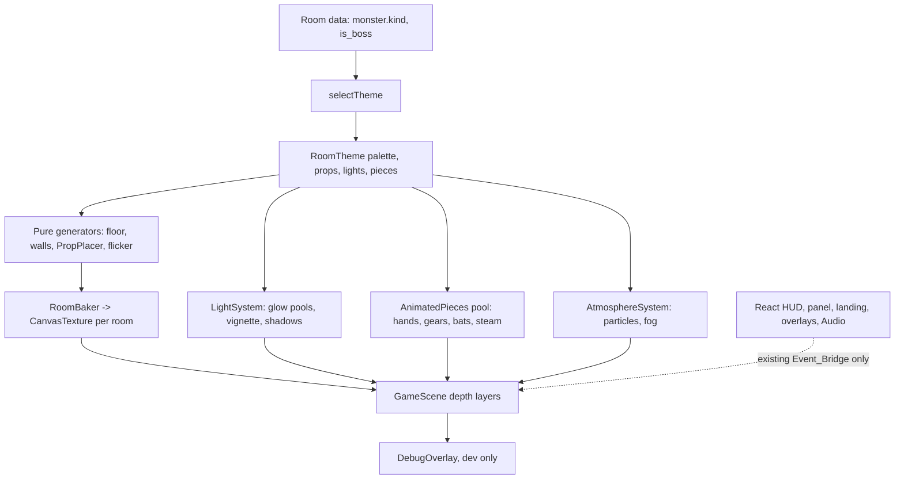

# Design Document: frontend-06-halloween-visuals

## Status

Phase 1 (PLAN ONLY). No app code has been written or changed. Implementation starts after the user confirms the decisions below.

## Open decisions for user confirmation

| ID | Decision | Options | Recommended default | Impact if changed |
|----|----------|---------|---------------------|-------------------|
| D1 | Palette conflict. Your hexes (#100D18, #1D1728, #E9A23B, #68C9A5, #7546A8, #F2E8D5, #B83D4A) are the original roadmap tokens. frontend-04 approved and shipped a different set (#100B18, #1C1427, #251A32, #39244F, #9B5DE5, #FF9F1C, #F5EBDD, #C83E4D, #59C9A5, #E9B44C). | (a) Keep existing semantic tokens and ADD new ones. (b) Switch base tokens to your hexes. | (a). Add pumpkin #F28A1E, ember #E9A23B, ghost #68C9A5, toxic #8BE04E, witch #7546A8, magenta #C04BD6, indigo shadow #1A1638, bone #F2E8D5, blood #B83D4A as new tokens in src/index.css and src/game/colors.ts. | (b) touches every component and several tests (colors.test.ts, tokens.test.ts, scans.test.ts). Base hexes differ by only 1 to 4 channel steps, so (b) gains almost nothing visually. Contrast note (estimate, to be measured by a test): #7546A8 on #100B18 is about 2.9:1, below 3:1, so witch purple is used for fills and glows only. Text and borders keep #9B5DE5 (existing MAGIC). Pumpkin #F28A1E on #100B18 is about 7.8:1. |
| D2 | Room to theme mapping. Clockwork Crypt is the gear_golem room (label already "Clockwork Crypt"). Library = paper_wraith. Witch's Laboratory = toxic_slime. Boss Hall = is_boss (exam_warden). So Pumpkin Workshop falls on memory_eater (label "Forgotten Wing"). | Keep label "Forgotten Wing" or rename to "Pumpkin Workshop" in src/demo/demoDungeon.json (cosmetic data only). | Theme ids: entry (fallback), library, witch_lab, clockwork_crypt, pumpkin_workshop, boss_hall. Selection stays data-driven by kind and is_boss, never by label. Rename the label to "Pumpkin Workshop" (data text only, no gameplay effect). | Existing ids change: workshop to clockwork_crypt (gear_golem), crypt to pumpkin_workshop (memory_eater), lab to witch_lab, throne to boss_hall. roomTheme.property.test.ts and roomTheme-related decor sprites need updating. The old "crypt" tomb decor moves to the Clockwork Crypt coffins. |
| D3 | Camera zoom. Rooms are 1280x800 world px and the canvas is 960x540. At zoom 1.0 the camera shows 960x540 (75% x 67% of a room). Zoom 1.25 shows 768x432. Zoom 1.5 shows 640x360 (half a room), and the docked question panel hides more of the bottom. A room never fits whole at any zoom, so the existing follow camera stays. | 1.0, 1.25, 1.5 to 2.0 | 1.0 as a named constant CAMERA_ZOOM. Gain presence by larger props and sprites rather than zoom. Try 1.25 in the Phase 2 review only if you want closer characters. | Higher zoom crops the monster when the panel is open and increases non-integer pixel scaling shimmer (Scale.FIT is already non-integer). The corridor (192 px) fits at all zooms. |
| D4 | Art source. | Code-drawn only, or CC0 packs. | Code-drawn only (zero licence risk, no network, small bundle). | CC0 packs need a licence line per pack in ASSETS_LICENSES.md and add bundle size. |
| D5 | Lighting technology. | (a) Baked radial-glow canvas textures with ADD blend plus a baked vignette overlay. (b) Camera postFX (addVignette, addBloom, addGlow). (c) Light2D / PointLight. | (a) for everything, one code path for WebGL and Canvas. Optional (b) addVignette is not used by default. (c) rejected: Light2D needs normal maps and a per-light shader pass; PointLight is WebGL only. | (b) adds a full-screen framebuffer pass and has no canvas fallback. (c) risks the 60 fps target on integrated GPUs. |
| D6 | Static decoration baking. | CanvasTexture (2D context) per room, or RenderTexture compositing. | One CanvasTexture per room (1280x800) drawn with seeded 2D code, covering floor, walls, wall dressing, flat props and decals. Existing registry sprites are drawn into it with drawImage from their source canvases. Animated pieces stay separate pooled objects. RenderTexture is the fallback if compositing registry sprites proves awkward. | Memory is identical (about 3.9 MiB per room). RenderTexture needs a per-frame GPU framebuffer and has no cost advantage here. |
| D7 | Debug performance overlay. | Always off, or dev-only toggle. | Dev-only, enabled by ?debug=1 or the F3 key, drawn as a single Phaser Text updated twice per second. Excluded from production work when disabled. | None for players. |
| D8 | Sound default. Brief says "muted/quiet by default". Current engine starts unmuted with MASTER_GAIN 0.25 (src/audio/sfx.ts). | Start muted, or start quiet. | Start quiet: unmuted, master 0.25, ambient bed at most 5% of master, owl and creak at most 10%. Browsers also block audio until the first user gesture. Mute toggle remains and is remembered for the session. | Starting muted means first-time players hear nothing and may think sound is broken. |
| D9 | Branch. | Continue on feature/frontend-rpg-polish, or create feature/frontend-halloween-visuals from it. | New branch feature/frontend-halloween-visuals created from feature/frontend-rpg-polish, so the overhaul can be reviewed or dropped alone. | Staying on the current branch mixes this work with the pending frontend-04 Phase 7 polish. |
| D10 | Baking cadence. build() currently draws every room at once with about 1000 Graphics rects per room. | Bake all five rooms at load, or bake current and adjacent rooms lazily. | Lazy: bake the current and next room, destroy rooms beyond one step away. Peak textures about 11.7 MiB for baked rooms. | Baking all five costs about 19.5 MiB and a longer first load but is still under the 32 MiB cap. |
| D11 | Lightning flash on the boss hall (photosensitivity). | Camera flash or soft overlay. | A pooled low-alpha overlay (peak alpha 0.25), at most once per 8 s, off under Reduced_Motion. No camera.flash. | Stronger flashes risk photosensitivity guidance (WCAG 2.3.1: no more than 3 flashes per second). |

Other conflicts found while reading the code:

- C1. roomTheme.ts uses a two-tone checker floor (`floor: [a, b]`) and GameScene.drawFloor draws it with Graphics rects. The new floor replaces both; the `floor` field becomes a palette for the generator.
- C2. Wall tiles are visible sprites ('wall-tile') in a static physics group. Baked walls hide them with setVisible(false). Their bodies stay, so collisions are unchanged.
- C3. AtmosphereSystem already owns fog ellipses and a pooled spark image with MAX_PARTICLES = 24. New systems reuse that cap and ObjectPool rather than adding a parallel cap.
- C4. The brief's camera zoom assumption (room fits at 1.5x to 2x) is wrong; see D3.
- C5. Audio cues already exist for footstep, growl, attack, hit, correct, wrong, gate, victory, defeat. Only 'miss' and 'boss' (entrance) are new. "Door" maps to the existing 'gate' cue.
- C6. Audio is outside Phaser (src/audio/). Ambient sound is therefore driven from React and the existing event flow; the Scene_Renderer never imports it. This keeps the import boundary intact.
- C7. The Event_Bridge is unchanged. All new visuals read only existing events (load-dungeon, set-phase, set-reduced-motion, set-muted, set-view-inset, gate-open, apply-result) and internal scene state (room change, encounter start).
- C8. frontend-04 Phase 7 (polish) is deferred until this spec finishes. Both touch Hud, QuestionPanel and overlays, so doing them in parallel would conflict.

## Overview

The overhaul keeps the architecture: GameScene builds rooms from layout data, themes are chosen by monster kind and is_boss, ObjectPool reuses objects, Reduced_Motion is a scene flag. The change is concentrated in four new layers:

1. A procedural art layer (pure, seeded generators that draw into a CanvasTexture per room).
2. A Light_System (baked glow textures with ADD blend, a baked vignette, soft shadows).
3. A set of Animated_Pieces and pooled effects (clock hands, gears, bats, steam, bursts).
4. React/CSS restyling of HUD, panel, landing, overlays plus generated ambient audio.

Pure logic (theme mapping, flicker, prop placement, particle budgets, contrast) lives in Phaser-free modules so it can be unit and property tested.

## Phaser 3.90.0 capability check

Installed version: 3.90.0 (frontend/node_modules/phaser/package.json line 3). Paths below are relative to frontend/node_modules/phaser/src.

| API | Verified at | Renderer | Use in this spec | Fallback |
|-----|-------------|----------|------------------|----------|
| BlendModes.ADD (1), MULTIPLY (2), SCREEN (3) | renderer/BlendModes.js lines 46, 57, 68 | WebGL and Canvas. Canvas mapping to 'lighter', 'multiply', 'screen' in renderer/canvas/utils/GetBlendModes.js lines 27 to 29 | Light pools, glows, moon beams, shadows (MULTIPLY) | None needed |
| TextureManager.createCanvas / CanvasTexture.refresh | textures/TextureManager.js line 695; textures/CanvasTexture.js | Both | Baked room textures, glow sprites, vignette | None needed |
| TextureManager.addDynamicTexture / RenderTexture (saveTexture, draw) | textures/TextureManager.js line 775; gameobjects/rendertexture/RenderTexture.js; textures/DynamicTexture.js | Both (Canvas resizes an underlying canvas) | Alternative for compositing sprites (D6) | CanvasTexture |
| Tweens: TweenManager.getTweens | tweens/TweenManager.js line 898 | Both | Debug_Overlay tween count | Omit the count |
| Camera shake, flash, fade | cameras/2d/Camera.js lines 88 to 108 (fadeEffect, flashEffect, shakeEffect) | Both | Existing uses; skipped under Reduced_Motion | None needed |
| Camera.postFX.addVignette(x, y, radius, strength) | gameobjects/components/FX.js line 520; Camera mixes in PostPipeline (cameras/2d/Camera.js line 59, initPostPipeline line 68; gameobjects/components/PostPipeline.js line 132) | WebGL only. FX.js line 57: "All effects are WebGL only and do not have canvas counterparts" | Not used by default (D5) | Baked vignette image |
| FX addGlow (line 453), addBloom (line 620), addShadow (line 478), addBlur (line 568), addGradient (line 595), addColorMatrix (line 639) | gameobjects/components/FX.js | WebGL only | Not used. Reserved for an optional WebGL-only bloom on the boss aura after profiling; guarded by `renderer.type === Phaser.WEBGL` | Baked glow sprite |
| Lights / Light2D (LightsManager) | gameobjects/lights/LightsManager.js | WebGL only (addPointLight, line 120 doc: WebGL only) | Rejected (D5) | n/a |
| PointLight game object | gameobjects/pointlight/PointLight.js | WebGL only | Rejected | Baked glow sprite |

Rules that follow:

- Every effect from FX.js or PointLight is behind a renderer check and no effect is required for correctness.
- Items reserved but unused stay unused unless profiling in Phase 6 shows a benefit.
- At the start of Phase 2 a smoke test confirms the baked paths render in the canvas renderer (config type forced to Phaser.CANVAS in a dev query flag `?renderer=canvas`).

## Architecture



Depth layers in GameScene (room-local order): 0 baked room texture; 1 wall colliders (invisible); 3 decals and contact shadows (MULTIPLY); 4 fog; 5 light pools (ADD); 9 animated wall pieces; 10 actors; 11 particles; 20 monster and player auras; 50 room label; 90 lightning overlay; 100 vignette (scrollFactor 0).

New modules (all under frontend/src/game unless noted):

- world/themes: extended roomTheme.ts (ids, lights, pieces, budgets) plus world/themeBudget.ts (pure budget math).
- world/propPlacement.ts (pure Prop_Placer, Keep_Out_Zone).
- world/keepOut.ts (pure Keep_Out_Zone from RoomLayout constants).
- systems/flicker.ts (pure Flicker_Function).
- art/room/*.ts (floor, walls, crypt dressing generators; draw to a 2D context; seeded RNG in art/room/rng.ts).
- textures/registerGlow.ts (glow, vignette, shadow textures).
- systems/LightSystem.ts, systems/RoomBaker.ts, systems/AnimatedPieces.ts, systems/TransitionSystem.ts, systems/DebugOverlay.ts.
- src/audio/ambient.ts (Audio_Engine bed and stingers) and additions to src/audio/sfx.ts.
- src/design/contrast.ts (pure WCAG contrast ratio used by a test).

## Per-room before and after

All rooms share the generators for flagstone, walls and lighting. The "now" column describes the current state in roomTheme.ts and GameScene.

| Room (theme id, monster kind, demo label) | Now | After |
|--------|-----|-------|
| Entry Hall (library, paper_wraith) | Two-tone checker floor, 4 bookshelves and a cobweb sprite, dust particles, faint amber tint | Flagstone floor, towering shelves along the north wall, floating candles (4), drifting pages (4, from the pool), ghostly translucent books (3), cobwebs, arched moonlight window with 2 additive beams, cool blue-green moon pool against warm candle pools, dust particles |
| Alchemist's Lab (witch_lab, toxic_slime) | Green checker floor, 2 cauldron and 2 potion sprites, bubble particles | Mossy damp flagstone, bubbling cauldron with glow ring and bubbles (pooled), potion shelves, hanging herbs (static), jars with floating eyes or sparks (2 animated), purple and green light pools |
| Clockwork Crypt (clockwork_crypt, gear_golem) SAMPLE | Brown checker floor, gear and chain sprites, orange sparks | Full treatment, see sample room section |
| Forgotten Wing to Pumpkin Workshop (pumpkin_workshop, memory_eater) | Blue-grey crypt floor, tombs, candle, mist | Warm plank-and-stone floor, 3 jack-o'-lanterns with flickering faces, hay bales, scarecrow, wall tools, warm orange pools, floating embers |
| Boss Room (boss_hall, exam_warden) | Red checker floor, columns, rune, ember particles | Dark red-purple stone, giant moon window, purple-fire chandelier (animated flames), bone-white throne on the north wall, banners, red and purple torches, heavier fog, lightning overlay, larger boss with aura and dramatic intro |

## Per-screen before and after

| Screen | Now | After |
|--------|-----|-------|
| HUD (Hud.tsx, hudHelpers.ts, RoomProgress.tsx) | Panel frames from Frame/Panel components, health and XP bars | Dark stone frame variant, orange and purple edge glow (box-shadow), SVG cobweb corners, candle-flame accent on the current room pip, bone dividers, low-health red pulse via CSS animation disabled under reduced motion |
| Question panel (QuestionPanel.tsx) | Docked panel with options | Spellbook look: parchment CSS gradient plus noise data URI under 2 KB, corner candle (CSS flame, static under reduced motion), ink-style options with hover and focus glow. Text colors keep at least 4.5:1 on parchment (dark ink on light parchment, measured in test) |
| Landing (LandingPage.tsx) | Static landing | CSS-only night sky (gradients), large moon, 2 fog layers via transform animation, 3 SVG bats crossing, flickering title via opacity animation, glowing pumpkin button. No Phaser, no raster images. Animations removed under prefers-reduced-motion |
| Victory (VictoryOverlay.tsx) | Overlay with text | Floating embers and bat confetti (CSS, at most 24 elements), XP counter counting up (steps; jumps to final value under reduced motion) |
| Defeat (DefeatOverlay.tsx) | Overlay with text | Row of candles whose flames fade out one by one, static dimmed candles under reduced motion |
| Pause (PauseMenu.tsx) | Plain overlay | Same stone frame as HUD |
| Transitions (GameScene.onRoomChange) | 180 ms camera fade | Mist wipe (pooled mist sprites sweeping up, at most 600 ms) or bat swarm (6 pooled bats); any key or pointer ends it; omitted under Reduced_Motion |

## Components and Interfaces

All new pure modules have no Phaser import.

```ts
// world/roomTheme.ts (extended)
export type ThemeId = 'entry' | 'library' | 'witch_lab' | 'clockwork_crypt' | 'pumpkin_workshop' | 'boss_hall'
export interface LightSpec { x: number; y: number; radius: number; color: number; min: number; max: number; seed: number }
export interface PieceSpec { kind: 'clockHands' | 'pendulum' | 'gear' | 'steam' | 'bat' | 'flame' | 'candle' | 'bubble' | 'page' | 'lightning'; x: number; y: number; count: number }
export interface RoomTheme { id: ThemeId; palette: ThemePalette; lights: readonly LightSpec[]; pieces: readonly PieceSpec[]; particles: ParticleSpec; /* existing fields kept */ }
export function selectTheme(kind: string | undefined, isBoss: boolean): RoomTheme  // unchanged signature

// systems/flicker.ts
export function flicker(timeMs: number, seed: number, min: number, max: number, reduced: boolean): number

// world/keepOut.ts
export function keepOutZone(): Rect[]                       // corridor + circles as bounding rects
// world/propPlacement.ts
export interface PropSize { w: number; h: number }
export interface PlacedProp { kind: string; x: number; y: number; w: number; h: number }
export function placeProps(seed: number, kinds: readonly { kind: string; size: PropSize; count: number }[], blocked: readonly Rect[]): PlacedProp[]

// world/themeBudget.ts
export const AMBIENT_CAP = 24              // equals MAX_PARTICLES
export const PIECE_CAP = 24
export const ROOM_TOTAL_CAP = 48
export const REDUCED_AMBIENT_CAP = 4
export function themeBudget(theme: RoomTheme, reduced: boolean): { ambient: number; pieces: number; total: number }

// design/contrast.ts
export function contrastRatio(fg: number, bg: number): number
```

LightSystem (Phaser): `setRoom(theme, origin)`, `update(time)` (writes alpha and scale on pre-created images only, no allocation), `follow(playerImage)`, `setMonsterGlow(monster | null)`. It reads Reduced_Motion through a getter, same pattern as AtmosphereSystem.

RoomBaker (Phaser): `bake(roomId, theme, origin) => string textureKey`, `release(roomId)`, `estimatedBytes()`.

## Data Models

Texture and asset inventory (all code-drawn, D4). Memory = width x height x 4 bytes.

| Asset | Size | How drawn | Baked or animated | Memory |
|-------|------|-----------|-------------------|--------|
| Baked room texture, one per room | 1280x800 | Seeded 2D code: flagstone (per-tile tone, cracks, moss blots, stains, seams, worn edges), wall top and inner faces, arches, wall dressing, flat props, decals | Baked | 3.90 MiB each; 11.7 MiB for current plus adjacent (D10); 19.5 MiB if all five |
| glow_warm, glow_cool, glow_green, glow_purple, glow_red | 128x128 | Radial gradient on canvas | Sprites, ADD, alpha and scale animated | 64 KiB each, 320 KiB total |
| vignette | 480x270 scaled 2x, linear filter | Radial gradient, black edges | Static, scrollFactor 0 | 0.50 MiB |
| shadow_soft | 64x32 | Elliptical gradient | Static sprites under characters | 8 KiB |
| beam | 64x256 | Linear gradient trapezoid | Static, ADD | 64 KiB |
| fog_blob | 256x128 | Soft ellipse gradient | Animated drift (existing fog count 3) | 128 KiB |
| clock_hands (2), pendulum, gear_l, gear_s | each at most 128x128 | Canvas lines and polygons | Animated (rotation tween or time driven) | Under 200 KiB total |
| bat (2 frames), steam_puff, ember, candle_flame (3 frames), page, bubble, wisp | each at most 32x32 | Pixel maps via existing pixelMap and frames | Animated, pooled | Under 100 KiB total |
| Monster glow ring, player aura | 128x128 (reuse glow textures) | none new | Animated | 0 extra |
| Damage number | Phaser Text, pool of 4 | Font FONT_DISPLAY | Animated, reused | About 4 x 16 KiB |
| Existing registry sprites (src/art/sprites/*) | at most 32x32 each | Pixel maps | As now | Under 1 MiB |

Estimated peak texture memory per scene: 11.7 + 0.32 + 0.50 + 0.4 + 1 = about 14 MiB. Total cap in requirements: 32 MiB. Per room (excluding shared): 3.9 MiB baked plus under 0.5 MiB room-specific pieces.

Theme palette data (new fields, pure):

```ts
interface ThemePalette { floorBase: number; floorTones: readonly number[]; wallTop: number; wallInner: number; mortar: number; accentLight: number; coolShadow: number }
```

Per-theme light list and piece list are plain data. Counts per theme must satisfy `ambient <= 24`, `pieces <= 24`, `ambient + pieces <= 48`, enforced by tests (Requirement 10).

Light pool count per room: at most 8 ADD sprites (4 torches, up to 4 theme lights) plus monster ring and player aura = 10 additive draws. Their overdraw is bounded because each is at most 256 px wide (radius 128) in world px.

## Sample room: Clockwork Crypt (gear_golem)

Coordinates are room-local (origin top-left, 1280x800, TILE 32). Existing anchors from RoomLayout.ts: player spawn (640, 704); monster spawn (640, 336); gate x 576 to 704, y 0 to 32; pillars at (160,160), (1056,160), (160,576), (1056,576), each 64x64; torches at (256,40), (1024,40), (40,400), (1240,400).

Keep_Out_Zone (rects, derived in keepOut.ts):

- Corridor: x 544 to 736, y 32 to 768 (192 wide, centered on spawn, monster and gate).
- Monster circle radius 96 around (640,336) (bounding rect 544 to 736 by 240 to 432, inside the corridor width but extended where needed: x 544 to 736).
- Spawn circle radius 64 around (640,704).
- Gate approach: x 544 to 736, y 32 to 160.
- Pillars and the 32 px border ring are blocked areas for props.

North wall elevation art zone (y 0 to 128, visual only; physics unchanged, actors may stand in front of it):

- Broken clock face: center (352, 64), radius 60, cracked glass, missing numeral segments, warm amber back glow (glow_warm, ADD, alpha 0.25 to 0.4). Hands (2 sprites, pivot at center) driven by time: minute hand one rotation per 60 s, hour hand one per 12 min, with an occasional 400 ms stutter. Static at 10:10 under Reduced_Motion.
- Pendulum case: x 928 to 976, y 0 to 128, swinging bob (tween on angle, plus or minus 14 degrees, 2.4 s period). Static under Reduced_Motion.
- Gears: large gear center (1120, 72) radius 48, small gear (1058, 98) radius 28, counter-rotating, speed 8 and 14 degrees per second. Static under Reduced_Motion.
- Pipes with vents: pipe run x 760 to 1000 at y 24 to 40; vents at (800, 44) and (960, 44). Steam puffs from a pool of 6 rising 40 px over 1.2 s every 2 to 4 s; none under Reduced_Motion.
- Arched doorway at the gate (x 560 to 720, y 0 to 40) with iron bands; gate glow_warm pulse when openable.
- Hanging chains at x 480 and x 800 (length 96, y 0 to 96), baked; one sways 2 degrees (animated) under normal motion.
- Corner cobwebs: NW (32,32) 96 px, NE 96 px, SW and SE 64 px, baked.
- Ceiling bats: 3 roosted at (496, 24), (520, 28), (832, 26). Every 8 to 20 s one flutters a 160 px arc and returns. Pool of 3. None flies under Reduced_Motion.

Floor dressing (baked flagstone, 32 px tiles with per-tile seeded tone from palette `floorTones`, plus):

- Cracks (seeded polylines, 14), moss blots along walls and in cracks (green #2F4A3A to #3C5C45, 18), stains (dark, MULTIPLY, 6), seams (1 px lighter lines), worn edges (lighter tile rims at the corridor).
- Brighter wear strip along the corridor so the path reads as the path.

Blocking dressing (kept out of the Keep_Out_Zone, pillars and walls):

- Stone coffins with lids ajar: west wall at (40..96, 240..344) and (40..96, 480..584); east wall at (1184..1240, 460..564). The west torch at (40,400) sits between the two west coffins. Lid gap shows a faint toxic-green glow (glow_green, alpha 0.15). These are visual only; no colliders are added.
- Scatter props via placeProps with seed derived from room id: bones (6, 12x6), candles (5, 8x12, each with a small warm pool), papers (5, 14x10), floor runes (3, 48x48, decal layer, may overlap the corridor only if flagged `flat: true`; default is not allowed to avoid ambiguity).

Lighting setup:

- Vignette overlay over the screen (depth 100), intensity 0.55 at the edges.
- Warm pools at the 4 torches (radius 112, flicker min 0.55 max 1.0), 5 candle pools (radius 48, min 0.5 max 1.0), amber clock back-glow (radius 96, min 0.7 max 1.0, slow).
- Cool indigo ambient: a MULTIPLY indigo-tint rect at alpha 0.12 over the room, so warm pools read warm.
- Glow ring under the active monster (ellipse 128x48, glow_warm, pulse 0.35 to 0.55 over 1.6 s).
- Faint player aura (glow_purple, radius 40, alpha 0.12).
- Soft contact shadows (shadow_soft, MULTIPLY, alpha 0.5) under player, monster and bats.
- Optional floor fog: 2 fog blobs (existing AtmosphereSystem fog), skipped under Reduced_Motion.

Character polish (confirm in Phase 2 by reading Monster.ts and Player.ts first):

- Monster: idle breathing (scaleY 1 to 1.03 over 1.8 s, anchored at feet), two glowing eye points (ADD, small glow_warm), wind-up (lean back 6 px and tint for 200 ms before the existing attack tween; no change to attack timing seen by the combat flow), hit flash (white tint 80 ms, already partly exists in EffectsSystem), defeat: scale down with 8 pooled sparks, then hide.
- Player: outlined silhouette (darker 1 px outline in the pixel map), cape and hat 1 px sway every 600 ms on a frame swap (no allocation), 16x6 shadow.
- Reduced_Motion: no breathing, no sway, defeat is an instant fade.

## Performance risks and mitigations

| Risk | Mitigation |
|------|------------|
| Overdraw from additive lights and fog | At most 10 ADD sprites per room, none larger than 256 px; fog stays at 3 blobs with low alpha; nothing full-screen except the vignette (one quad) |
| Per-room particle growth | MAX_PARTICLES 24, PIECE_CAP 24, ROOM_TOTAL_CAP 48 asserted by tests; Reduced_Motion cap of 4 |
| RenderTexture / canvas memory | CanvasTexture 3.9 MiB per room, lazy bake of current and next room only (D10), release on leaving; cap 32 MiB checked by Debug_Overlay |
| Tween count | Prefer time-driven updates inside one LightSystem.update loop over one tween per object; current tween total is shown in the overlay; target under 60 |
| Per-frame allocation | New update loops write to existing objects only; no object or array literals in update paths; flicker is a pure number function |
| Text rendering | Phaser Text only for the room label and 4 pooled damage numbers; setText only on change |
| Canvas fallback cost | Same baked path; ADD uses 'lighter' composite, which is slower on Canvas, so the light count is reduced to 6 when the renderer is Canvas |
| Graphics command buffers | The current per-room Graphics floor (about 1000 fillRect calls each, kept every frame) is replaced by one texture, which should reduce draw cost |
| First load | Landing page has no images and no Phaser; room baking runs when a room becomes current, about a few ms per room (to be measured) |

60 fps budget plan: aim for under 4 ms CPU per frame for scene update, under 150 draw calls (baked room = 1, lights about 10, pieces about 25, particles up to 24, actors about 10). The user reads fps and counts from the Debug_Overlay in each room during Phase 6; automated tests cannot measure fps.

## Correctness Properties

*A property is a characteristic or behavior that should hold true across all valid executions of a system-essentially, a formal statement about what the system should do. Properties serve as the bridge between human-readable specifications and machine-verifiable correctness guarantees.*

Reflection on redundancy: determinism and bounds of the flicker function stay in one property; the reduced-motion midpoint is separate because it has a different expected value. Particle cap, piece cap and reduced cap merge into one budget property. Non-overlap with keep-out zones and with other props merge into one placement property; determinism of placement is separate. Known-kind mapping and unknown-kind fallback merge into one non-boss theme property.

### Property 1: Boss rooms always use the boss hall theme

For any kind string (including undefined, empty, known and unknown values), selectTheme(kind, true) returns the boss_hall theme.

**Validates: Requirements 6.1**

### Property 2: Non-boss theme depends only on the monster kind

For any kind string, selectTheme(kind, false) returns library, witch_lab, clockwork_crypt or pumpkin_workshop when kind is paper_wraith, toxic_slime, gear_golem or memory_eater respectively, and returns entry for every other value (including names such as "constructor" or "__proto__"). The result is a registered theme and repeated calls return the same theme.

**Validates: Requirements 6.2, 6.3, 6.4, 6.5, 6.6**

### Property 3: Flicker stays within bounds and is deterministic

For any time, seed and bounds with min <= max under normal motion, flicker returns a value v with min <= v <= max, and two calls with equal inputs return equal values.

**Validates: Requirements 8.1, 8.2**

### Property 4: Flicker is constant under reduced motion

For any time, seed and bounds with min <= max, flicker with reduced = true returns (min + max) / 2.

**Validates: Requirements 4.3, 8.3**

### Property 5: Placed props never block

For any seed and any prop list that fits, every placed prop rectangle lies inside the room interior and does not intersect the Keep_Out_Zone, any pillar, the border wall ring, or any other placed prop.

**Validates: Requirements 7.5, 9.1, 9.2**

### Property 6: Prop placement is deterministic

For any seed and prop list, two calls to placeProps return deeply equal results.

**Validates: Requirements 9.3**

### Property 7: Theme budgets respect the caps

For any registered theme and any reduced-motion flag, themeBudget returns ambient <= 24, pieces <= 24 and total <= 48, and when reduced is true ambient <= 4.

**Validates: Requirements 2.2, 2.3, 10.1, 10.2, 10.3**

### Property 8: Contrast ratio is symmetric and bounded

For any two colors a and b, contrastRatio(a, b) equals contrastRatio(b, a) and lies in [1, 21]. For any color a, contrastRatio(a, a) is 1. The required text and UI token pairs are checked by example tests against the thresholds in Requirement 4.6.

**Validates: Requirements 4.6**

## Error Handling

- Unknown theme kind: entry theme (no throw).
- Prop list that cannot fit after bounded attempts (200 per prop): placeProps skips that prop and returns the rest; a test asserts the Clockwork Crypt list places all props.
- Baking failure (canvas context null): RoomBaker falls back to the existing Graphics checker floor path and logs once with console.warn.
- Effect API absent or renderer is Canvas: WebGL-only effects are skipped.
- AudioContext missing or suspended: Audio_Engine does nothing and does not throw (existing engine behaviour kept).
- Texture memory over 32 MiB: Debug_Overlay shows the value in red; RoomBaker releases rooms beyond one step away immediately on room change.
- Scene rebuild (reset event): RoomBaker.release for all rooms, killAll tweens (existing teardown) and pool clear, so no leaks.

## Testing Strategy

Property-based testing applies to the pure modules (theme mapping, flicker, placement, budgets, contrast). It does not apply to Phaser rendering, CSS styling, or Web Audio output; those use example tests, component tests, manual review and the Debug_Overlay.

Libraries: vitest and fast-check (already used, for example in roomTheme.property.test.ts). Each property is one property-based test with at least 100 runs, tagged with a comment `Feature: frontend-06-halloween-visuals, Property N: <title>`.

Required tests (non-optional):

- roomTheme.property.test.ts updated for Properties 1 and 2.
- flicker.property.test.ts for Properties 3 and 4.
- propPlacement.property.test.ts for Properties 5 and 6, plus an example that the Clockwork Crypt prop list fully places for 200 seeds.
- themeBudget.property.test.ts for Property 7, plus an example iterating THEME_IDS.
- contrast.property.test.ts for Property 8 and an example test of required pairs (HUD text on stone, panel ink on parchment, button text on pumpkin, ink on night base).
- palette parity example test: src/index.css tokens equal src/game/colors.ts values.
- Component tests for reduced-motion variants of Hud, QuestionPanel, VictoryOverlay, DefeatOverlay, LandingPage.
- Audio_Engine tests with the existing fake context: muted gives no output, ambient gain ceiling, missing context does not throw.
- Existing 267 tests keep passing, including importBoundary.test.ts.

Manual and tool-assisted checks (Phase 6): Debug_Overlay readings from the user per room, canvas renderer smoke run, contrast and reduced-motion check per changed screen, typecheck, lint, build.
