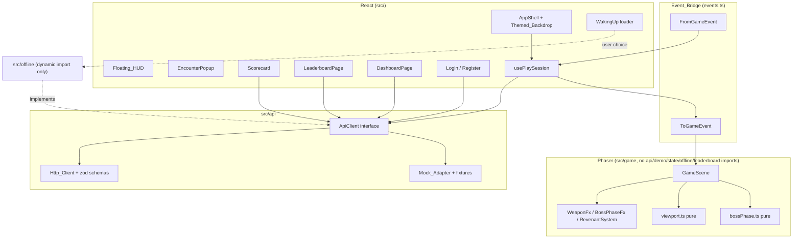

# Design Document: frontend-07-premium-ux-leaderboard

## Overview

This design turns the playable Halloween client into a full-screen, character-led game with a leaderboard, dashboard, auth, offline fallback, badges and a share card. It is delivered in Phases 0 to 8 on branch feature/frontend-premium-ux. Each phase ends with a STOP checkpoint.

Core ideas:

1. The Backend decides outcomes. The UI renders what an `ApiClient` returns. A typed `ApiClient` has three implementations behind one interface: `Http_Client` (real, zod-validated), `Mock_Adapter` (default for demos) and `Offline_Adapter` (loaded only after the player chooses the Offline demo).
2. Pure logic lives in Phaser-free modules (viewport, boss phase, leaderboard ranking, badges, offline rules, validation) so it can be property tested.
3. The side Question_Panel is replaced by an overlay `EncounterPopup` drawn over a full-viewport Phaser canvas. The combat state machine (`combatMachine`) is unchanged.
4. Phaser receives only display data over the Event_Bridge through additive typed events.

Sources of truth used while writing this design (there is no api-contract.md, game-design.md or demo_dungeon.sample.json yet): `frontend/src/types/api.ts`, `docs/handoff/B-to-A.md`, `src/demo/rules.ts`, `src/api/mock/mockAdapter.ts`.

## Open decisions for user confirmation

Reply "approve" to accept every recommended default.

| ID | Decision | Options | Recommended default | Impact if changed |
|----|----------|---------|---------------------|-------------------|
| D1 | Scale mode | FIT (letterbox), RESIZE (canvas equals viewport) | RESIZE with a transparent canvas over the Themed_Backdrop. The camera zoom comes from the Viewport_Helper, so wide and tall windows show more world instead of bars. See Scale_Evidence. | FIT keeps today's fixed 960x540 view but shows themed bars at any non-16:9 size, and zoom stays 1.0 so Requirement 2.5 and 2.6 become trivial. FIT is the fallback if RESIZE fails verification at any size in Phase 1. |
| D2 | Zoom rule | Continuous, quarter steps | `zoom = clamp(snapQuarter(min(w/960, h/540)), 0.75, 3.0)`. Quarter steps limit pixel shimmer. At 1920x1080 zoom is 2.0 and shows the same 960x540 world window as today. | Continuous zoom is smoother on resize but shimmers sprites. |
| D3 | How the encounter replaces the side panel | (a) Keep 1280x800 room, 960x540 FIT canvas, panel beside or below, view inset 0. (b) Full viewport canvas, overlay pop-up, view inset 0. | (b). The canvas fills the App_Shell, the pop-up overlays it with a 55 percent scrim, the camera does not move (`set-view-inset` stays `bottomFraction: 0`, so the existing event keeps its meaning). The speech panel sits in the lower 45 percent on desktop and fills the width on phones. The monster stays visible in the upper area behind the scrim. Camera zoom is no longer a fixed 1.0 (see D1, D2). | (a) is today's behaviour: panel beside at 900 px and above, below the canvas under it, and the stage shrinks when the panel opens. |
| D4 | Portrait art pipeline | Phaser textures, React canvas | Code-drawn Canvas2D portraits in `src/art/portraits/`, rendered by a React `PortraitCanvas` (one cached bitmap per kind and pose), animated with CSS transforms. Phaser is not involved, so the import boundary is untouched. | Phaser portraits would need new bridge events and texture work for no visual gain. |
| D5 | Entry side rule | Per room, per monster | By room order parity: even order slides in from the left, odd from the right, the boss from the right. | Per monster kind would repeat the same side for repeated kinds. |
| D6 | Typewriter rate | 30, 45, 60 chars per second | 45 chars per second, skip on Space, Enter or click, instant under Reduced_Motion. | Slower reads as drama but blocks players. |
| D7 | Weapon selection source | Backend only, frontend choice | Backend only: `weapon_id` on the attempt result, fallback Rusty Dagger. The mock unlocks by level: dagger L1, staff L2, crossbow L3, hammer L5, sigil L8 (PROPOSED, mock only). | A frontend choice would contradict the authority rule. |
| D8 | Critical hit | Backend flag, local rule | Backend flag `is_critical`. The mock sets it when the streak is a positive multiple of 3. Damage stays 20, so working balance and the 6-hit boss are unchanged; the flag only changes presentation. | A bonus-damage crit is a backend scoring change and is noted in B-to-A.md. |
| D9 | Revenant delivery | Embedded in run payload, GET /reviews/due | `ApiClient.getDueReviews(dungeonId)` backed by GET /reviews/due in the Proposed_Contract. The count also arrives as `due_review_count` in progress. Person A can switch to embedding without UI change because the method hides it. | Embedding changes `Run` and every fixture. |
| D10 | Revenant gameplay effect | Blocking, optional | Optional. Revenants appear after the room monster is defeated, up to 3 per room, never block the gate and never change HP of the room monster. A wrong answer on a revenant costs the same player damage as a topic room (10) in mock and offline. | Blocking would change gate-open flow, which Requirement 9.8 forbids. |
| D11 | Leaderboard polling | Interval, websocket | `setInterval` 30 s only while the screen is mounted and the tab is visible, with an immediate fetch on mount and on tab refocus. No websockets. | Websockets need contract work and are out of scope. |
| D12 | Provisional rank rule | Insert and renumber, estimate | Insert the player's run into the entries using the same comparator, assign the index plus one, and do not store it. | Estimation by percentile is cheaper but cannot be property tested for ordering. |
| D13 | Auth endpoints | Invent now, propose | They are not in B-to-A.md, so they are PROPOSED CONTRACT items: POST /auth/register, POST /auth/login, POST /auth/logout, GET /auth/me. The Mock_Adapter implements them with an in-memory user table and an httpOnly-style flag only (no real cookie). | Without proposing them the Auth_Screens could not be built honestly. |
| D14 | Password rules | Light, strong | Register: 10 to 72 characters with at least one letter and one digit. Username: 3 to 20 characters of letters, digits, underscore. Login only requires non-empty values, so older passwords still work. | Strong login checks lock out real users. |
| D15 | Offline module loading | Static, dynamic | Dynamic `import('@/offline')` only inside the explicit Offline demo handler. A test fails when any other file imports `src/offline` statically. | Static import ships offline code in normal mode, breaking Requirement 14.7. |
| D16 | Zod version | Range, pin | Exact `zod@4.6.7` (confirmed to exist on npm with `npm view zod@4.6.7 version`). | A range risks silent schema changes. |
| D17 | Contract test layout | One file per endpoint, shared suite | One shared suite `src/contract/suite.ts` run by `mock.contract.test.ts` always and `http.contract.test.ts` only when `VITE_API_BASE_URL` is set and mocks are off. Script `test:contract` runs `vitest --run src/contract`. | Duplicating assertions per client lets them drift. |
| D18 | Share card fonts | Web fonts, @fontsource | Self-hosted @fontsource families already in the project (Cinzel, Pirata One, Inter), awaited with `document.fonts.load` before drawing. No network. | External fonts violate Requirement 15.8. |
| D19 | Speed Reader badge | On, off | Off by default behind `VITE_BADGE_SPEED_READER`, and the badge id is still supported in types and rendering. | On needs timing data the contract does not carry. |
| D20 | Branch and commits | Single, per phase | Stay on feature/frontend-premium-ux, one commit per phase after the user approves the STOP. | A single commit hides regressions. |
| D21 | Upload wizard (Phase 8) | Build, skip | Build as optional, hidden for guests, against a mock `uploadNotes` marked pending. | Skipping removes Requirement 16 coverage. |
| D22 | Intro story storage | localStorage, session | localStorage key `sd.introSeen` (a non-secret flag, not a token). | Session storage replays the story every tab. |
| D23 | Hook trigger | Save, agent stop | PostFileSave on `frontend/src/**` runs lint, typecheck and tests. See Hook_Format_Evidence. | Agent stop runs less often but misses manual edits. |
| D24 | Demo board seed | Backend only, bundled | Mock returns 8 seeded Ghost_Rivals. The Offline_Module bundles its own 8. Both are flagged `is_seeded_rival` and labeled "Ghost Rival - demo". | Unlabeled seed data would mislead players. |
| D25 | Where the API foundation lands | Phase 0, Phase 1, spread | The zod layer, ContractError, fixtures and contract suite for the existing endpoints land at the end of Phase 1 (Phase 0 is housekeeping only). Each later phase adds its own endpoint, schema, fixture and contract case in its first sub-task. | Putting it in Phase 0 widens the housekeeping STOP; spreading everything late delays contract feedback. |
| D26 | Badge catalog placement | Phase 5, Phase 7 | The badge ids, labels, icons and `BadgeGrid` land in Phase 5 (the Scorecard and Dashboard need them). Phase 7 adds the rules, mock and offline computation, lore and share card. | Moving the catalog to Phase 7 leaves Phase 5 screens without badge icons. |

## Scale_Evidence

Verified in the installed package, `frontend/node_modules/phaser/package.json` shows `"version": "3.90.0"`. In `node_modules/phaser/src/scale/const/SCALE_MODE_CONST.js`:

- line 37: `NONE: 0`
- line 47: `WIDTH_CONTROLS_HEIGHT: 1`
- line 57: `HEIGHT_CONTROLS_WIDTH: 2`
- line 69: `FIT: 3`
- line 80: `ENVELOP: 4`
- line 90: `RESIZE: 5`

`src/scale/const/CENTER_CONST.js` line 50 has `CENTER_BOTH: 1`. Both `Phaser.Scale.FIT` (used today in `src/game/config.ts`) and `Phaser.Scale.RESIZE` therefore exist in 3.90.0.

Behaviour notes (from Phaser docs for the Scale Manager, to be confirmed by the Phase 1 per-size verification): RESIZE sets the game size equal to the parent size and emits a `resize` event; FIT keeps the aspect ratio and letterboxes. With RESIZE the scene must update camera size and zoom itself, which is why the Viewport_Helper exists.

## Hook_Format_Evidence

The Kiro documentation (kiro.dev/docs/hooks and "What's new in 1.0" hooks page, found by web search) states that hooks are standalone JSON files in `.kiro/hooks/*.json` with a versioned schema. The docs pages did not render through the fetch tool, so the exact field names come from the tool schema available in this session: `{ "version": "v1", "hooks": [{ "name", "trigger", "matcher", "action": { "type": "command", "command" } }] }` with trigger `PostFileSave` and a regex `matcher` tested against the file path. Phase 0 creates the hook through that schema, then confirms the file loads. This is recorded honestly as "format taken from the session tool schema; docs page text not retrievable".

## Architecture



### Layout of the full-screen shell

```
+--------------------------------------------------------------+  100dvh x 100dvw + safe-area
| Themed_Backdrop (gradient, vignette, fog)  [z0]               |
|  Phaser canvas, transparent, RESIZE        [z1]               |
|  +-- Floating_HUD top bar (HP, XP, level, due, mute, fs) [z2] |
|  |                                                            |
|  |      player        monster      (never covered by HUD)     |
|  |                                                            |
|  +-- Controls legend (bottom, collapsible < 640 px) [z2]      |
|  EncounterPopup: scrim + portrait + Speech_Panel   [z3]       |
|  Pause / Defeat / Scorecard overlays               [z4]       |
+--------------------------------------------------------------+
```

The HUD keep-out rule: the HUD occupies only the top 56 px and bottom 40 px bands plus left and right gutters. The camera follows the player with a dead zone so the player and the active monster stay in the middle band, and a pure function `hudSafeBand(viewport)` returns the rectangle where gameplay must stay. A property test checks the HUD rectangles never intersect it.

## Components and Interfaces

### Module map (new and changed files, paths relative to frontend/)

| Area | File | Purpose |
|------|------|---------|
| Config | `src/config/flags.ts` | Typed reads of `VITE_USE_MOCKS`, `VITE_API_BASE_URL`, `VITE_MOCK_SEED_REVENANTS`, `VITE_BADGE_SPEED_READER` |
| API | `src/api/ApiClient.ts` (extend) | Adds `getLeaderboard`, `getDueReviews`, `register`, `login`, `logout`, `getMe`, `uploadNotes` |
| API | `src/api/schemas.ts` | zod schemas for every response |
| API | `src/api/ContractError.ts` | Thrown on schema mismatch with endpoint and field path |
| API | `src/api/client.ts` (change) | Parses each response with its schema |
| API | `src/api/mock/fixtures/*.json` | Fixtures including PROPOSED fields |
| API | `src/api/mock/mockBadges.ts`, `mockLeaderboard.ts`, `mockReviews.ts`, `mockAuth.ts` | Demo-only computation |
| Types | `src/types/api.ts` (extend) | New optional fields tagged `/** PROPOSED */` |
| Contract | `src/contract/suite.ts`, `mock.contract.test.ts`, `http.contract.test.ts` | Shared assertions |
| Game | `src/game/viewport.ts` | `zoomForViewport`, `layoutClass`, `hudMode`, `hudSafeBand` |
| Game | `src/game/bossPhase.ts` | `bossPhase(hp, maxHp)` |
| Game | `src/game/config.ts` (change) | RESIZE, transparent canvas |
| Game | `src/game/events.ts` (extend) | New typed events (below) |
| Game | `src/game/systems/WeaponFxSystem.ts`, `BossPhaseSystem.ts`, `RevenantSystem.ts`, `CurseFlash.ts` | Pooled effects |
| Game | `src/game/fx/weapons.ts` | Pure descriptors per weapon (shape, color, particle count) |
| Shell | `src/components/AppShell.tsx`, `ThemedBackdrop.tsx`, `FullscreenButton.tsx`, `src/shell/useFullscreen.ts` | Full-screen shell |
| HUD | `src/components/Hud.tsx` (change), `ControlsLegend.tsx` | Floating HUD |
| Encounter | `src/encounter/EncounterPopup.tsx`, `SpeechPanel.tsx`, `AnswerGrid.tsx`, `Typewriter.tsx`, `useTypewriter.ts`, `lines.json`, `lines.ts`, `entrySide.ts` | Pop-up |
| Art | `src/art/portraits/{ghost,vampire,skeleton,golem,witch,warden}.ts`, `index.ts`, `PortraitCanvas.tsx` | Original portraits |
| Weapons | `src/weapons/weapons.ts`, `Armory.tsx` | Ids, names, unlock levels |
| Leaderboard | `src/leaderboard/ranking.ts`, `provisional.ts`, `view.ts`, `useLeaderboard.ts`, `LeaderboardPage.tsx`, `Podium.tsx`, `Row.tsx`, `Avatar.tsx` | Board |
| Scorecard | `src/scorecard/Scorecard.tsx`, `mastery.ts`, `useCountUp.ts` | End screen |
| Dashboard | `src/pages/DashboardPage.tsx`, `src/dashboard/*` | Home |
| Auth | `src/auth/validation.ts`, `LoginPage.tsx`, `RegisterPage.tsx`, `errors.ts`, `useRetryAfter.ts` | Forms |
| Loader | `src/pages/WakingUp.tsx`, `src/state/useDemoStart.ts` | 8 s timeout and Offline choice |
| Offline | `src/offline/{index,adapter,rules,badges,rivals,demoDungeon.json}` | Deterministic engine |
| Badges | `src/badges/badges.ts`, `BadgeGrid.tsx` | Ids, labels, icons |
| Share | `src/share/renderShareCard.ts`, `postText.ts`, `ShareDialog.tsx` | PNG and text |
| Lore | `src/lore/intro.ts`, `IntroStory.tsx` | Skippable story |
| Upload | `src/upload/*` (Phase 8) | Wizard |
| Tests | `src/test/boundary.test.ts` | Offline and Phaser import checks |
| Docs | `.kiro/hooks/frontend-lint-test-on-save.json`, `.kiro/steering/frontend-ui-standards.md`, `docs/handoff/B-to-A.md`, `docs/kiro-log-frontend.md`, `frontend/ASSETS_LICENSES.md` | Phase 0 and per-phase logs |

### ApiClient interface (extended)

```ts
export interface ApiClient {
  // existing
  startDemoSession(): Promise<DemoSessionResponse>
  getDungeon(id: string): Promise<Dungeon>
  startRun(dungeonId: string): Promise<Run>
  submitAttempt(runId: string, req: AttemptRequest): Promise<AnswerResult>
  clearRoom(runId: string, roomId: string): Promise<ClearRoomResponse>
  finishRun(runId: string): Promise<RunSummary>
  getProgress(): Promise<ProgressInfo>
  // PROPOSED (pending Person A)
  getLeaderboard(q: { dungeonId: string; period: 'all' | 'week'; limit?: number }): Promise<LeaderboardResponse>
  getDueReviews(dungeonId: string): Promise<DueReview[]>
  register(c: Credentials): Promise<User>
  login(c: Credentials): Promise<User>
  logout(): Promise<void>
  getMe(): Promise<User | null>
  uploadNotes(file: File, onStep?: (s: UploadStep) => void): Promise<UploadResult>   // Phase 8
}
```

`getApi()` keeps its shape. A new `setApiOverride(client)` lets the Offline choice replace the resolved client at runtime. The override is installed only from the Offline handler.

### New Event_Bridge events (additive)

```ts
// ToGameEvent additions
| { type: 'set-viewport'; width: number; height: number }                     // display only, from the shell
| { type: 'encounter-open'; monsterId: string; side: 'left' | 'right' }        // dim and focus, display only
| { type: 'encounter-close' }
| { type: 'spawn-revenants'; roomId: string; revenants: RevenantSpawn[] }
// apply-result gains optional fields on the payload's AnswerResult (weapon_id, is_critical), no new event
// FromGameEvent additions
| { type: 'revenant-engaged'; revenantId: string }
| { type: 'revenant-rested'; revenantId: string }
| { type: 'boss-phase-changed'; phase: 'normal' | 'enraged' | 'defeated' }
```

`RevenantSpawn` is `{ id: string; questionId: string; x?: number }` defined in `events.ts` itself (not imported from the API), so Phaser keeps its boundary. Existing events and payloads are untouched; `events.test.ts` gets a compatibility test listing the old shapes.

### Viewport_Helper (pure)

```ts
export const BASE_W = 960, BASE_H = 540
export function zoomForViewport(w: number, h: number): number            // D2
export function layoutClass(w: number, h: number): 'phone' | 'tablet' | 'desktop' | 'wide'
export function hudMode(w: number): 'compact' | 'full'                    // compact below 640
export function hudSafeBand(w: number, h: number): { x: number; y: number; w: number; h: number }
```

### Boss phase (pure)

```ts
export type BossPhase = 'normal' | 'enraged' | 'defeated'
export function bossPhase(hp: number, maxHp: number): BossPhase
// maxHp <= 0 -> 'normal'; hp <= 0 -> 'defeated'; hp / maxHp < 0.5 -> 'enraged'; else 'normal'
```

Boss HP 120: 60 is exactly 50 percent and stays normal; 59 is enraged. Lightning is limited by a pure scheduler `nextLightningAt(now, last, reduced)` returning Infinity under Reduced_Motion and at least `last + 8000` otherwise, with peak alpha 0.25 (D11 of frontend-06 is reused).

### Encounter flow

`usePlaySession` still owns the combat machine. `EncounterPopup` is mounted when `isCombatActive(state.combat) && question`. It receives the same props as `QuestionPanel` plus `monsterKind`, `side`, `weaponId`, `isCritical`, `isRevenant`.

Sequence:

1. Phaser emits `encounter-started`. The hook picks the question as today and sends `encounter-open` (dim). The popup slides the portrait in (300 ms, none under Reduced_Motion) and shows a taunt line, then the Typewriter reveals the question.
2. Keys 1 to 4 call `onAnswer(option[n-1])`. The popup shows the submitting state.
3. On `result-received` the hook sends `apply-result` (now carrying `weapon_id` and `is_critical`). The popup shows hurt or taunt pose, the damage number from `result.damage_dealt` (never computed), the Source_Line and explanation, and a reaction line.
4. Phaser plays the weapon strike, wisp burst or curse flash, and emits `result-animation-done` once.
5. Enter or auto-advance leaves the result. Between questions the popup slides out within 300 ms; for a next question it slides back in. Retreat is always available while a question is open.

Focus is trapped inside the Speech_Panel while open (existing `OverlayFrame` pattern reused) and restored to the game on close. Results and rank changes go to one `aria-live="polite"` region.

### Weapons and critical presentation

`src/weapons/weapons.ts` exports `WEAPONS` (id, name, unlockLevel) and `resolveWeapon(id?: string)` returning Rusty Dagger for unknown or absent ids. `src/game/fx/weapons.ts` maps the id to a pure descriptor `{ shape: 'slash' | 'bolt' | 'arrow' | 'shockwave' | 'burst', color, count, durationMs }`. `WeaponFxSystem` draws from a pool of 16 reusable Graphics/Image objects and reads the descriptor, so no object is created per frame. A critical hit scales the damage text by 1.5 and adds a pooled white flash at alpha 0.35 (static marker under Reduced_Motion).

### Revenants

`RevenantSystem` owns up to 3 pooled ghost sprites per room. It spawns only after the room monster HP reaches 0, so gate-open timing is unchanged. Revenants are tinted translucent (alpha 0.6, additive glow texture, bob tween off under Reduced_Motion). Engaging a revenant emits `revenant-engaged`; the hook resolves its question from the `DueReview` list and runs the same encounter with the intro line "The ghost of a question you forgot...". A correct answer plays the "memory laid to rest" effect (pooled wisp rising and fading) and emits `revenant-rested`; the hook decrements the displayed counter locally for display only and refetches progress afterward.

### Leaderboard

Ranking is a pure comparator in `src/leaderboard/ranking.ts`: score desc, accuracy desc, best_streak desc, display_name asc (code-point order, case-sensitive for determinism), then entry id asc. `rankEntries(entries)` returns a new array with `rank` assigned as index plus one (ties are fully broken, so ranks are unique). `insertProvisional(entries, me)` inserts and returns the provisional rank. `buildBoardView(response, me)` returns `{ podium, rows, meRow }` where `meRow` is pinned (always present when `me.entry` or a provisional entry exists, even if outside the first `limit` rows) and every `is_seeded_rival` entry gets the label "Ghost Rival - demo". The backend rank is shown when the response contains one; the client sort is used for the provisional insert and the tests.

`useLeaderboard(dungeonId, period)` fetches on mount, polls every 30 s while mounted and visible, and clears the timer on unmount (fake-timer test). States: loading skeleton, empty, error with Retry.

### Scorecard, dashboard and mastery

`classifyMastery(pct)` returns `weak` (below 50), `learning` (50 to 79), `strong` (80 and above); values are clamped to 0 to 100 first. The Scorecard replaces `VictoryOverlay`; `useCountUp` is a pure-time function plus a hook (instant under Reduced_Motion). Topic mastery and weak concepts come from a PROPOSED `RunSummary.topic_mastery[]` and `weak_concepts[]` (see Data Models), mocked now.

The Dashboard shows skeletons while `getProgress` is pending, an error card with Retry when it fails, and keeps independent cards (top-5 preview, armory) usable. The guest variant shows the demo card, provisional stats and the Create account call to action.

### Auth

`validateUsername`, `validateRegisterPassword` and `validateLoginPassword` are pure and return a message key or null. `mapAuthError(status)` returns friendly text for 401, 409, 422, 429 and 5xx. `useRetryAfter(headerValue)` disables submit for the header seconds or 10 s. No token is written to localStorage or sessionStorage (a test asserts both stay empty after login on the mock).

### Waking up and Offline demo

`useDemoStart` calls `startDemoSession()` and starts an 8 s timer. On timeout it exposes `offerOffline: true` while the request keeps running. Choosing Offline does `const { createOfflineAdapter } = await import('@/offline')`, installs it with `setApiOverride`, and shows the label "Offline demo - progress is not saved" in the shell. If the real request later succeeds after the player chose Offline, the result is ignored.

`src/offline/rules.ts` re-exports and wraps `src/demo/rules.ts` `applyAnswer` and the same profiles, so one rules implementation serves both the mock and the offline module. It adds a deterministic run state machine, clear and finish calculations, badge evaluation and bundled Ghost_Rivals. Determinism: no `Math.random`, no `Date.now` in outcomes; attempt ids and the clock are injected.

### Badges

`evaluateBadges(runStats, options)` is pure, shared by the mock and the offline module (it lives in `src/badges/rules.ts`, which only they and tests import). Inputs: per-room records `{ correct, wrong, damageTaken, cleared }`, `bossCleared`, `maxStreak`, `revenantsCleared`, `allRoomsCleared`. Rules:

| Badge | Rule |
|-------|------|
| perfect_room | at least one cleared room with 0 wrong answers |
| no_damage | run finished with player HP equal to max (no wrong answers at all) |
| streak_5 | best streak at least 5 |
| boss_slayer | boss room cleared |
| first_blood | at least one correct answer |
| memory_keeper | revenantsCleared at least 3 |
| speed_reader | only when enabled by D19 and `fastReads` at least 3 |
| dungeon_master | all rooms cleared and no_damage |

### Share card

`renderShareCard(data, canvas)` draws a 1200x630 canvas using only code-drawn art and self-hosted fonts, and `canvas.toBlob('image/png')` feeds the Download button. `buildPostText(data)` returns text beginning with `#KiroweenHackathon26`. If `navigator.clipboard.writeText` rejects, the dialog shows the text in a selectable `<textarea readonly>`. A test scans `src/share/` for `http`, `fetch(` and `new Image` with a remote `src`.

## Data Models

All new fields are optional in the TypeScript types so the existing fixtures and tests still compile, are marked `/** PROPOSED */`, and are mandatory only in the new fixtures.

```ts
// types/api.ts additions
export type WeaponId = 'rusty_dagger' | 'arcane_staff' | 'hunter_crossbow' | 'spectral_hammer' | 'flame_sigil'
export type BadgeId = 'perfect_room' | 'no_damage' | 'streak_5' | 'boss_slayer' | 'first_blood'
                    | 'memory_keeper' | 'speed_reader' | 'dungeon_master'

interface AnswerResult { /** PROPOSED */ weapon_id?: string; /** PROPOSED */ is_critical?: boolean }

interface RunSummary {
  /** PROPOSED */ badges_earned?: BadgeId[]
  /** PROPOSED */ leaderboard_rank?: number
  /** PROPOSED */ weapon_unlocked?: WeaponId | null
  /** PROPOSED */ level_up?: { from: number; to: number } | null
  /** PROPOSED */ topic_mastery?: { room_id: string; label: string; percent: number }[]
  /** PROPOSED */ weak_concepts?: { text: string; page: number }[]
}

interface ProgressInfo {
  /** PROPOSED */ badges?: BadgeId[]
  /** PROPOSED */ weapons?: { id: WeaponId; unlock_level: number }[]
  /** PROPOSED */ recent_runs?: { id: string; dungeon_name: string; score: number; accuracy: number; finished_at: string }[]
  /** PROPOSED */ due_review_count?: number
}

interface LeaderboardEntry {
  rank: number; display_name: string; is_guest: boolean; is_seeded_rival: boolean
  level: number; score: number; accuracy: number; best_streak: number; badge_ids: BadgeId[]
  /** Needed for the final tie-break; PROPOSED, entry id falls back to display_name. */ id?: string
}
interface LeaderboardResponse {
  entries: LeaderboardEntry[]
  me: { rank: number | null; is_provisional: boolean; entry: LeaderboardEntry | null }
  updated_at: string
}
interface DueReview { id: string; question: Question; room_id?: string; times_missed: number }
interface Credentials { username: string; password: string }
```

Zod schemas mirror these with `.optional()` on every PROPOSED field, so a real backend that has not added them yet still validates. `ContractError` message format: `Contract mismatch at GET /leaderboard: entries[2].score expected number, received string`.

Mock fixtures live in `src/api/mock/fixtures/` (`leaderboard.demo.json`, `dueReviews.json`, `progress.json`, `finish.json`, `attempt.correct.json`, `attempt.wrong.json`). A test validates every fixture against `schemas.ts`.

## Correctness Properties

_A property is a characteristic or behavior that should hold true across all valid executions of a system, a formal statement about what the system should do. Properties serve as the bridge between human-readable specifications and machine-verifiable correctness guarantees._

Reflection result: the zoom bounds and quarter-step grid are one property; HUD compact mode and safe band are one; mastery bands and count-up stay separate because they test different functions; Offline determinism and rule conformance stay separate because one compares two runs and the other compares to a reference model. Boundary scans, fullscreen, timing and visual criteria are example or smoke tests, not properties.

### Property 1: Viewport zoom is bounded and on the grid

For any viewport width in 320 to 3840 and height in 480 to 2160, `zoomForViewport(w, h)` returns a value between 0.75 and 3.0 inclusive that is a multiple of 0.25, and the same inputs always return the same value.

**Validates: Requirements 2.5, 2.6**

### Property 2: HUD mode and safe band

For any viewport, `hudMode(w)` is `compact` exactly when w is below 640, and the rectangles occupied by the HUD bands do not intersect `hudSafeBand(w, h)`, which has positive width and height.

**Validates: Requirements 3.2, 3.3**

### Property 3: Boss phase depends only on HP thresholds

For any maxHp above 0 and any integer hp, `bossPhase(hp, maxHp)` is `defeated` when hp is 0 or below, `enraged` when hp is above 0 and hp divided by maxHp is below 0.5, and `normal` otherwise; and lowering hp never moves the phase from enraged back to normal.

**Validates: Requirements 8.1, 8.2**

### Property 4: Lightning schedule respects spacing and reduced motion

For any non-decreasing sequence of timestamps, the flashes granted by the lightning scheduler are at least 8000 ms apart, never exceed a peak alpha of 0.25, and none are granted when Reduced_Motion is true.

**Validates: Requirements 8.3, 8.5, 8.6**

### Property 5: Entry side alternates

For any room order n, `entrySide(n)` differs from `entrySide(n + 1)`, and `entrySide(n)` is the same on every call.

**Validates: Requirements 4.2**

### Property 6: Number keys map to options

For any options array of length 1 to 6 and any pressed key, `keyToOption(key, options)` returns `options[k - 1]` when the key is the digit k with 1 <= k <= options.length, and null for every other key.

**Validates: Requirements 4.5**

### Property 7: Characters and lines have fallbacks and bounded counts

For any monster kind string, `portraitFor(kind)` returns a registered Portrait_Character (Skeleton when the kind is unknown), `linesFor(kind)` returns between 3 and 5 taunt lines and between 3 and 5 reaction lines, and `pickLine(list, seed)` returns a member of the list for any integer seed.

**Validates: Requirements 5.3, 5.4, 5.5, 5.6**

### Property 8: Typewriter visibility

For any text length, rate, elapsed time, skip flag and reduced flag, `visibleChars` returns an integer between 0 and the length, is non-decreasing in elapsed time, and equals the length when skip or reduced is true.

**Validates: Requirements 5.7, 5.8**

### Property 9: Weapon resolution

For any string or undefined weapon id, `resolveWeapon` returns the matching Weapon when the id is one of the five known ids and Rusty Dagger otherwise; and for any player level and weapon list the Armory marks a Weapon unlocked exactly when its unlock level is at most the level.

**Validates: Requirements 7.2, 7.3, 7.5**

### Property 10: Revenant spawn count and counter

For any list of Due_Reviews, the number of Revenants spawned in a room is the smaller of 3 and the list length (0 for an empty list), and for any due count n and any number r of rested Revenants the displayed counter equals the larger of 0 and n minus r.

**Validates: Requirements 9.1, 9.4, 9.5, 9.6**

### Property 11: Mock due reviews follow wrong answers

For any answer sequence on the Mock_Adapter, the due-review question ids equal the set of question ids whose latest answer was wrong.

**Validates: Requirements 9.9**

### Property 12: Mastery bands

For any mastery percentage between 0 and 100, `classifyMastery` returns `weak` below 50, `learning` from 50 up to but excluding 80, and `strong` from 80, and values outside 0 to 100 are clamped first.

**Validates: Requirements 10.3**

### Property 13: Count-up is monotone and ends at the target

For any target score and any non-decreasing times, `countUpValue` is non-decreasing, never exceeds the target, equals the target at or after the duration, and equals the target at time 0 when Reduced_Motion is true.

**Validates: Requirements 10.1, 10.9**

### Property 14: Ranking is a total, permutation-invariant order

For any list of entries with distinct ids, sorting any permutation with `rankEntries` yields the same sequence, assigns unique ranks 1 to n, and every adjacent pair is ordered by score descending, then accuracy descending, then best streak descending, then display name ascending, then id ascending.

**Validates: Requirements 11.5**

### Property 15: Provisional rank insertion

For any ranked entries and any player run, `insertProvisional` returns a list that is one longer, is still sorted by the comparator, contains the run exactly once, and gives the run a rank equal to 1 plus the number of existing entries that outrank it.

**Validates: Requirements 11.7**

### Property 16: Board view pins me and labels rivals

For any board response and any `me`, `buildBoardView` includes a highlighted pinned row for the player whenever the player has a stored or provisional entry (even when the entry falls outside the returned limit), and a row carries the label "Ghost Rival - demo" exactly when `is_seeded_rival` is true.

**Validates: Requirements 11.6, 11.9**

### Property 17: Auth validation and messages

For any string, `validateUsername` accepts exactly the strings of 3 to 20 letters, digits or underscores; `validateRegisterPassword` accepts exactly the strings of 10 to 72 characters with at least one letter and one digit; `mapAuthError` returns a non-empty message for every status from 100 to 599 and the same server message for every 5xx; and `parseRetryAfter` returns a positive integer for any header string and 10 when the header is absent.

**Validates: Requirements 13.1, 13.3, 13.4, 13.7**

### Property 18: Offline rules conform to the game rules

For any sequence of correct and wrong answers over the bundled dungeon, the Offline_Module results equal a reference model of the working rules: damage 20 on a correct answer limited to remaining monster HP, player damage 10 (12 from the boss) limited to remaining player HP, score delta 100 and XP delta 10 per correct answer, streak increments on correct and resets on wrong, player HP and monster HP stay within 0 and their maximum, and room clear XP is 25 (100 for the boss).

**Validates: Requirements 14.5, 1.2**

### Property 19: Offline determinism

For any answer sequence, running the Offline_Adapter twice from a fresh state yields identical result sequences, summaries and badge lists.

**Validates: Requirements 14.5**

### Property 20: Badge rules

For any run statistics, `evaluateBadges` awards memory_keeper exactly when at least 3 Revenants were cleared, never awards speed_reader unless it is enabled, awards dungeon_master only when boss_slayer and no_damage are also awarded, awards no_damage only when no wrong answer was recorded, and awards streak_5 exactly when the best streak is at least 5.

**Validates: Requirements 15.1, 15.2, 15.3**

### Property 21: Share post text

For any share data (score, rank, badges, dungeon name, including empty badges and Unicode names), `buildPostText` returns text that starts with `#KiroweenHackathon26`.

**Validates: Requirements 15.7**

### Property 22: Schema validation round trip and loud failure

For any value generated to satisfy a response schema, parsing returns an equal value; and for any such value with one required field removed or retyped, parsing throws a `ContractError` whose message names the endpoint and the failing path. Every fixture parses without error.

**Validates: Requirements 17.3, 17.4, 17.7**

## Error Handling

| Situation | Behaviour |
|-----------|-----------|
| Schema mismatch | `ContractError` with endpoint and path; the page shows a themed error card with Retry, never partial data (17.4) |
| Network or 5xx on attempt | Existing flow: `answer-failed`, same `attempt_id` reused on retry |
| `finishRun` fails | Scorecard shows the error with Retry and keeps run values already known (10.10) |
| `getProgress` fails | Dashboard card error with Retry, other cards stay usable (12.4) |
| `getLeaderboard` fails | Error state with Retry, previous rows stay visible when a poll fails after a success |
| Fullscreen rejected | Layout unchanged, short status message in the aria-live region (2.8) |
| Auth 401, 409, 422, 429, 5xx | Friendly text from `mapAuthError`; 429 disables submit for Retry-After seconds or 10 s |
| `POST /demo/session` exceeds 8 s | Offline demo offered, request continues, late success ignored after Offline is chosen |
| Clipboard rejected | Post text shown in a selectable read-only textarea |
| Canvas `toBlob` returns null | Share dialog shows "Could not create the image" and keeps the text copy |
| Unknown `weapon_id`, unknown monster kind | Rusty Dagger and Skeleton fallbacks |
| WebGL or canvas unavailable | Existing `GameCanvas` alert path |
| RESIZE fails verification at a size | Fall back to FIT via the single `SCALE_MODE` constant in `config.ts` and record it in the Phase 1 report |

## Testing Strategy

Property-based testing applies to the pure logic above. It does not apply to CSS layout, Phaser drawing, fullscreen, timing against a real server or art; those use example tests, per-size manual verification and the debug overlay.

- Library: fast-check 4.10.2 (already installed) with Vitest 5.1.0. Do not write a property-test framework.
- Every property test runs at least 100 iterations (`numRuns: 100`) and carries a comment tag: `Feature: frontend-07-premium-ux-leaderboard, Property N: <title>`. One property test per property.
- Unit and example tests: pop-up focus and keys, typewriter skip, leaderboard states and polling with fake timers, Dashboard and Scorecard states, Auth forms and storage emptiness, Waking up timeout, share dialog fallbacks, event compatibility (old events unchanged).
- Boundary tests: `importBoundary.test.ts` extended to forbid `src/offline` and `src/leaderboard` from `src/game`; `src/test/boundary.test.ts` fails when any file outside `src/offline/**`, `src/pages/useDemoStart*` dynamic import sites, tests and the offline entry statically imports `src/offline`; a share-card scan forbids remote URLs.
- Contract tests: `npm run test:contract` runs `src/contract/suite.ts` through `mock.contract.test.ts` (always) and `http.contract.test.ts` (only when `VITE_API_BASE_URL` is set and `VITE_USE_MOCKS` is not "true"; otherwise skipped with a clear message). Endpoints covered: demo session, dungeon, run, attempt (correct and wrong), room clear, finish, progress, leaderboard.
- Per-phase verification: `npm run typecheck`, `npm run lint`, `npm test`, `npm run build` with real output pasted into the STOP summary, plus fps and particle counts from `?debug=1` for each new scene state (encounter open, weapon strike, enraged boss, revenants).
- Viewport verification (Phase 1): 1366x768, 1536x864, 1920x1080, 2560x1440 and 390x844. For each size record zoom, canvas size, HUD collapse state, bars visible (yes or no) and fps.

## Mock-only and PROPOSED rules summary

| Item | Mock and offline rule | Real mode |
|------|-----------------------|-----------|
| Weapon unlock | Level thresholds in D7 | `weapon_id`, `weapon_unlocked` from Backend |
| Critical hit | Streak multiple of 3, damage unchanged | `is_critical` from Backend |
| Badges | `evaluateBadges` | `badges_earned` from Backend |
| Leaderboard | 8 seeded rivals plus the player's finished runs, ranked by the comparator | GET /leaderboard |
| Revenants | Wrong-answer set, optional seeded set | GET /reviews/due |
| Level and XP | Existing mock formula | Backend |
| Auth | In-memory table | Backend |
| Boss difficulty, speed bonus | Not modelled | Backend scoring change, noted in B-to-A.md |
