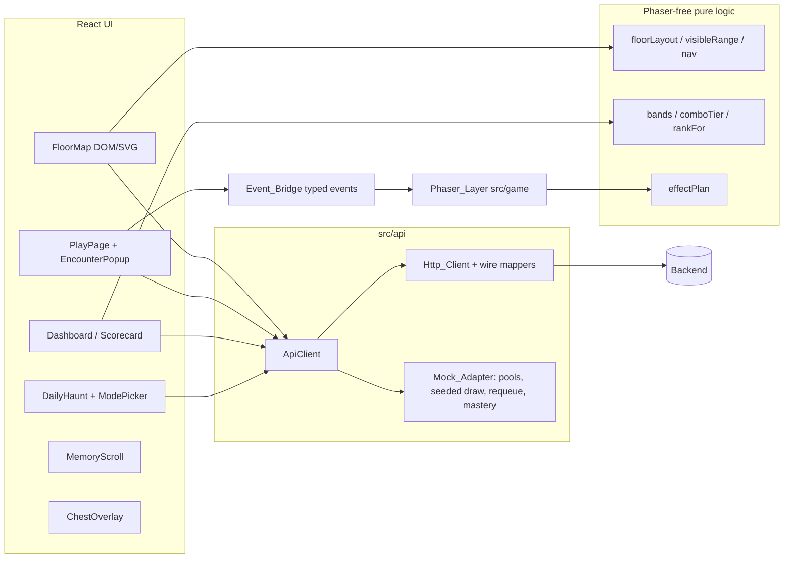
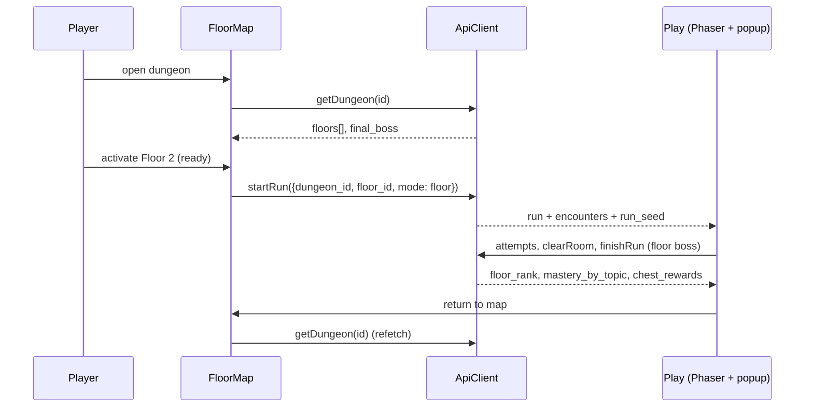

# Design Document: frontend-08-campaign-learning-loop

## Overview

A fixed five-room dungeon cannot help a student memorize large notes. This design turns the finished client into a campaign (Floors that grow with the notes), a short Daily Haunt review loop, and visible progress numbers. It is delivered on branch `feature/frontend-campaign` in Phase 0 (this document set) and Phases 1 to 6. Each phase is sized for one sub-agent and ends with a STOP checkpoint.

Core ideas:

1. The Backend decides every outcome. The UI renders what an `ApiClient` returns. The Http_Client now has a wire layer (zod wire schemas plus pure Wire_Mappers) so the real Backend shapes map to a stable Domain_Model. UI code never sees raw wire shapes.
2. The Mock_Adapter plays the planned Backend: question pools, seeded draws, requeue, mastery, ranks, Daily Haunt, generation status. Everything it invents is PROPOSED in `docs/handoff/B-to-A.md` and marked pending.
3. The floor map is DOM and SVG with windowed rendering. Phaser stays the room and encounter renderer and learns only display events.
4. Pure logic (seeded draw, requeue, mastery, rank, combo tier, band, layout, virtualization, nav, Daily Haunt selection, effect plans) lives in Phaser-free modules and is property tested with fast-check (100+ runs).
5. The product never claims guaranteed memorization. Copy shows measured numbers only.

Sources used (read before writing): `.kiro/steering/api-contract.md`, `game-design.md`, `docs/handoff/A-to-B.md`, `docs/openapi.json`, `docs/handoff/demo_dungeon.sample.json`, `backend/app/schemas/*.py`, `backend/app/api/{runs,progress,dungeons,auth}.py`, `docs/handoff/B-to-A.md`, `frontend/src/types/api.ts`, `src/api/schemas.ts`, `src/api/ApiClient.ts`, `src/game/events.ts`, `src/pages/usePlaySession.ts`, and the frontend-07 spec.

## Build order

The user approved this order. It is repeated at the top of tasks.md.

1. frontend-08 Phase 0 (this: reconcile and plan)
2. frontend-08 P1: floors data model and reconciliation fixes
3. frontend-08 P2: floor map and campaign flow
4. frontend-07 P5: scorecard, leaderboard, dashboard, built on floors and mastery
5. frontend-07 P6: auth, the "Waking up the dungeon..." loader, offline demo with floors
6. frontend-08 P3: Daily Haunt and modes
7. frontend-08 P4: learning loop
8. frontend-08 P5: game feel and ranks
9. frontend-07 P7: badges, lore, share card (merge the intro story with the frontend-08 tutorial into one first-run flow)
10. frontend-08 P6: tutorial, polish, a11y and responsive, README, log, licences
11. Optional: frontend-07 P8 upload wizard, reusing the floor-generation status UI
12. Optional: equip a weapon from the Armory (needs the PROPOSED equipped-weapon field)

Dependencies that follow from the order:

- frontend-07 P5 (Scorecard, Dashboard) consumes `floor_rank`, `mastery_by_topic`, `Floor` and `Mastery_Band` from frontend-08 P1 and P2. It does not redefine them.
- frontend-07 P6 offline demo must serve 2 floors plus the Final_Boss from `demo_dungeon.sample.json` (see D13).
- frontend-08 P3 adds the Dashboard Daily Haunt button to the Dashboard built in frontend-07 P5.
- frontend-07 P7 badges consume `badges_earned` and `chest_rewards`; its intro story is merged with the frontend-08 P6 tutorial.

## Open decisions for user confirmation

Reply "approve" to accept every recommended default.

| ID | Decision | Options | Recommended default | Impact if changed |
|----|----------|---------|---------------------|-------------------|
| D1 | Floor map rendering | DOM/SVG, Phaser scene | DOM and SVG with windowed rendering, no new dependency. Nodes are buttons (native focus, labels, tab order), the path is one SVG. | Phaser would need new bridge events, custom focus handling and a second canvas. |
| D2 | Virtualization | None, windowing by scroll offset, react-window | Own windowing in a pure `visibleRange(scrollTop, viewportH, count, pitch, overscan, focusedIndex)`. Fixed pitch 132 px, overscan 3 rows, the focused node is always rendered. Below 12 Floors render all. | A library adds a dependency for a one-column list. No windowing risks jank at 25+ Floors. |
| D3 | Seeded RNG | Math.random, mulberry32 with FNV-1a string hash | mulberry32 seeded from an FNV-1a hash of the run seed string; partial Fisher-Yates shuffle. Mock only. Real mode never draws. | A library dependency, or non-deterministic tests. |
| D4 | Question pool and draw size | Fixed 5, 6 to 8 | The draw size is `6 + (hash(seed) mod 3)` (6, 7 or 8), limited to the pool size. Dev fixtures synthesize pools of 15 to 20 labeled "Sample question". The demo keeps its authored questions (at least 8 per topic) so no new copyrightable content is invented. | Authoring 15+ real demo questions per topic is about 60 questions of content work. |
| D5 | Requeue gap | 1, 3, 5 questions | A missed question returns after 3 further questions (`requeue_after: 3`), or at the end of the draw if fewer remain, at most 2 returns per question. Mock only; real mode uses the Backend value. | A gap of 1 feels like an instant retry, 5 feels too distant in a 6 to 8 question run. |
| D6 | Mastery formula (mock) | Average, EMA | EMA with alpha 0.3: `m' = clamp(round(m + 0.3 * (target - m)), 0, 100)` where target is 100 (correct) or 0 (wrong); the first attempt on a Topic starts from 50. A retry counts the same. Bands: Weak below 50, Learning 50 to 79, Strong 80 and above (matches `game-design.md`). | A plain average reacts too slowly after many attempts. |
| D7 | Rank thresholds (mock) | Accuracy only, accuracy and HP | `first_try_accuracy` (correct answers that were not retries divided by distinct questions): S at 0.90 and above with no retry, A at 0.80 and above, B at 0.60 and above, otherwise C. Pure function `rankFor`. PROPOSED to Person A as a scoring decision. | Including HP penalizes players for monster counter damage that is already tracked. |
| D8 | Combo tiers | 3 tiers, 4 tiers | Streak 0 to 2 none; 3 to 4 Combo; 5 to 7 Hot; 8 to 11 Blazing; 12 and above Legendary. Display only, from `combo` or `streak`. | More tiers make the early game flat. |
| D9 | Daily Haunt length | 5, 8, 10 items | The Backend builds it; the mock returns at most 8 due items (about 5 minutes at 35 s per item). The UI shows whatever count arrives and never trims it. | A longer run reduces the daily habit. |
| D10 | Exam timer default | Off, on | Off by default. When enabled in the picker, choices are 10, 20 or 30 minutes. The countdown is announced politely at 5 minutes and 1 minute only, and does not pulse under Reduced_Motion. On zero the client calls `finishRun`. | A default-on timer hurts accessibility. |
| D11 | Dev route path | `/dev/floors`, `/__dev/floors` | `/dev/floors?floors=1\|3\|10\|25&status=mixed`. Registered only when `import.meta.env.DEV` is true through a lazy import, so production bundles exclude the route and the large fixtures. | A visible production route risks faked floors in a demo. |
| D12 | Seeded demo shape | 5 rooms as is, regroup | See D13. The demo shows exactly 2 Floors plus the Final_Boss in every build. | A larger demo contradicts the "no faked floors" rule. |
| D13 | Demo mapping | Floors from rooms, floors from sample JSON | Mock (existing 5 rooms): Floor 1 "The Entry Crypt" = rooms 1 and 2 (Floor_Boss = room 2 monster), Floor 2 "The Alchemy Wing" = rooms 3 and 4 (Floor_Boss = room 4 monster), Final_Boss = room 5, the existing Exam Warden. Offline_Demo from `demo_dungeon.sample.json` (3 topics plus the boss): Floor 1 = CPU and Storage, Floor 2 = Networking, Final_Boss = The Exam Warden (220 HP). Real mode: whatever `floors[]` the Backend returns, or one legacy Floor "The Crypt" (D17). | A different grouping only changes fixture data. |
| D14 | Tutorial flag key | One key, two keys | `sd.tutorialSeen` (value `"1"`). The merged first-run flow also writes `sd.introSeen` (frontend-07 D22). No tokens or progress in either key. | One merged key would break frontend-07 D22 tests. |
| D15 | Wire layer | Change domain types to the wire, map at the boundary | Map at the boundary. `src/api/wire/*.ts` holds wire zod schemas and pure mappers; the Domain_Model in `src/types/api.ts` stays stable and gains floors. | Changing domain types ripples through 576 tests. |
| D16 | Which doc is the truth | `api-contract.md`, openapi and backend code | `docs/openapi.json`, `backend/app/schemas/*.py` and the A-to-B Day 3 table, because `api-contract.md` Section 3 disagrees with them (see Contract reconciliation, row C1). Ask Person A to refresh `api-contract.md`. | If `api-contract.md` is right, only the wire schemas change. |
| D17 | Backend without floors | Fake floors, one legacy floor | One synthetic Floor "The Crypt" holding all rooms, labeled honestly. No splitting by room count. | Splitting would invent a structure the Backend does not have. |
| D18 | Run request | Dungeon only, with floor and mode | `{dungeon_id, floor_id|null, mode}`. Until Person A supports it, the Http_Client sends `{dungeon_id}` only, and `mode`/`floor_id` apply in the mock. Non-floor modes are hidden in real mode until a capability is detected (see D26). | Hiding behind a flag keeps real mode honest. |
| D19 | Generation polling | Interval, backoff | Poll `GET /documents/{id}/status` (or `floor.status` through `GET /dungeons/{id}`) every 2.5 s, paused while the tab is hidden, stopped at a terminal status, with a cap of 10 minutes then a friendly "taking longer than usual" message and a Retry. Mock generation advances one Floor every 4 s. | Backoff delays the first-floor reveal. |
| D20 | Memory scroll content | Local text, Backend text | Explanation, evidence quote and page come from the attempt response. `correct_answer` is PROPOSED (revealed only after a wrong answer). If absent, the line is hidden. | Revealing it in `GET /dungeons/{id}` would leak answers; Person A already redacts it. |
| D21 | Retry rules (mock) | Full damage, reduced | The mock returns `is_retry: true` and `retry_multiplier: 0.5` and halves damage and XP. These are PROPOSED values needing Person A's decision. The UI shows the numbers it receives. | Full damage makes missing a question free. |
| D22 | Hit-stop and shake | Long, short | Hit-stop 60 ms and shake 140 ms at intensity 0.004 on critical hits and boss-killing blows. Reduced_Motion: none. Boss death: 900 ms sequence, or a 200 ms fade under Reduced_Motion. | Longer hit-stop reads as lag. |
| D23 | Chest rendering | Phaser, DOM | DOM overlay with framer-motion. It lists exactly `chest_rewards`. | Phaser would need reward data across the bridge. |
| D24 | Branch and commits | Single, per phase | Stay on `feature/frontend-campaign`, one commit per phase after approval. | A single commit hides regressions. |
| D25 | Mock persistence | Memory, sessionStorage | Memory only. A reload restarts the mock campaign. (Real progress lives in the Backend.) | sessionStorage helps demos but adds state bugs. |
| D26 | Capability detection | Assume, detect | The Http_Client exposes `capabilities` (floors, modes, daily haunt) derived from the presence of fields in `GET /dungeons/{id}` and a successful `GET /reviews/due`. Missing capability hides the feature with an honest "coming soon" state. | Assuming support would break real mode. |

## Contract reconciliation

Truth order (D16): backend code and `openapi.json`, then A-to-B Day 3 table, then `api-contract.md`. "Fix" means a Frontend change (Phase 1 task 3.1 unless noted). "B" means the Backend side is right and the Frontend adapts; "A-doc" means a documentation conflict on Person A's side; "ask" means a question for Person A.

### Naming and shape mismatches

| ID | Area | Frontend today | Backend (real) | Right side | Frontend fix |
|----|------|----------------|----------------|-----------|--------------|
| C1 | Contract docs | n/a | `api-contract.md` Section 3 uses `selected_option`, `correct`, `source{page,slide,chunk_id}`, `review_status`, `GET /reviews/due` items `{question_id, prompt, due_at}`, and `POST /runs` returning `{run_id, player_hp, ...}`. `openapi.json` and the schemas use different names. | Code and openapi | Build against openapi. Ask Person A to update `api-contract.md` (A-doc). |
| C2 | Dungeon title | `Dungeon.name` | `DungeonDetailView.title` | B | Map `title` to `name`. |
| C3 | Dungeon questions | top-level `questions[]`, `Monster.question_ids` | `rooms[].questions[]` (id, prompt, options, difficulty) | B | Mapper flattens room questions to the domain `questions[]` and fills `question_ids`. |
| C4 | Room fields | `label`, `order`, `monster{id,name,kind,max_hp}` | `room_number`, `topic_name`, `monster_name`, `monster_type`, `monster_hp`, `is_boss` | B | Map `topic_name` to `label`, `room_number` to `order`, build `monster` (id `monster-<room id>`). |
| C5 | Monster kind | `kind` is a visual id (`paper_wraith`...) | `monster_type` is a display name ("Silicon Golem", "The Exam Warden (Boss)") | B | `kindFromMonsterType(name, is_boss)`: keyword match, boss maps to `exam_warden`, unknown to the default look (already supported). |
| C6 | Question type | `type: mcq\|true_false` | Not sent; `difficulty` (easy, medium, hard) | B | Derive `type` from options (`["True","False"]` is `true_false`); keep `difficulty` as optional domain field. |
| C7 | Room HP values | 60 normal, 120 boss | Normal 60 to 100, Elite 120 to 160, Boss 220 to 300 (sample: 80, 90, 85, 220) | B | Never hard-code HP; the UI reads `monster_hp`. Mock demo updated to 80/90/85/85 and Final_Boss 220 in the Exam Warden fixture. |
| C8 | Run start | `Run{id, player_hp, monster_hp, current_room_id}` | `RunDetailResponse{id, dungeon_id, current_hp, current_score, current_streak, xp_earned, status, started_at, rooms[]}` (201) | B | Map `current_hp` to `player_hp`; `current_room_id` = first uncleared room; `monster_hp` = that room's `monster_current_hp`. Keep score and streak for resume. |
| C9 | Attempt request | `{question_id, selected_answer, attempt_id}` | Same plus optional `weapon_name` (default "Rusty Dagger") | Agreed | No change now. Equipped weapon is optional item 12. |
| C10 | Attempt result names | `correct`, `player_hp_remaining`, `score_delta`, `xp_delta`, `streak`, `source{page,chunk_id}`, `review_status` | `is_correct`, `damage_dealt`, `damage_taken`, `is_critical`, `current_hp`, `current_score`, `current_streak`, `monster_hp_remaining`, `explanation`, `evidence_quote` | B | Mapper: `correct = is_correct`; `player_hp_remaining = current_hp`; `streak = current_streak`. `score_delta` = difference from the last known `current_score` (display only, from two Backend values); `xp_delta` is not sent (HUD XP comes from clear and finish). Make `source`, `review_status` optional; Source line shows `evidence_quote` and page when present. |
| C11 | Source page | `source.page` | No page in the attempt response. `GET /documents/{id}/source-preview` returns chunks with `page_number` | B plus PROPOSED | Show `evidence_quote`; request `page` and `chunk_id` in the attempt response (PROPOSED). Optional lookup through `source-preview` for the owner. |
| C12 | Critical hits | Flag only, damage unchanged | Critical multiplies damage by 1.5, hard questions by 1.25 | B | Mock updated: critical damage x1.5 and hard x1.25 so mock matches. Presentation unchanged. |
| C13 | Weapons | Mock unlocks by level; ids snake_case; five weapons all 20 damage | Names "Rusty Dagger", "Arcane Staff", "Hunter Crossbow", "Spectral Hammer", "Flame Sigil"; base damage 20/25/30/35/40; unlocks: 100 XP, clear 2 rooms, level 3, first boss | B | Map names to ids with a lookup. Mock unlock rules and damage replaced by the table. Armory lists `unlocked_weapons`; locked ones show the requirement text. |
| C14 | Progress | `{level, total_xp, xp_to_next, badges?, weapons?, recent_runs?, due_review_count?}` | `{user_id, level, total_xp, unlocked_weapons: string[]}`. Also `GET /progress/scorecard` `{total_score, accuracy, mastery_band, ...}` | B | `xp_to_next` becomes optional; the HUD hides the XP bar fill when absent and shows total XP. Map `unlocked_weapons` to `weapons`. Optional `getScorecardTotals()`. |
| C15 | Run finish | `{score, xp, correct, total, accuracy, ...}` | `{id, score, xp_earned, correct_count, total_attempts, accuracy, mastery_band, status}` | B | Mapper renames `xp_earned`, `correct_count`, `total_attempts`; `mastery_band` (single string for the whole run) is shown as the run band. `topic_mastery`, `weak_concepts` stay absent until PROPOSED. |
| C16 | Finish errors | n/a | 409 `BOSS_NOT_CLEARED` before boss defeat; idempotent on repeat | B | Map the code to a friendly message; allow repeat finish. |
| C17 | Room clear | `{xp_delta}` | `{success, room_id, xp_delta, is_boss}`; 409 `MONSTER_ALIVE`; 25 XP topic, 100 boss; 404 `ROOM_NOT_FOUND` | B | Add optional fields to the schema. |
| C18 | Attempt errors | 404, 409 | 409 `RUN_FINISHED`, 409 `OUT_OF_ORDER_ROOM`, 409 `ROOM_ALREADY_CLEARED`, 400 `UNKNOWN_WEAPON`, 403 `WEAPON_LOCKED`, 404 `QUESTION_NOT_FOUND`, 401 on expired guest | B | Central `describeError` maps each code to a message. 401 triggers a session refresh (frontend-07 P6). |
| C19 | Revenant attempts | Revenant answered through `POST /attempts` after the room monster is defeated, with `damage_dealt: 0` | Attempts on a cleared room return 409 `ROOM_ALREADY_CLEARED` | B | Rejected in effect. Real-mode Revenants become Daily Haunt only (a run of due items, PROPOSED). Room-embedded Revenants stay mock-only and are hidden in real mode (capability, D26). |
| C20 | Due reviews | `GET /reviews/due?dungeon_id=` bare array of `{id, question{...}, room_id, times_missed}` | `GET /reviews/due` (no dungeon filter) bare array of `{question_id, prompt, options, next_review_at, repetition_count}` | B plus PROPOSED | Mapper: `id = question_id`, `question = {id, type derived, prompt, options}`, `times_missed` absent, `room_id` resolved by looking up `question_id` in the loaded dungeon (drop unmatched for room view, keep for Daily Haunt). No filter by dungeon: the global list fits Daily Haunt. The earlier proposal is superseded by the new `{due_count, next_due_at, daily_streak, items}` shape. |
| C21 | Run resume | none | `GET /runs/{id}` returns full state incl. per-room HP and cleared flags | B | Add `ApiClient.getRun(id)` and use it to rehydrate after reload (small, Phase 1). |
| C22 | Auth bodies | PROPOSED `{user: {...}}` wrappers, logout 204 | Register 201 returns bare `UserResponse`; login 200 bare user; logout 200 `{success: true}`; `GET /auth/me` bare user with `expires_at`; `DELETE /auth/me` exists | B | Update frontend-07 P6 auth schemas accordingly (note added in its tasks). |
| C23 | Auth rules | Username 3 to 20, password 10 to 72 with letter and digit | Username 3 to 32, letters/digits/underscore, normalized to lowercase, not starting `guest_` or `system`; password 8 to 128 | B | Client hint rules match the Backend; the Backend remains the validator. |
| C24 | 422 body | `{detail:{code,message}}` assumed | FastAPI validation errors return `detail` as an array of `{loc, msg, type}` | B | `errors.ts` handles array details. |
| C25 | Session cookie | "session cookie" | `studydungeon_session`, HttpOnly, SameSite Lax, Secure false in dev; guest TTL 24 h | B | No code change (cookie is invisible to JS). Keep `credentials: "include"`. Note Secure/HTTPS for production in README. |
| C26 | Base URL and proxy | `VITE_API_BASE_URL` | Runbook uses `VITE_API_BASE=/api` and a Vercel rewrite `/api/:path*` to the backend (Day 1 destination keeps `/api`, Day 3 drops it) | Agreed with ask | Read `VITE_API_BASE ?? VITE_API_BASE_URL`; add `frontend/vercel.json` with the Day 3 rewrite and ask Person A which destination form is final. |
| C27 | Cold start | none | `GET /health` returns `{status: "healthy"}`; Render free tier sleeps | B | Used by frontend-07 P6 "Waking up the dungeon..." loader. |
| C28 | Guest limits | Guests can start any run | Guests may run only the public demo dungeon; 403 `GUEST_FORBIDDEN`; documents blocked for guests | B | Hide upload and non-demo dungeons for guests; map the 403 code. |
| C29 | Uploads | PROPOSED `POST /uploads`, `GET /uploads/{id}` | `POST /documents` (202, multipart), `GET /documents/{id}/status`, `GET /documents` , `POST /documents/{id}/retry`, `GET /documents/{id}/topics`, `POST /documents/{id}/generate-dungeon` (201), `DELETE /documents/{id}` | B | Our upload proposal is superseded; frontend-07 P8 uses the real document endpoints. Status values are processing, accepted, rejected, failed; `chunks_count` (the contract text says `topic_count`). |
| C30 | Leaderboard | PROPOSED `GET /leaderboard` | No endpoint in openapi | Not addressed | Keep PROPOSED, mock only, hide in real mode (D26). |
| C31 | Floors, pools, modes | PROPOSED here | Not present in openapi | Not addressed | PROPOSED in B-to-A "frontend-08 campaign additions". |

### Status of earlier PROPOSED items

| Item | Status from Person A |
|------|----------------------|
| `is_critical` on attempts | Implemented (field exists; also changes damage, see C12). |
| `weapon_id` on attempts | Not implemented as a response field. The request takes `weapon_name` instead. |
| Finish additions (`badges_earned`, `leaderboard_rank`, `weapon_unlocked`, `level_up`, `topic_mastery`, `weak_concepts`) | Not addressed. Only a single `mastery_band` exists. |
| Progress additions (`badges`, `weapons`, `recent_runs`, `due_review_count`) | Not addressed. `unlocked_weapons` (names) exists. |
| Leaderboard | Not addressed. |
| Due reviews, Option 2 `GET /reviews/due` | Implemented in a different shape (C20). Not filterable by dungeon. |
| Revenant answers through `POST /attempts` after the monster is defeated | Rejected in effect (C19). |
| Auth endpoints | Implemented with different bodies (C22). |
| Upload endpoint | Superseded by the document endpoints (C29). |
| Boss phase derived from HP | No backend change needed (unchanged). |
| Boss difficulty, speed bonus | Partly answered by `game-design.md` (boss 12 HP counter-damage, 220 to 300 HP); question mix still open. |

## Current modeling (today)

Frontend (Domain_Model in `src/types/api.ts`):

- Dungeon: `{id, name, rooms[], questions[]}` with five rooms; no floors.
- Room: `{id, label, order, is_boss, monster}`; Monster: `{id, name, max_hp, question_ids, kind}`.
- Question: `{id, type, prompt, options}`; no difficulty, no answer.
- Run: `{id, dungeon_id, player_hp, monster_hp, current_room_id}`; the run reducer (`runReducer`) tracks room progress from `AnswerResult` and `clearRoom`.
- Revenant: `DueReview{id, question, room_id, times_missed?}` shown after the room monster dies, up to 3 per room; `RevenantSystem` and `HauntedCounter` display them.
- Progress: `{level, total_xp, xp_to_next, ...}` plus PROPOSED badges, weapons, recent runs, due count.
- Mastery: only the PROPOSED per-run `topic_mastery[]`. No per-topic persisted mastery.
- Question picking: `questionSelector` cycles the room's `question_ids` (client-side choice). This is replaced in real mode by the Backend's pool (the room's `questions[]` is already the Backend's selection).

Backend (real):

- Dungeon: `DungeonDetailView{id, title, is_public_demo, created_at, rooms[]}`; Room has `room_number`, `topic_name`, `monster_name`, `monster_type`, `monster_hp`, `is_boss`, `questions[]` (answers redacted). One boss, last.
- Run: `GameRun` with HP, score, streak, XP, status (active, completed, defeated); `GET /runs/{id}` returns per-room HP and cleared flags; attempts are idempotent by `attempt_id` and room-order enforced; room clear computed from summed `damage_dealt`.
- Question: id, prompt, options, difficulty; correct option, explanation and quote stay server side and arrive on attempt.
- Revenant (review): `ReviewItem` per user and question with `due_at` and `repetition`; SRS intervals 10 min, 1 day, 3 days, then 7, 14, 30 days; `GET /reviews/due` returns everything due for the user, across dungeons.
- Progress: `UserProgress{level, total_xp, unlocked_weapons}`; scorecard aggregates all attempts into one accuracy and band.
- No floors, no question pool per topic, no run modes, no per-topic mastery, no generation per floor (dungeon generation is one request that returns `status: ready`).

## Architecture



Campaign flow:



## Components and Interfaces

### Module map (paths relative to `frontend/`)

New:

- `src/api/wire/{dungeon,run,attempt,progress,reviews,auth,errors}.ts`: wire zod schemas plus pure mappers; `src/api/wire/wire.property.test.ts`.
- `src/campaign/floorLayout.ts`: `layoutFloors(count, width)`, `visibleRange(...)`, `nextFocus(index, key, count)`, `nextPlayable(floors)`.
- `src/campaign/FloorMap.tsx`, `FloorNode.tsx`, `FogOverlay.tsx`, `FinalBossNode.tsx`, `ContinueButton.tsx`, `useGenerationStatus.ts`.
- `src/campaign/CampaignPage.tsx`: route `/campaign/:dungeonId` (the map is the new home after the landing page).
- `src/campaign/DevFloors.tsx`: route `/dev/floors` (lazy, DEV only).
- `src/learning/{mastery,rank,combo}.ts`: `masteryBand`, `rankFor` (mock), `comboTier`.
- `src/learning/MasteryBar.tsx`, `MemoryScroll.tsx`, `RequeueNotice.tsx`, `ProgressPanel.tsx`, `StreakCalendar.tsx`.
- `src/haunt/{DailyHauntButton,HauntFinale,ModePicker,ExamTimer}.tsx`, `src/haunt/hauntSelection.ts`.
- `src/api/mock/{pool,seededRng,draw,requeue,mockMastery,mockFloors,mockGeneration,mockHaunt}.ts` and fixtures `src/api/mock/fixtures/floors.{1,3,10,25}.ts`.
- `src/game/fx/effectPlan.ts` (pure), `HitStopSystem.ts`, `BossDeathSystem.ts`, `LootBurstSystem.ts`, `ComboAura` additions in existing systems.
- `src/rewards/ChestOverlay.tsx`.
- `src/tutorial/{TutorialFlow,steps}.ts(x)`, `src/tutorial/tutorialFlag.ts`.

Changed:

- `src/types/api.ts`, `src/api/schemas.ts`, `src/api/ApiClient.ts`, `src/api/client.ts` (Http_Client uses the wire layer), `src/api/errors.ts`, `src/api/mock/mockAdapter.ts`, `src/pages/usePlaySession.ts`, `src/state/runReducer.ts`, `src/game/events.ts` (additive events only), `src/App.tsx`.

### Domain_Model additions

```ts
export type FloorStatus = 'locked' | 'ready' | 'generating' | 'failed' | 'cleared'
export type RunMode = 'floor' | 'daily_haunt' | 'weak_topics' | 'exam' | 'replay_floor'
export type FloorRank = 'S' | 'A' | 'B' | 'C'
export type MasteryBand = 'weak' | 'learning' | 'strong'

export interface TopicInfo { id: string; title: string; mastery: number /* 0..100 */ }
export interface FloorBoss { id: string; name: string; hp: number; kind?: string }
export interface Floor {
  id: string; index: number; title: string; status: FloorStatus
  topics: TopicInfo[]; boss: FloorBoss; rank: FloorRank | null
  room_ids: string[]
}
export interface FinalBoss { id: string; name: string; hp: number; unlocked: boolean }
export interface Dungeon {            // extended, backward compatible
  id: string; name: string; rooms: Room[]; questions: Question[]
  floors?: Floor[]; final_boss?: FinalBoss      // absent => legacy single floor (D17)
}
export interface Room { /* existing */ floor_id?: string }
export interface StartRunRequest { dungeon_id: string; floor_id: string | null; mode: RunMode }
export interface Run { /* existing */ mode?: RunMode; run_seed?: string; revenants?: DueReview[] }
export interface AnswerResult { /* existing, all additions optional */
  requeue_after?: number | null; is_retry?: boolean; retry_multiplier?: number
  combo?: number; correct_answer?: string; evidence_quote?: string
}
export interface RunSummary { /* existing, all additions optional */
  floor_rank?: FloorRank; mastery_by_topic?: { topic_id: string; title: string; mastery: number }[]
  chest_rewards?: { id: string; kind: 'xp' | 'coins' | 'weapon' | 'badge'; label: string; amount?: number }[]
}
export interface DueReviewsResponse { due_count: number; next_due_at: string | null; daily_streak: number; items: DueReview[] }
export interface ProgressInfo { /* existing */ notes_conquered_percent?: number
  memory_strength?: { topic_id: string; title: string; strength: number }[]
  streak_calendar?: { date: string; reviewed: boolean }[]
  weak_concepts?: { text: string; page: number | null; source_ref?: string }[]
  equipped_weapon?: WeaponId }
export interface GenerationStatus { dungeon_id: string; floors: { id: string; status: FloorStatus }[] }
```

`ApiClient` additions: `getDungeon` returns floors, `startRun(req: StartRunRequest)`, `getRun(id)`, `getDueReviews()` returning `DueReviewsResponse`, `getGenerationStatus(dungeonId)`, `retryFloor(floorId)`. The previous `getDueReviews(dungeonId)` bare-array method is kept as a deprecated adapter over the new one until the HUD counter is migrated in Phase 3.

### Event_Bridge additions (backward compatible)

- `ToGameEvent`: `{type: 'set-combo'; tier: 0|1|2|3|4}`, `{type: 'play-boss-death'; roomId: string}`, `{type: 'loot-burst'; x?: number; y?: number}`. `load-dungeon` already receives only the chosen Floor's rooms. No existing event or payload changes.
- `FromGameEvent`: `{type: 'boss-death-done'; roomId: string}`.
- The enforcement test (`importBoundary.test.ts`) also forbids `src/campaign`, `src/learning`, `src/haunt`, `src/rewards`, `src/tutorial` imports in `src/game`.

### Floor map

- Layout (pure): row pitch 132 px; node center x = `w/2 + amp * sin(i * 0.9)` with `amp = min(120, w * 0.25)`; total height = `count * pitch + padding`. The SVG path is a smooth curve through node centers, chunked per 5 Floors so only chunks in range are rendered.
- Windowing: `visibleRange` returns `[start, end]` for the scroll position plus overscan; the focused index is always included; a spacer div keeps the scroll height. Below 12 Floors, everything renders. The scroll container uses `overflow-y: auto` with native smooth scrolling; Reduced_Motion uses instant scroll.
- Fog: a CSS gradient and a pre-rendered noise layer over locked nodes (no per-frame canvas work). Decoration moves with CSS transforms only.
- Node content: title, `MasteryBar` ring (SVG circle with stroke-dasharray), boss icon (lucide-react `Skull`), status chip, rank letter when cleared, spinner when generating, Retry button when failed.
- Keyboard: roving tabindex over nodes; ArrowUp/Down (and Left/Right) move by one, Home and End jump, PageUp/PageDown by 5, Enter or Space opens. `nextFocus` is pure. Focus change scrolls the node into view.
- Continue: `nextPlayable(floors)` returns the first `ready` Floor, else the Final_Boss if unlocked, else null (button disabled with an explanation).
- Copy: "Your notes became N floors", "Floor 3 is being summoned...", failure "Floor 3 could not be summoned. Retry", empty "Your notes are not ready yet".

### Mock_Adapter behaviour (planned Backend, PROPOSED)

- `pool.ts`: `Question_Pool` per Topic; dev fixtures synthesize 15 to 20 "Sample question" items; the demo uses its authored questions.
- `draw.ts`: `drawQuestions(pool, runSeed)` returns `size = 6 + (hash(seed) mod 3)` limited to the pool, using mulberry32 and a partial Fisher-Yates shuffle.
- `requeue.ts`: `buildQueue(drawn)` plus `onAnswer(queue, id, correct)`; a miss inserts the question after 3 further items (or at the end), at most 2 returns per question; returns `requeue_after`.
- `mockMastery.ts`: EMA (D6) per Topic stored in the mock session; `masteryBand` for display.
- `rankFor` (D7) and `chest_rewards` (e.g. xp plus a coin amount based on the rank) are computed only in the mock.
- `mockGeneration.ts`: floor status over time (D19), with a dev switch to force a `failed` Floor and Retry.
- `mockHaunt.ts`: builds `DueReviewsResponse` from missed and due questions with a mock clock; the `daily_haunt` run uses `hauntSelection` (only items with `due_at <= now`, capped at 8).
- Real mode: none of these modules is imported (`src/api/index.ts` loads the mock lazily when `VITE_USE_MOCKS=true`), and a test asserts it.

### Learning loop UI

- Requeue: `runReducer` holds `pendingRequeue: {questionId, remaining}`. After each answer, `remaining` decrements; at zero the question is presented again via the existing popup, with a banner "The question returns...". The queue itself is the Backend's (real) or the mock's; the reducer only displays.
- Memory_Scroll: parchment panel (CSS), unroll animation 450 ms (instant under Reduced_Motion), content: correct answer if present, explanation, "From your notes: page X" (or the quote when no page), then a "Retry now" button (focus moves to it) and a "Continue" action. A polite live region announces "Memory scroll: correct answer ...".
- Mastery_Bar: one component with the band label (text plus icon, not color alone).
- Progress panel: notes conquered %, memory strength per Topic, a 12-week streak calendar (grid of buttons with date labels, not color-only), weakest concepts with page references. Each block hides when its field is absent.
- Honest copy rules: "You answered 7 of 10 right on first try", "Memory strength 64 (Learning)". No "you will remember", no guarantee words (a copy lint test scans strings in `src/learning` and `src/haunt` for a banned-phrase list).

### Game feel

- `effectPlan.ts` (pure): `planHit({critical, bossKill, reducedMotion})` returns `{hitStopMs, shakeMs, shakeIntensity, flash, popScale}`. Reduced_Motion returns zeros except a short flash-free pop.
- Phaser applies the plan through a pooled `HitStopSystem` (scene `time.timeScale` freeze for `hitStopMs`) and camera shake. Damage pops reuse the existing pool; knockback is a tween on the monster sprite.
- Boss death: `BossDeathSystem` plays a dissolve of pooled sparks (max 60 particles) then emits `boss-death-done`. Loot burst reuses the pooled spark texture.
- Combo_Meter: React HUD element with five tiers; Phaser gets `set-combo` for an aura intensity (tint only).
- Chest: DOM overlay after the Scorecard continue, items from `chest_rewards`.
- Performance pass: the existing `DebugOverlay` gets a report mode printing fps (average and 1% low over 10 s), active particles and texture memory (from `renderer.textures` or `game.textures` sizes) for the heaviest scenes (boss room, full Revenant room, 25-floor map); results go to the kiro log.

### Tutorial and first-run flow

`TutorialFlow` runs the merged first-run sequence: intro story panels (frontend-07 P7) then the five tutorial steps (move, engage, answer, memory scroll, Daily Haunt), about 30 seconds in total, with Skip on every step. Steps use highlight overlays and the real UI (a scripted mock encounter in tutorial mode). `tutorialFlag.ts` reads and writes `sd.tutorialSeen` and `sd.introSeen` (D14).

## Data Models

See "Domain_Model additions". Wire models (examples) live in `src/api/wire/` and mirror `backend/app/schemas/*.py` and `docs/openapi.json`. The reconciliation table above is the field-level reference.

Sample mapped Floor for the demo (D13):

```json
{ "id": "floor-1", "index": 1, "title": "The Entry Crypt", "status": "ready",
  "topics": [{ "id": "room-1", "title": "Entry Hall", "mastery": 0 }, { "id": "room-2", "title": "Alchemist's Lab", "mastery": 0 }],
  "boss": { "id": "monster-2", "name": "Toxic Slime", "hp": 90 }, "rank": null, "room_ids": ["room-1", "room-2"] }
```

## Correctness Properties

*A property is a characteristic or behavior that should hold true across all valid executions of a system-essentially, a formal statement about what the system should do. Properties serve as the bridge between human-readable specifications and machine-verifiable correctness guarantees.*

### Property 1: Wire mapping produces valid domain values and fails loudly

For any generated Backend-shaped payload for a dungeon, run, attempt, finish, progress, due-review or auth response, mapping it yields a value that passes the Domain_Model schema, and for any payload with a required field removed or mistyped, the Http_Client throws a ContractError naming the endpoint.

**Validates: Requirements 1.2, 1.3, 1.4**

### Property 2: Legacy dungeons become one honest floor

For any Backend dungeon with at least one room and no floors, the mapped Dungeon has exactly one Floor titled "The Crypt" whose `room_ids` equal all room ids in order.

**Validates: Requirements 2.6**

### Property 3: Floor fixtures are valid at every size

For any floor count in {1, 3, 10, 25} and any status assignment, the generated fixture validates against the schema, has unique floor ids, contiguous indexes starting at 1 and a Final_Boss.

**Validates: Requirements 2.5, 2.7**

### Property 4: Seeded draw is deterministic, bounded and repeat-free

For any Question_Pool of 15 to 20 questions and any run seed, `drawQuestions` returns 6 to 8 questions, every one from the pool, with no repeats, and the same seed and pool always return the same ordered result.

**Validates: Requirements 3.2, 3.3, 3.4**

### Property 5: Requeue never loses or duplicates a question

For any drawn list and any sequence of correct and wrong answers, each question is presented exactly one time plus its number of misses (at most 2 returns), the queue empties, and no question is presented that was not drawn.

**Validates: Requirements 3.5, 3.6**

### Property 6: Mastery stays in range

For any starting value from 0 to 100 and any sequence of correct and wrong attempts, every updated Mastery is an integer from 0 to 100, a correct attempt never lowers it and a wrong attempt never raises it.

**Validates: Requirements 3.7**

### Property 7: Mastery bands match their boundaries

For any integer from 0 to 100, `masteryBand` returns Weak below 50, Learning from 50 to 79 and Strong from 80, and the band never decreases as the value increases.

**Validates: Requirements 10.2**

### Property 8: Floor rank is monotone in accuracy

For any two first-try accuracies a1 at most a2 with equal retry counts, `rankFor(a2)` is at least as good as `rankFor(a1)`, and the boundaries 0.90, 0.80 and 0.60 map to S, A and B respectively.

**Validates: Requirements 3.8, 11.3**

### Property 9: Daily Haunt contains only due items and handles empty

For any set of review items, a clock time and a cap, the selection contains only items with `due_at` at or before the time, is ordered by `due_at`, has at most the cap, and an empty or all-future set returns an empty selection with the next due time.

**Validates: Requirements 3.9, 7.5, 7.6**

### Property 10: Generation status only moves forward

For any elapsed-time sequence, a Floor's mock status moves only along generating to ready or failed, and never returns to generating or from a terminal state.

**Validates: Requirements 3.10**

### Property 11: Virtualization covers the viewport and the focused node

For any floor count from 0 to 60, scroll offset, viewport height and focused index, `visibleRange` includes every node intersecting the viewport and the focused node, never exceeds the count, and for counts of 12 or fewer returns all nodes.

**Validates: Requirements 5.8**

### Property 12: Keyboard navigation reaches every node

For any floor count from 1 to 60, repeatedly applying ArrowDown from the first node visits every node exactly once and stops at the last, Home and End reach the first and last, and the index never leaves the range.

**Validates: Requirements 5.9**

### Property 13: Continue picks the first playable floor

For any list of Floors with arbitrary statuses, `nextPlayable` returns the first Floor with status `ready`, or the Final_Boss when none is ready and it is unlocked, or null.

**Validates: Requirements 5.10, 5.6**

### Property 14: Combo tier is monotone with fixed boundaries

For any non-negative integer streak, `comboTier` is non-decreasing in the streak, equals 0 below 3 and increases exactly at 3, 5, 8 and 12.

**Validates: Requirements 11.1, 11.2**

### Property 15: Chest shows exactly the rewards

For any list of `chest_rewards`, the Chest view model contains the same items in the same order, and an empty or missing list yields no Chest.

**Validates: Requirements 11.4, 11.5**

### Property 16: Effect plans respect reduced motion

For any critical and boss-kill flags, `planHit` with Reduced_Motion on returns zero hit-stop and zero shake, and with it off returns hit-stop and shake only for critical hits and boss kills.

**Validates: Requirements 12.1, 12.3**

## Error Handling

- Wire validation failure: `ContractError` with endpoint and field; the UI shows "Something is out of sync with the server" and a Retry, never partial data.
- Backend `detail.code` values map to friendly messages (C16, C18, C28). 401 triggers session refresh. 429 shows the retry delay.
- Floor `failed`: Retry button calls `retryFloor`; the map announces the result in the live region.
- Generation polling timeout (10 min): friendly message and manual Retry.
- Run start rejected: stay on the map with the message.
- Missing optional fields (`floor_rank`, `chest_rewards`, `correct_answer`): hide the related UI block; never invent values.
- Empty states: no floors, nothing due (celebration and next due time), no weak concepts.
- Unknown capability in real mode (D26): features hidden with a "coming soon" note.

## Testing Strategy

Property-based testing applies: the feature has pure logic (draw, requeue, mastery, rank, tiers, layout, virtualization, navigation, selection, mapping) with large input spaces. Use fast-check with at least 100 runs per property, one property test per Correctness Property, tagged `Feature: frontend-08-campaign-learning-loop, Property N: <title>`.

Example and unit tests cover: floor node status rendering, Retry button, fog on locked Floors, Continue button states, campaign flow with the mock (start Floor, boss closes it, map updates), Daily Haunt finale and empty state, mode picker requests, exam timer off by default, Memory_Scroll with and without `correct_answer`, requeue banner, Mastery_Bar labels, Progress panel hiding absent blocks, tutorial flag, dev route gating (DEV true and false), seeded demo has exactly 2 Floors, copy lint for banned phrases, and keyboard-only play.

Boundary tests: Phaser has no `api`, `demo`, `state`, `offline`, `campaign`, `learning`, `haunt`, `rewards`, `tutorial` imports; with `VITE_USE_MOCKS=false` the mock modules are not loaded; the only files that compute rank, mastery or draws are under `src/api/mock`, `src/offline` and pure helpers used by them.

Contract tests: `npm run test:contract` runs the shared suite against the Mock_Adapter now and against the real API when `VITE_API_BASE` is set and mocks are off. New cases: `getDungeon` with floors, `startRun` with mode, `getDueReviews` new shape, `getGenerationStatus`, `finishRun` additions, and the wire mappers against recorded real samples (`docs/handoff/demo_dungeon.sample.json`, `docs/openapi.json` examples).

Every phase runs typecheck, lint, the full suite, `test:contract` and the build and reports real output. Accessibility and performance checks are manual plus the scripted measurements listed in Phase 5 and Phase 6.

## Risks

| ID | Risk | Likelihood | Impact | Mitigation |
|----|------|-----------|--------|-----------|
| R1 | Person A does not build floors, pools or modes in time | High | High | Everything is built on the mock behind capability detection (D26); real mode shows the legacy single Floor. |
| R2 | Wire mapping hides a contract drift | Medium | High | Wire zod schemas, recorded-sample tests, ContractError, contract suite against the real API. |
| R3 | `api-contract.md` is right and openapi is stale | Low | Medium | D16 asks Person A to confirm; only wire schemas change. |
| R4 | 25-floor map janks on an integrated GPU | Medium | Medium | Windowing, CSS transforms only, no per-frame canvas, measured in the performance pass. |
| R5 | Mock pools need content the team cannot author | Medium | Low | Synthetic "Sample question" pools for dev fixtures; the demo keeps authored questions (D4). |
| R6 | Retry and rank rules diverge from Person A's decisions | High | Medium | Marked PROPOSED, shown from response values only, pure functions easy to replace. |
| R7 | Regressions in the 576 existing tests while changing types | Medium | High | Additive optional fields, domain types stable (D15), full suite each phase. |
| R8 | Hit-stop and shake cause discomfort | Low | Medium | Short durations, Reduced_Motion disables them, mute respected. |
| R9 | Misleading copy suggests guaranteed memorization | Low | High | Copy lint test, honest-copy requirement, review at each STOP. |
| R10 | Dev fixtures leak into production | Low | High | DEV-only lazy route, production test of route registration, demo capped at 2 Floors. |
| R11 | Time runs short | High | Medium | Cut list below. |
| R12 | Real revenants cannot be answered through attempts (C19) | High | Medium | Daily Haunt run is PROPOSED; room Revenants hidden in real mode until supported. |

## Cut list

Drop in this order if time runs short, so the core campaign (Phases 1 and 2) plus Daily Haunt (Phase 3) survive:

1. Optional: equip a weapon from the Armory (item 12).
2. Optional: frontend-07 P8 upload wizard (item 11).
3. Phase 6 tutorial animations (keep a static three-card first-run and the flag).
4. Phase 5 boss death sequence and loot burst (keep hit-stop, shake and combo).
5. Phase 5 chest overlay (show rewards on the Scorecard instead).
6. Phase 4 streak calendar and weak concepts block (keep mastery bars and the Memory_Scroll).
7. Phase 3 Exam timer (keep Exam without a timer), then Replay Floor, then Weak Topics.
8. Phase 2 fog polish and path decoration (keep the working map, keyboard navigation and Continue).

Never cut: Phase 1 reconciliation fixes, floors data model, floor map with Continue, Daily Haunt, honest copy and the authority rule.
