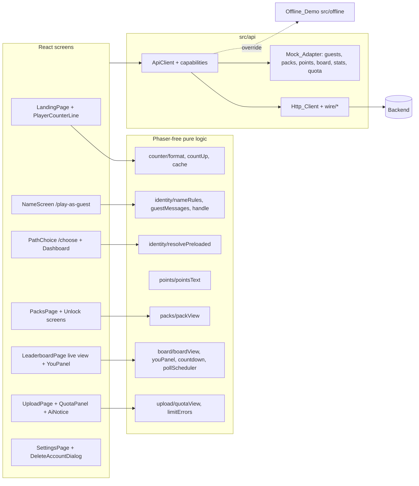
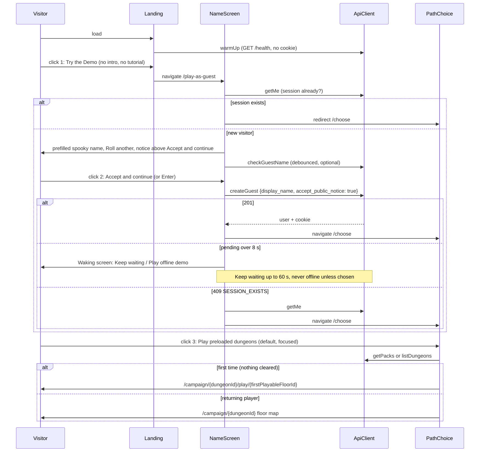
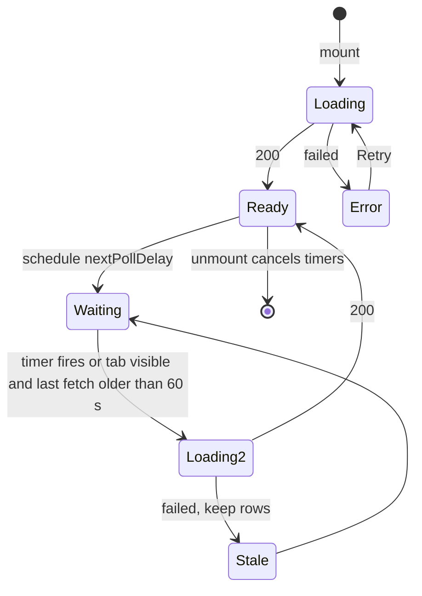

# Design Document: frontend-10-live-players

## Overview

The Backend (backend-07, merged to main) now has real identity: named guests with a 30-day cookie, account upgrade and account deletion. The product decision is to make StudyDungeon a place with real players: a visitor picks a display name, chooses between preloaded dungeons and their own notes, earns Leaderboard points that accumulate across packs, and sees a leaderboard of real players only. This design adds that to the finished client (frontend-00 to frontend-08, the layout pass and the mobile pass) in Phase 0 (this document set) and Phases 1 to 5. Each phase ends with a STOP checkpoint, and each phase is committed separately after approval on branch `feature/frontend-live-players`.

Core ideas:

1. The Backend decides every number: points, ranks, points to the next rank, pack status, quota, player count. The UI renders what an `ApiClient` returns. Local computation exists only in the Mock_Adapter and the labeled Offline_Demo (D2).
2. Features split into REAL now (guest name check, guest create, upgrade, delete account, `GET /dungeons`) and PROPOSED (packs, points fields, new leaderboard, player counter, upload quota, guest upload). PROPOSED endpoints are built against the mock, validated with zod when real, and protected by a Capability that is proven by the first call (D2).
3. Pure logic (name hints, handle display, pack view, You panel, countdown, poll scheduling, counter formatting, quota view, limit messages) lives in Phaser-free modules and is property tested with fast-check (100+ runs).
4. New screens use the existing `PageShell` fit variant on desktop and release to natural scrolling on small touch screens (D26). The mobile work (`src/touch`, `styles/touch.css`, PauseButton, `html[data-touch]`) is not modified.
5. Copy says "points" for the leaderboard value and "Dungeon score" for the run value (D15).

Sources read before writing: `docs/handoff/FRONTEND_STATE_AND_CHANGES.md` (Sections 6, 9 and 10), `docs/handoff/BACKEND_REQUIREMENTS_V2.md` (A to E, G, I and the open questions), `docs/handoff/B-to-A.md`, `docs/handoff/A-to-B.md`, the frontend-07 and frontend-08 specs, `.kiro/specs/backend-07-prerequisites-and-identity/*`, `backend/app/api/auth.py`, `backend/app/schemas/auth.py`, `backend/app/core/identity.py`, `backend/app/core/deps.py` (partly), `backend/app/api/dungeons.py` (list route), and these frontend files: `api/ApiClient.ts`, `api/client.ts`, `api/index.ts`, `api/wire/auth.ts`, `api/mock/mockLeaderboard.ts`, `state/SessionContext.tsx`, `state/useStartDemo.ts`, `pages/LandingPage.tsx`, `dashboard/CampaignCards.tsx`, `leaderboard/{LeaderboardPage,useLeaderboard,view}.ts(x)`, `upload/{UploadPage,limits}.ts(x)`, `contract/{suite,http.contract.test}.ts`, `touch/useTouchMode.ts`, `components/PageShell.tsx`, `App.tsx`. Files I did not open (the mock adapter internals, `offline/*`, `campaign/*`, `scorecard/*`, `encounter/*`, `Hud.tsx` props) are named in tasks as "locate first" steps.

## Build order

1. frontend-10 Phase 0 (this: plan, documents only)
2. Phase 1: guest entry and path choice (name screen, choice screen, session display, upgrade, delete account, warm-up)
3. Phase 2: preloaded packs (pack page, unlock screens, points display, score/points labels)
4. Phase 3: leaderboard with real players (tabs, You panel, freshness)
5. Phase 4: player counter
6. Phase 5: upload path for guests (quota, notice, limit errors, per-floor progress)

Dependencies: Phase 2 needs the resolver and the choice screen from Phase 1. Phase 3 needs the points types from Phase 2 and the Handle display from Phase 1. Phase 5 needs the fallback CTA target (the Phase 1 resolver). Phase 4 is independent after Phase 1 and can move earlier if time is short.

## Design decisions

| ID | Decision | Choice | Rationale |
|----|----------|--------|-----------|
| D1 | Branch and commits | Stay on `feature/frontend-live-players`; one commit per phase after approval; no push by the agent. | Matches D24 of frontend-08. |
| D2 | Capability model | Extend `ApiCapabilities` with optional fields typed `CapabilityState = boolean \| 'unproven'`. REAL-now features (`guestIdentity`, `accountUpgrade`, `accountDelete`) start `true` in `HTTP_CAPABILITIES` and flip to `false` on 404, 405 or 501. PROPOSED features (`packs`, `liveBoard`, `playerCounter`, `uploadQuota`, `guestUpload`) start `'unproven'`: the first call of the feature is the probe; a 2xx that passes the wire schema sets `true`; 404, 405 or 501 sets `false`; any other error leaves the state unchanged. The mock reports everything on (absent fields mean on, like `uploads?`), the offline module reports all of them `false`. State lives in memory for the page session. | Reuses the frontend-08 D26 pattern. The existing real client starts with all PROPOSED features off and never calls them, so a third state is needed or the first call would never happen. Self-healing for REAL-now features covers a Backend that is rolled back. |
| D3 | `GET /meta` | Not consumed in this feature. Recommended to Person A (V2 open question 13) in B-to-A.md. The probe in D2 works without it. | A capability endpoint is cheaper than probing, but it does not exist and the brief forbids inventing live endpoints. |
| D4 | Name screen (amended 2026-11-11) | Route `/play-as-guest` (page, not a modal). `LandingPage.tryDemo` navigates straight to `/play-as-guest`; the intro story and the tutorial are no longer a step before it (D34) and `useStartDemo.start()` is not called. The page: (a) on mount, if `SessionContext` has a user or `getMe()` returns one, `navigate('/choose', {replace: true})`; (b) otherwise shows the form. The Display_Name field is PREFILLED with `randomSpookyName()` (D32); a "Roll another" button replaces it with a different name (never equal to the current value); the player can still edit it. There is NO confirmation checkbox. The notice "Your name and points appear on the public leaderboard." sits directly above the primary button, labelled "Accept and continue". Activating that button or pressing Enter in the field is the acceptance and sends `accept_public_notice: true` exactly once. Submit calls `createGuest`. `useCreateGuest` owns the waking flow of D33. `useStartDemo` stays for the fallback (D5) and for the Dashboard's Play Demo. | A page is deep-linkable, works with browser back, and fits the PageShell. A prefilled name, Enter-to-submit and no checkbox keep the title-screen-to-fight path at three clicks (D35). The checkbox was removed because it would be a fourth click; the notice shown right above the button that says "Accept" is the explicit acceptance (see "Phase 0 review changes"). |
| D5 | Fallbacks of the name screen | `guestIdentity` false (name-check or create answered 404, 405 or 501): the screen says names are not available yet and the button starts `useStartDemo.start()` (POST /demo/session, opens `/campaign/{dungeon_id}`), so real mode keeps working against an older Backend; this legacy call uses the same waking flow as D33 (two choices at 8 s, `WAKE_MAX_MS`, no automatic offline). 409 `SESSION_EXISTS`: call `getMe()`; if a user comes back, `setUser` and go to `/choose`; if `getMe()` returns null, show a generic "Try again" error. 503 `GUEST_CREATION_PAUSED`: message plus the Offline_Demo button. Offline_Demo: starts only when the player chooses it; it skips the name and uses a local label "Explorer (offline)". | Each real error code has a defined user path. No real session ever falls back to offline silently. |
| D6 | Name check cadence | Local rules first (D8). A server check runs only when the local rules pass, the value has been stable for 500 ms, and it differs from the last value checked. At most one check in flight. A 429 or any error from the check turns live checks off for the page; submit remains the authority. The server rate limit is 30 per minute per IP, and schools share IPs. | Protects the shared-IP budget and never blocks the player on a decoration. |
| D7 | Choice screen (amended 2026-11-11) | Route `/choose` (`RequireSession`). Component `PathChoice` with two large cards; the same component renders on the Dashboard as a compact variant for registered users and guests. The preloaded card is visually highlighted as the default (modifier class, "Recommended" tag) and receives initial focus on mount (`autoFocus`/ref), so Enter activates it. Preloaded card: `resolvePreloadedDungeon()` then, for a first-time player, `navigate('/campaign/{id}/play/{firstPlayableFloorId}')` (D31), otherwise `navigate('/campaign/{id}')` (floor map); legacy single-floor Backends use the existing floor-1 route mapping. Upload card: `navigate('/upload')` with the quota line when `uploadQuota` is not off. | One component, two places. The default card and the direct run support the 3-click path (D35). |
| D8 | Client name rules | `checkLocalName(raw)` mirrors `validate_display_name` in `backend/app/core/identity.py`: trim, NFKC, length 3 to 16, first and last character ASCII letter or digit, characters from `[A-Za-z0-9 _-]`, no double space. It returns the first broken rule and a message. It never checks reserved or profane words (the list stays on the server, A-R2); the server's `not_allowed` message is shown instead. | Hints only; the Backend decides. |
| D9 | Resolving the preloaded dungeon | `resolvePreloadedDungeon(api)` order: (1) `getPacks()` when `packs` is not off: `next_pack_id` pack, else the first `available` or `in_progress` pack, else (all completed) the pack with order 1; (2) `listDungeons()` (`GET /dungeons`, session required): the public demo (`is_public_demo` true) with the oldest `created_at`; (3) only when no session exists and `guestIdentity` is off: `POST /demo/session`. If none works: error with Retry and the Offline_Demo offer. The pure part is `pickPreloaded(packs, dungeons)`. The result also carries what D31 needs (`isFirstTime`, `firstPlayableFloorId`) so the choice screen can open the first floor run directly. | `POST /guests` returns no `dungeon_id` (unlike `POST /demo/session`), so the dungeon must be resolved. `POST /demo/session` creates a new anonymous guest and overwrites the cookie, so it must never run while a named session exists. |
| D10 | Identity display | `displayHandle(user)` returns `handle`, else `display_name#tag`, else `display_name`, else `username` for a registered user, else `"Guest"`. A Guest's `username` is never used. The real `username` of a guest is an internal `guest_xxxxxxxx` string. The wire user schema accepts a null `username`; the domain `User.username` stays `string` (`''` for null). A boundary test scans `src/**/*.tsx` for `.username` and allows it only in a short list of files (auth forms, settings account line, `identity/handle.ts`). The leaderboard page today uses `user?.username` for the provisional row; it changes to `displayHandle`. | Requirement 3.4. V2 A-R8 forbids showing login names publicly. |
| D11 | Upgrade | `RegisterPage` reads the session: when the user is a Guest and `accountUpgrade` is not off it shows "Create an account to keep your name and points" and calls `upgradeGuest` (`POST /auth/upgrade`); otherwise it behaves as today. `GuestBanner`, the Dashboard guest card and the Scorecard link to `/register?upgrade=1` only when `accountUpgrade` is not false. `upgrade` 404, 405 or 501 sets the flag false and the offers disappear. After success: `setUser(response)`, navigate to `/dashboard`. | Real now (Req 4). Keeps the same id, public id and handle (verified in `auth.py`). |
| D12 | Delete my account | Route `/settings` (`RequireSession`) replaces the placeholder in `LinksCard` (the card links to `/settings`). `DeleteAccountDialog` lists what goes, requires typing `DELETE`, sends `DELETE /auth/me` with `{"confirm":"DELETE"}`. On success: `clearSession()`, clear caches (counter, packs, board, quota via `resetClientCaches()`), `navigate('/')`. Errors: 403 `SYSTEM_USER_PROTECTED`, 422 `CONFIRMATION_REQUIRED` show the message; 401 behaves as success without the server call result. The Http client's `request` helper gains the `DELETE` method. Available to guests. | Real now; privacy; A11. |
| D13 | Warm-up | `warmUp()` in `src/identity/warmUp.ts`: a module-level flag; calls `fetch(base + '/health', {credentials: 'omit', method: 'GET'})` inside `try`, ignores result. It lives on the Http client as `api.warmUp?.()` so the mock and offline adapters simply do not define it. Called from a `useEffect` in `LandingPage` and in `NameScreen` (the flag makes the second call a no-op). | Requirement 7. Keeps the "mock sends nothing" rule structural. |
| D14 | Pack data model and mock | Types `Pack`, `PacksResponse`, `PackProgress` in `types/api.ts` (shapes from V2 B.2). Mock: three packs. Pack 1 is the existing demo dungeon (`DEMO_DUNGEON_ID`, 2 floors plus the Exam Warden). Packs 2 and 3 reuse the generated-dungeon context builder added in the mobile pass ("Sample question" content with a private key) and are titled "Sample Pack 2" and "Sample Pack 3" with `sample: true`; the UI shows a small "Sample content" chip when `sample` is true. Packs 2 and 3 keep the "Sample content" label in mock mode on the pack page, the floor map and the unlock screen (explicit acceptance criterion: Requirement 8.10). No invented study claims are written. | The mobile pass already generates playable mock dungeons, so no new content is authored (risk R5 of frontend-08). |
| D15 | Points and labels | Optional fields on `AnswerResult` (`points_awarded`, `points_reason`, `points_bonus`, `player_points`), `ClearRoomResponse` (`points_awarded`, `points_reason`) and `RunSummary` (`points_earned`, `player_points`, `pack_progress`). Wire schemas accept them as optional. A pure `pointsText(awarded, reason)` returns text such as "+10 points, already answered this week" or null (hide). Labels: "Dungeon score" everywhere the run score is shown; "Leaderboard points" for `points_*`. Tests that assert the old "Score" word are updated and the changes recorded in the kiro log. The mock computes points with a simplified V2 C.2 table (first correct 100 or 150 once per question and week, repeat 10, retry half, practice half, room 50, boss 200, pack 500) in `mockPoints.ts`, marked PROPOSED. | 9.7 and 9.9 of the state doc. The mock rules are only a stand-in; Person A decides the real values. |
| D16 | Leaderboard API shape | New `ApiClient.getBoard(query: {board, period})` returning `BoardResponse` (V2 D.3). The legacy `getLeaderboard` (per dungeon, with Ghost Rivals) stays for the Offline_Demo and its tests. `LeaderboardPage` chooses the live view when `liveBoard` is not off, otherwise the legacy view when `leaderboard` is not false, otherwise "coming soon". The Mock_Adapter implements `getBoard` from its own run history plus the seeded Ghost Rivals, marking each rival with `is_seeded_rival: true`. The real wire mapper has no such field and drops unknown keys. | Additive; no existing leaderboard test needs to change. |
| D17 | Tie-break display | The UI never sorts or re-ranks the real board. It shows entries in the order received with the `rank` received. The info line says: "Ties go to whoever reached the total first." (V2 D-R6). | Requirement 11.5; the Backend gives unique ranks. |
| D18 | Refresh policy | Constants: `MIN_BOARD_INTERVAL_MS = 60_000`, `REFETCH_JITTER_MS = 2_000` (random, 0 to 2 s after `next_refresh_at`, to avoid a thundering herd). Pure `nextPollDelay({now, nextRefreshAt, lastFetchAt, visible, retryAfterUntil})` returns `null` when hidden, otherwise the delay until the later of `next_refresh_at`, `lastFetchAt + 60 s` and `retryAfterUntil`, never negative. One timer, no `setInterval`. The `me` block is part of the same response, so the You panel refreshes with the board; on `visibilitychange` to visible the hook refetches if the last fetch is older than 60 s. A user Retry after a first-load error is allowed immediately. No websockets. The old 30 s interval is not used for the live view. | The Backend snapshot refreshes hourly and the live `me` costs one count query; 60 s keeps the You panel fresh without waste (brief: poll only as often as the API allows). |
| D19 | Countdown and reset display | `formatCountdown(targetMs, nowMs)` returns `h:mm:ss` or `m:ss`, `0:00` at or after the target. A 1 s local `setInterval` runs only while the page is mounted and visible. The weekly reset is shown as `Resets Monday 00:00 UTC` built from `week.resets_at` and `week.timezone` with `Intl.DateTimeFormat({timeZone})`, plus the viewer's local time in brackets. An invalid IANA zone falls back to UTC. | Requirement 11.4 and 13. |
| D20 | States | Skeletons reuse the `sd-skel` styles of the current leaderboard. Empty: "Be the first to enter" with a Play button to `/choose`. Error: `role="alert"` with Retry. Stale: the existing "Could not refresh" line. | Reuse. |
| D21 | Player counter | `src/counter`: `formatExplorerLine(n)` (null unless an integer of 1 or more; "Be among the first explorers" with no number for 1 to 9; "N explorers have braved the dungeon" for 10 or more with `Intl.NumberFormat('en-US')`), `explorerCountText(n)` (pure helper for any secondary text: "1 explorer" for 1, "N explorers" otherwise; 10 or more is always plural in the title line, so the singular case only appears in secondary text), `countUpValue(t, duration, target, reduced)`, `shouldRefetch(fetchedAt, now, ttlMs)`, `fetchPlayerCount(api)` with a module-level cache (default TTL 300 s or `cache_seconds`; failure is not cached; one in-flight request). `PlayerCounterLine` renders nothing on null, animates with `requestAnimationFrame` over 800 ms unless Reduced_Motion, and keeps the final number in an `sr-only` span so assistive technology reads it once (the animated span is `aria-hidden`). The mock returns `VITE_MOCK_PLAYER_COUNT` when set, else 0, so a mock deployment never shows an invented number; the offline module has no counter. | Requirement 14. "Never invent or inflate." |
| D22 | Guest upload | `UploadPage` gate becomes: no session, redirect prompt; session and (registered or `guestUpload` not off): call `getUploadQuota()`; quota 2xx for a Guest proves `guestUpload`. The page shows `QuotaPanel` from the pure `quotaView(quota)`: allowed (with remaining `limit_today - used_today`, never negative), or blocked with a message per reason (`player_daily_limit`, `ip_daily_limit`, `stored_limit`, `global_daily_limit`, `ai_unavailable`). When blocked, the drop zone is disabled and the button "Play preloaded dungeons instead" runs the resolver (D9). If the quota request fails for a Guest, the page falls back to the existing gate text. | Requirement 15. Real today: POST /documents answers 403 GUEST_FORBIDDEN, which flips `guestUpload` off. |
| D23 | AI notice and limits | `AiNotice` component with the draft text from state doc 9.6 and a checkbox; the drop zone stays disabled until ticked. `uploadDocument(file, {acceptAiNotice})` appends `accept_ai_notice=true` to the multipart body. `ApiError` keeps the full `detail` extras (`limit`, `found`, `reason`, `retry_after_seconds`, `offer_packs`) in `error.extra.detail`. A pure `describeLimitError(code, extra)` produces "This PDF has 42 pages; the limit is 30." (same for slides and characters). ALL upload limits live in ONE constants module, the existing `src/upload/limits.ts`, extended: accepted formats, `MAX_FILE_MB = 15`, `MAX_PDF_PAGES = 30`, `MAX_SLIDES = 30`, `MAX_DOCX_CHARS = 60_000`, `MIN_TEXT_CHARS = 500` and the stored document limits (as hints only, the Backend quota wins). The module carries a `TODO` comment to read the values from the server later (for example from `GET /uploads/quota` or a future `GET /meta`). A pure `rulesText(limits = UPLOAD_LIMITS)` builds the sentence "Accepted formats: PDF, DOCX, PPTX, TXT, PNG, JPEG. Up to 15 MB. PDF up to 30 pages, PPTX up to 30 slides, DOCX up to 60,000 characters, at least 500 characters of text." from the constants, and every UI string about the rules (wizard, drop zone, error hints, `describeLimitError`) is built from the same constants; a test fails when a literal limit number appears in `src/upload/*.tsx`. The 60,000 DOCX character limit is UNCONFIRMED (Person A's default B20, not agreed): B-to-A asks Person A to confirm or send the real value. The copy lint test bans retention and training promises in `src/upload`. | 9.6 and G-R9 to G-R11. The DOCX number is Person A's default (assumption B20). |
| D24 | Per-floor progress | The wizard's summon step reuses the frontend-08 generation status UI (`useGenerationStatus`, `FloorStatus` chips) and lists one row per floor from `floors[]` of the document status or `GET /dungeons/{id}`. Without `floors[]` it shows the single existing status line. | Reuse; the mobile pass already made generated dungeons playable in the mock. |
| D25 | Mock persistence | Memory only (frontend-08 D25). A reload in mock mode forgets the guest. "Guest identity survives refresh" is verified with the real Backend (cookie plus `getMe`) and by a SessionContext test with a fake `getMe`. | Keeps mock state simple. |
| D26 | Layout | New screens use `PageShell variant="fit"` plus a class `sd-live` defined in new `styles/live.css`. Under `html[data-touch]` and `(max-width: 640px), (max-height: 520px)` the rule `.sd-page--fit.sd-live` releases the fixed height (`height: auto; min-height: 100dvh; overflow-y: auto`), so phones scroll naturally. Buttons use the existing `sd-cta` and `sd-ghost-btn` classes, which already get 44 px targets from `touch.css`. No edit to `touch.css`, `src/touch/*` or `PauseButton`. Checks at 360x740, 768x1024, 1366x650 and 1920x1080. | Requirement 17. |
| D27 | New modules vs Phaser | New directories `src/identity`, `src/packs`, `src/points`, `src/board`, `src/counter` are added to the forbidden import list of `importBoundary.test.ts`. | Requirement 18.2. |
| D28 | Offline_Demo | Unchanged visually. Capabilities for the new features are `false`, so no name screen is shown after choosing it, no counter, no packs, no live board (the legacy board with rivals stays), no upload. | The offline module is a labeled fallback, not a place for real players. |
| D29 | Real board and rivals | The boundary test from frontend-07/08 is extended: no file outside `src/api/mock`, `src/offline` and the legacy `leaderboard/view.ts` may contain the string "Ghost Rival" or read `is_seeded_rival`, and the live board view receives entries without that field in real mode (wire mapper drops it). | Requirement 11.7, 18.7. |
| D30 | Backend facts that change the plan | See "Contradictions and findings". Highlights: names are not unique (no "taken" error); registered users get `handle = username` until A-R10; `last_active_at` is never updated (no sliding renewal); the moderation list matches substrings and refuses ordinary names. | Honest scope. |
| D31 | First-time player and direct floor run | A player is "first time" when the data returned by the Backend for the resolved preloaded dungeon shows nothing cleared: from `GET /packs` the pack has `status === 'available'`, `floors_cleared === 0` and `points_earned === 0`; from `GET /dungeons` only, the dungeon detail (`GET /dungeons/{id}`) or `GET /progress` shows no cleared room. If the data is missing, ambiguous or the request fails, the player is treated as returning and gets the floor map. Never decided from localStorage or sessionStorage (no progress is stored client side). `firstPlayableFloorId` is the first floor whose status is playable in the dungeon data (single-floor legacy: the existing floor-1 route mapping). The pure `isFirstTime(packOrDungeonProgress)` and `firstPlayableFloorId(dungeon)` live in `identity/resolvePreloaded.ts`. The exact field names are located in Phase 1 (campaign and progress types were not opened in Phase 0). | The Backend is the only source of progress, and a wrong guess only costs one extra click (the floor map), never a lost run. |
| D32 | Spooky names | Pure module `src/identity/spookyNames.ts`: two frozen lists (about 24 adjectives such as Hollow, Velvet, Pale, Ashen, Gloomy; about 24 creatures such as Raven, Wraith, Ghoul, Moth, Lantern) joined by one space; every combination is at most 16 characters (list entries are at most 7 letters, enforced by a test), ASCII letters only, and contains no reserved or profane substring (the mock reserved list, the substring rule of X6 and a short local blocklist are checked by a test over all combinations, because the Backend matches substrings). `randomSpookyName(rng = Math.random, exclude?)` returns a name different from `exclude`. `rollAnother(current)` calls it with `exclude = current`. The prefilled name is not checked with the server until the 500 ms rule of D6 fires or the player submits. | Zero network, deterministic tests with an injected RNG, and a property test over the whole name space. |
| D33 | Waking screen | `useCreateGuest` (and `useStartDemo` for the legacy call) start a timer when the request begins. At `OFFLINE_OFFER_MS` (8 s) the Waking_Screen shows two choices: "Keep waiting" and "Play offline demo". "Keep waiting" leaves the request pending and keeps the rotating tips until `WAKE_MAX_MS = 60_000` since the request started; then a friendly error with Retry and "Play offline demo" is shown (Retry sends a new request). The request is never aborted by the timer. If it succeeds while the choices or the error are shown and the player has not chosen offline, the flow continues normally to `/choose`. The Offline_Demo is loaded by dynamic import only on the player's choice; no timeout, error, 503 or capability change starts it. Constants `OFFLINE_OFFER_MS` and `WAKE_MAX_MS` live in one module (`identity/wakeConstants.ts`). A late success after the player chose offline is ignored. | A cold free-tier server can take up to a minute. A silent offline switch would hide a real player from the leaderboard and lose their points without their knowledge. |
| D34 | Tutorial is non-blocking | `LandingPage` no longer opens the intro story or the tutorial on the first visit and `tryDemo` has no first-run step. The "How to play · 30 sec" pill opens the full tutorial, which can be closed or skipped with one action (Skip button and Escape) and never delays the Name_Screen. The first room of a run shows the existing `ControlsHint` / `ControlsLegend` inline (touch legend in Touch_Mode) as the in-room tutorial. The flags `sd.introSeen` and `sd.tutorialSeen` stay UI-only (they may style the pill but gate nothing). | Removes two forced steps before the first fight (D35). |
| D35 | Three-click first fight (never cut) | Title screen: click 1 "Try the Demo"; Name_Screen: click 2 "Accept and continue" (prefilled name, Enter works too); Path_Choice: click 3 the preloaded card (highlighted, focused). The card opens `/campaign/{id}/play/{firstPlayableFloorId}` (D31) and the run starts with the first monster engageable by the E key or the Engage touch button and no other click. Measured by an example test that counts clicks in mock mode (task 3.14) and checked by hand in real mode. | The player reaches the first fight fast without reading anything. |

## Contradictions and findings

| ID | Finding | Resolution |
|----|---------|------------|
| X1 | The brief asks for "taken/filter" name errors. Names are not unique (V2 A-R3; `create_guest` adds a random tag). The only refusals are `too_short`, `too_long`, `characters`, `not_allowed`. | The name screen maps those four reasons. "Taken" does not exist. `not_allowed` covers filter and reserved names. |
| X2 | `POST /guests` returns no `dungeon_id`; `POST /demo/session` does. | D9 resolver. Asked in B-to-A: add `dungeon_id` (or `GET /packs`). |
| X3 | V2 A.3 shows `username: null` for guests. The real Backend returns an internal `guest_xxxxxxxx`. | The UI never shows it (D10). Asked: return null for guests. |
| X4 | V2 A-R10 gives registered users a display name and tag. Real `register` creates none, so `GET /auth/me` returns `handle = username` for them (`auth.py`, `get_me`). A leaderboard that shows `handle` would publish login names (V2 A-R8). | B-to-A asks Person A to build A-R10 before the live board ships. The UI shows what `handle` contains and cannot detect the problem. |
| X5 | V2 A-R4 promises sliding renewal and purge after 30 days of inactivity. In `core/deps.py` I found no write to `last_active_at` (searched for the field); `create_guest` sets it once, and the lazy purge deletes guests with `last_active_at` older than 30 days, so an active guest could be purged 30 days after creation. I did not read the whole file. | B-to-A question. The UI cannot fix it. |
| X6 | `identity.py` matches reserved words and profanity as substrings of the normalized name, so ordinary names such as "Nomad", "Groot", "Modest" or "Dickens" return `not_allowed`. | The `not_allowed` message must be friendly ("That name is not available. Try another."). B-to-A suggests whole-word matching for short reserved words. |
| X7 | `POST /auth/login` still sets `secure=False` (P6 asked for `COOKIE_SECURE`). `register` sets no cookie. | Note only; not a frontend change. |
| X8 | The brief's counter text is "N explorers have braved the dungeon"; the state doc 9.5 says "adventurers ... the crypt". | The brief wins. |
| X9 | The brief says "file rules text exactly as in the contract". No single contract text exists: `limits.ts` says 30 pages for everything, V2 G-R11 splits pages, slides and characters, and the DOCX number is only a default. | D23 proposes the text; Person A confirms (question in B-to-A). |
| X10 | The state doc says the mobile pass was uncommitted. `git status` on this branch is clean (only an untracked prompt text file), so the mobile files are part of the base. | No action. |
| X11 | V2 A-R12 retires `POST /demo/session` after the name step ships. The fallback in D5 still needs it for an older Backend. | Asked to keep it until the Frontend reports `guestIdentity` live. |
| X12 | The V2 `me` block has `points_needed` already including the "+1" tie rule (D-R6). | The UI displays `points_needed` and never recomputes it. |

## Assumptions

- AS1: The backend-07 fixes P1 to P7 hold on main. Not verified until the contract suite runs against a live Backend.
- AS2: `GET /dungeons` returns the public demo dungeon for a named guest (the route filters on `user_id` or `is_public_demo`, read in `dungeons.py`) and the demo is seeded at startup.
- AS3: Shapes of PROPOSED endpoints follow V2 exactly. Person A may change them; the wire schemas are the only code that then changes.
- AS4: The points reason list is `first_correct`, `repeat_correct`, `retry`, `wrong`, `too_fast`, `practice`, `not_ranked`, `daily_cap`, `room_clear`, `boss_clear`, `pack_complete`. Unknown reasons hide the reason text.
- AS5: Draft copy (public notice second line, AI notice, quota messages, counter line) can change without Backend impact (A9, A10 of the state doc).
- AS6: `week.timezone` is an IANA name; an invalid one falls back to UTC.
- AS7: The `accept_ai_notice` multipart field is ignored by today's `POST /documents` (FastAPI ignores unknown form fields) and required later.
- AS8: A browser tab on a shared school IP can hit the `POST /guests` limit of 30 per hour; the friendly 429 message covers it.
- AS9: `GET /health` is CORS-allowed from the dev origins (V2 F.7 asks for it).

## Architecture



Guest entry flow:



Leaderboard refresh:



## Components and Interfaces

### Module map (paths relative to `frontend/`)

New:

- `src/identity/{nameRules,spookyNames,wakeConstants,guestMessages,handle,resolvePreloaded,warmUp}.ts`, `NameScreen.tsx`, `useCreateGuest.ts`, `PathChoice.tsx`, `DeleteAccountDialog.tsx`, `UpgradeOffer.tsx`.
- `src/pages/SettingsPage.tsx`.
- `src/packs/{packView}.ts`, `PacksPage.tsx`, `PackUnlockedPage.tsx`, `AllPacksCompletePage.tsx`, `PackChip.tsx`.
- `src/points/pointsText.ts`, `PointsPop.tsx`.
- `src/board/{boardView,youPanel,countdown,pollScheduler}.ts`, `useBoard.ts`, `useNow.ts`, `BoardTabs.tsx`, `LiveBoard.tsx`, `YouPanel.tsx`.
- `src/counter/{format,countUp,cache}.ts`, `PlayerCounterLine.tsx`.
- `src/upload/{quotaView,limitErrors}.ts`, `QuotaPanel.tsx`, `AiNotice.tsx`, `FloorProgressList.tsx`.
- `src/api/wire/{guests,packs,board,stats,quota}.ts`.
- `src/api/mock/{mockGuests,mockPacks,mockPoints,mockBoard,mockStats,mockQuota}.ts`.
- `src/styles/live.css`.

Changed (additive):

- `src/types/api.ts`, `src/api/schemas.ts`, `src/api/ApiClient.ts`, `src/api/client.ts`, `src/api/errors.ts`, `src/api/wire/{auth,index}.ts`, `src/api/mock/mockAdapter.ts`, `src/api/mock/mockAuth.ts`, `src/offline/*` (capability flags only).
- `src/App.tsx` (routes `/play-as-guest`, `/choose`, `/packs`, `/packs/unlocked/:packId`, `/packs/complete`, `/settings`), `src/pages/LandingPage.tsx`, `src/pages/DashboardPage.tsx`, `src/dashboard/CampaignCards.tsx`, `src/components/{GuestBanner,Hud}.tsx`, `src/auth/RegisterPage.tsx`, `src/state/SessionContext.tsx`, `src/leaderboard/LeaderboardPage.tsx`, `src/state/useLeaderboardSupport.ts`, `src/campaign/CampaignPage.tsx` (pack header), `src/scorecard/*`, `src/share/*` and `src/encounter/*` (labels and points), `src/upload/{UploadPage,UploadWizard,useUploadFlow,SummonResult,limits}.ts(x)`, `src/contract/suite.ts`, the boundary tests.

### Domain types (additions to `src/types/api.ts`)

```ts
export type CapabilityState = boolean | 'unproven'

export interface User {            // existing fields stay; additions are optional
  id: string; username: string; is_guest: boolean
  public_id?: string; display_name?: string; tag?: string; handle?: string
}

export type NameReason = 'too_short' | 'too_long' | 'characters' | 'not_allowed'
export interface NameCheckResult { ok: boolean; display_name?: string; reason?: NameReason; message?: string }
export interface CreateGuestRequest { display_name: string; accept_public_notice: true }
export interface CreateGuestResponse { user: User; notice_version: string }
export interface DungeonSummary { id: string; title: string; is_public_demo: boolean; created_at: string; rooms_count: number }

export type PackStatus = 'locked' | 'available' | 'in_progress' | 'completed'
export interface Pack {
  id: string; order: number; title: string; description: string; dungeon_id: string
  floors_total: number; floors_cleared: number; final_boss_cleared: boolean
  status: PackStatus; points_earned: number
  sample?: boolean                       // mock only: placeholder content
}
export interface PacksResponse { packs: Pack[]; next_pack_id: string | null; all_completed: boolean }
export interface PackProgress { pack_id: string; status: PackStatus; unlocked_pack_id: string | null; all_completed: boolean }

export type PointsReason =
  | 'first_correct' | 'repeat_correct' | 'retry' | 'wrong' | 'too_fast' | 'practice'
  | 'not_ranked' | 'daily_cap' | 'room_clear' | 'boss_clear' | 'pack_complete'
export interface PlayerPoints { preloaded: number; own_notes: number; overall: number }
// AnswerResult += points_awarded?: number; points_reason?: string; points_bonus?: number; player_points?: PlayerPoints
// ClearRoomResponse += points_awarded?: number; points_reason?: string
// RunSummary += points_earned?: number; player_points?: PlayerPoints; pack_progress?: PackProgress

export type BoardKind = 'preloaded' | 'own_notes' | 'overall'
export interface BoardQuery { board: BoardKind; period: LeaderboardPeriod }
export interface BoardEntry {
  rank: number; public_id: string; handle: string; display_name: string; tag: string
  is_guest: boolean; level: number; points: number; rooms_cleared: number; badge_ids: string[]
  is_seeded_rival?: boolean              // mock only; never set by the wire mapper
}
export interface BoardMe {
  live: boolean; public_id: string; handle: string; rank: number | null; points: number
  next_above: { rank: number; handle: string; points: number; points_needed: number } | null
  top20: { in_top20: boolean; cutoff_points: number; points_needed: number }
  reason?: string
}
export interface BoardResponse {
  board: BoardKind; period: LeaderboardPeriod
  week: { timezone: string; starts_at: string; resets_at: string } | null
  updated_at: string; next_refresh_at: string; total_ranked_players: number
  entries: BoardEntry[]; me: BoardMe | null
}

export interface PlayerStats { players: number; rooms_cleared_total?: number; answers_total?: number
  packs_completed_total?: number; updated_at: string; cache_seconds: number }

export type QuotaReason = 'player_daily_limit' | 'ip_daily_limit' | 'stored_limit' | 'global_daily_limit' | 'ai_unavailable'
export interface UploadQuota {
  can_upload: boolean; reason: QuotaReason | null
  player: { is_guest: boolean; used_today: number; limit_today: number; stored: number; stored_limit: number; resets_at: string }
  global: { available: boolean }
  ranking: { min_chars: number; min_topics: number }
}
```

`ApiClient` additions: `checkGuestName(displayName)`, `createGuest(req)`, `upgradeGuest(credentials)`, `deleteAccount()`, `listDungeons()`, `getPacks()`, `getBoard(query)`, `getPlayerStats()`, `getUploadQuota()`, `uploadDocument(file, options?)` (options `{acceptAiNotice: boolean}`), `warmUp?()`. `ApiCapabilities` additions (all optional, `CapabilityState`): `guestIdentity`, `accountUpgrade`, `accountDelete`, `packs`, `liveBoard`, `playerCounter`, `uploadQuota`, `guestUpload`. A helper `capabilityOf(api, key): 'on' | 'off' | 'unproven'` treats an absent field as on (the mock).

### Wire schemas and endpoint table

| Endpoint | Status | Request | Response read | Capability |
|----------|--------|---------|---------------|-----------|
| `POST /guests/name-check` | REAL | `{display_name}` | `{ok, display_name?, reason?, message?}` | guestIdentity |
| `POST /guests` | REAL | `{display_name, accept_public_notice}` | `{user, notice_version}`; errors 409 SESSION_EXISTS, 429, 503 GUEST_CREATION_PAUSED, 422 NOTICE_NOT_ACCEPTED, 422 NAME_INVALID (`detail.reason`) | guestIdentity |
| `GET /auth/me` | REAL (extended) | cookie | user with `public_id`, `display_name`, `tag`, `handle`, `username` nullish | - |
| `POST /auth/upgrade` | REAL | `{username, password}` | user; errors 403 NOT_A_GUEST, 409 USERNAME_TAKEN, 422, 429 | accountUpgrade |
| `DELETE /auth/me` | REAL | `{confirm: "DELETE"}` | `{success, message}`; 422 CONFIRMATION_REQUIRED, 403 SYSTEM_USER_PROTECTED | accountDelete |
| `GET /dungeons` | REAL | session | `[{id, title, is_public_demo, created_at, rooms_count}]` | - |
| `GET /health` | REAL | none, no cookie | ignored | - |
| `GET /packs` | PROPOSED | - | `PacksResponse` | packs |
| `POST /runs` | PROPOSED addition | `pack_id` not sent; 403 `PACK_LOCKED` handled | existing | packs |
| attempt, clear, finish | PROPOSED additions | - | optional points and `pack_progress` fields | presence of fields |
| `GET /leaderboard?board=&period=` | PROPOSED (replaces the `dungeon_id` form) | - | `BoardResponse` | liveBoard |
| `GET /stats/players` | PROPOSED | - | `PlayerStats` | playerCounter |
| `GET /uploads/quota` | PROPOSED | session | `UploadQuota` | uploadQuota, guestUpload |
| `POST /documents` | PROPOSED change | multipart plus `accept_ai_notice` | existing; new 422/429/503 codes | guestUpload |

Wire mappers drop unknown keys and never copy `username` or internal ids into board entries. A required field that is missing or mistyped throws `ContractError` naming the endpoint (existing mechanism).

### Pure modules

| Module | Function | Input | Output |
|--------|----------|-------|--------|
| `identity/nameRules` | `checkLocalName(raw)` | any string | `{ok, rule, message}`; `rule` is `empty`, `too_short`, `too_long`, `edge`, `charset`, `double_space` or null |
| `identity/spookyNames` | `randomSpookyName(rng, exclude?)`, `SPOOKY_ADJECTIVES`, `SPOOKY_CREATURES` | RNG, optional name to avoid | a name that passes `checkLocalName`, at most 16 characters, has no reserved or profane substring and differs from `exclude` |
| `identity/resolvePreloaded` (first time) | `isFirstTime(progress)`, `firstPlayableFloorId(dungeon)` | pack or dungeon progress data | boolean, floor id or null (null means open the floor map) |
| `identity/guestMessages` | `reasonMessage(reason)`, `describeGuestError(err)` | reason string or an error | friendly text, `retryAfterSeconds?`, `offerOffline?` |
| `identity/handle` | `displayHandle(user)` | user | string, never a guest `username` |
| `identity/resolvePreloaded` | `pickPreloaded(packs, dungeons)` | packs response or null, dungeon summaries or null | `{dungeonId, source}` or null |
| `packs/packView` | `currentPack(res)`, `unlockedBetween(before, after)`, `packLabel(pack)` | pack responses | the pack to play, newly unlocked packs, "Pack N of M" |
| `points/pointsText` | `pointsText(awarded, reason)` | number, string | text or null |
| `board/boardView` | `buildLiveBoardView(res)` | `BoardResponse` | `{podium, rows, empty}` in server order |
| `board/youPanel` | `youPanelView(me, {isGuest, canUpgrade})` | `BoardMe` or null | `{kind, rank, points, passLine, enterLine, cta}` |
| `board/countdown` | `formatCountdown(targetMs, nowMs)`, `formatWeekReset(week, localZone)` | numbers, week | text |
| `board/pollScheduler` | `nextPollDelay(state)` | times, visibility, retry-after | ms or null |
| `counter/format` | `formatExplorerLine(n)`, `explorerCountText(n)` | unknown, integer | line (null, "Be among the first explorers" or "N explorers have braved the dungeon"); "1 explorer" / "N explorers" |
| `counter/countUp` | `countUpValue(t, duration, target, reduced)` | numbers | integer |
| `counter/cache` | `shouldRefetch(fetchedAt, now, ttlMs)` | numbers | boolean |
| `upload/quotaView` | `quotaView(quota)` | `UploadQuota` | `{kind, remaining, message}` |
| `upload/limitErrors` | `describeLimitError(code, extra)` | code, `{limit, found}` | string |

## Data Models

Sample wire bodies used by the mock and the wire tests (from V2; any change by Person A only edits `src/api/wire/*`):

```json
{ "ok": false, "reason": "not_allowed", "message": "That name is not available. Try another." }
```

```json
{ "user": { "id": "6f0c", "public_id": "p_8f3k2m", "username": "guest_a1b2c3d4", "display_name": "Raven", "tag": "4821",
            "handle": "Raven#4821", "is_guest": true, "created_at": "2026-11-20T12:00:00Z", "expires_at": "2026-12-20T12:00:00Z" },
  "notice_version": "2026-11" }
```

```json
{ "board": "preloaded", "period": "week",
  "week": { "timezone": "UTC", "starts_at": "2026-11-16T00:00:00Z", "resets_at": "2026-11-23T00:00:00Z" },
  "updated_at": "2026-11-20T12:00:00Z", "next_refresh_at": "2026-11-20T13:00:00Z", "total_ranked_players": 143,
  "entries": [ { "rank": 1, "public_id": "p_x81kq0", "handle": "Raven#4821", "display_name": "Raven", "tag": "4821",
                 "is_guest": true, "level": 4, "points": 2450, "rooms_cleared": 12, "badge_ids": [] } ],
  "me": { "live": true, "public_id": "p_8f3k2m", "handle": "Bat#2231", "rank": 37, "points": 610,
          "next_above": { "rank": 36, "handle": "Owl#7710", "points": 640, "points_needed": 31 },
          "top20": { "in_top20": false, "cutoff_points": 1120, "points_needed": 511 } } }
```

### Screen copy (drafts)

- Name screen: title "Name your hero"; prefilled name (for example "Hollow Raven") with the button "Roll another"; notice "Your name and points appear on the public leaderboard." and second line "Do not use your real full name." directly above the primary button "Accept and continue" (no checkbox); hints per rule (for example "Use at least 3 characters."); server `not_allowed`: "That name is not available. Try another."; 429: "Too many new players from this network. Try again in N minutes."; 503: "The dungeon is full for this hour. Try again later, or play the offline demo."
- Choice screen: cards "Play preloaded dungeons (try the game)" with the line "Instant. Hand-made questions." and "Upload my notes (play from your own material)" with the quota line.
- Unlock screen: "Next dungeon unlocked", the pack title, "Continue". Completion: "All dungeons conquered", the points line, "Upload my notes", "Daily Haunt" (only when supported).
- Leaderboard explanations: Preloaded "Everyone answers the same hand-made questions, so this is the fairest comparison."; Own notes "Rewards studying your own material. Notes differ, so it is ranked on its own."; Overall "Preloaded and own notes together."
- You panel: "Live. You can be ahead of the table below.", "31 points to pass Owl#7710", "511 points to enter the top 20", "You lead the board", "Earn your first points to join the board", "Pick a name and play to join".
- Counter: "N explorers have braved the dungeon" (10 or more), "Be among the first explorers" (1 to 9), hidden otherwise.
- Waking screen: "Waking up the dungeon..." with rotating tips and the buttons "Keep waiting" and "Play offline demo"; after 60 s: "The dungeon is taking a long time to wake. You can try again or play the offline demo." with Retry and "Play offline demo".

## Correctness Properties

*A property is a characteristic or behavior that should hold true across all valid executions of a system-essentially, a formal statement about what the system should do. Properties serve as the bridge between human-readable specifications and machine-verifiable correctness guarantees.*

### Property 1: Local name hints match the rule model

For any string, `checkLocalName(s).ok` equals the result of an independent model of the Local_Name_Rules (trim, NFKC, length 3 to 16, ASCII letter or digit at both ends, characters only from letters, digits, space, underscore and hyphen, no double space), and when `ok` is false the returned rule names a rule that the model also breaks and the message is non-empty.

**Validates: Requirements 2.6**

### Property 2: Server name reasons always map to a friendly message

For any reason string, including the four known reasons and arbitrary unknown strings or undefined, `reasonMessage` returns a non-empty message that does not contain the raw reason code, and for any `ApiError` with status 422, 429, 503 or 409 `describeGuestError` returns a non-empty message, and `retryAfterSeconds` equals the `Retry-After` value when it is a positive integer.

**Validates: Requirements 2.8, 2.11, 2.12**

### Property 3: Handle display never leaks a guest username

For any user, `displayHandle` returns a non-empty string; when `is_guest` is true the result never equals or contains the user's `username` unless that text is also part of the `handle` or `display_name`; when a `handle` is present the result equals it; and for a registered user without a handle or display name the result equals the username.

**Validates: Requirements 3.3, 3.4, 3.5**

### Property 4: Preloaded dungeon choice is deterministic and valid

For any packs response (or none) and any list of dungeon summaries (or none), `pickPreloaded` returns either null or a dungeon id that exists in the given packs or dungeons, prefers the pack named by `next_pack_id`, then the first available or in-progress pack, and then the oldest public demo dungeon, and returns the same result for the same input.

**Validates: Requirements 5.4**

### Property 5: Pack view reports exactly the newly unlocked packs

For any two pack lists with the same ids, `unlockedBetween(before, after)` returns exactly the packs whose status changed from `locked` to `available`, in pack order, returns an empty list when called with identical lists, and `currentPack` never returns a `locked` or `completed` pack unless every pack is completed.

**Validates: Requirements 8.2, 9.5**

### Property 6: Mock pack unlock follows the final boss

For any sequence of final-boss clears over packs 1 to N applied to the Mock_Adapter pack state, a cleared pack becomes `completed`, the next pack becomes `available` only if it was `locked`, no other pack changes status, applying the same clear twice changes nothing, and `all_completed` is true exactly when every pack is `completed`.

**Validates: Requirements 8.7**

### Property 7: Points text is total and hides what it cannot explain

For any non-negative integer of points and any reason string, `pointsText` returns either null or a non-empty string; it returns null when the amount is 0 or absent; it contains the amount when it returns text; and unknown reasons never produce reason wording.

**Validates: Requirements 10.3, 10.4, 10.5**

### Property 8: The board view keeps the server order

For any list of up to 20 board entries with strictly increasing ranks, `buildLiveBoardView` returns the podium as the first min(3, n) entries and the rows as the remaining entries, concatenated they equal the input order with the same rank values, and none is dropped, re-sorted or re-ranked.

**Validates: Requirements 11.5**

### Property 9: Wire mapping of the new shapes is valid, private-free and loud

For any generated valid wire body for the user, packs, board, player stats and quota endpoints, the mapped value passes its domain schema; for any such body with extra keys such as `username`, `id`, `is_seeded_rival` or unknown fields, the mapped board entries and public user fields contain none of them; and for any body with a required field removed or mistyped, the mapper throws a ContractError whose endpoint is the right one.

**Validates: Requirements 3.6, 11.7, 18.5**

### Property 10: The You panel shows exactly the numbers from the Backend

For any valid `me` block (rank at least 1 or null, `next_above` present only when rank is above 1, `in_top20` consistent with the rank), `youPanelView` shows the rank and points of the block unchanged, shows the pass line exactly when `next_above` is present and uses its `points_needed` and handle unchanged, shows no pass line at rank 1, shows the enter line exactly when `in_top20` is false and uses its `points_needed` unchanged, and returns the "Earn your first points" kind when the rank is null or the reason is `no_points_yet`.

**Validates: Requirements 12.1, 12.2, 12.3, 12.4, 12.5, 12.6, 12.10**

### Property 11: Countdown text is monotone and clamped

For any target time and any two times now1 at most now2, `formatCountdown(target, now2)` represents a duration that is less than or equal to the one for now1, the text is `0:00` when now is at or after the target, and for durations under one hour parsing the `m:ss` text gives back the remaining whole seconds.

**Validates: Requirements 13.2**

### Property 12: Poll scheduling never polls too early

For any state, `nextPollDelay` returns null when the tab is hidden, otherwise a non-negative number such that the poll time is not before `next_refresh_at`, not less than 60 seconds after the last fetch, and not before the end of a `Retry-After` window; and a first load (no last fetch) returns zero.

**Validates: Requirements 13.3, 13.4, 13.5, 13.6, 13.7**

### Property 13: Counter cache refetches only after expiry

For any fetch time, current time and TTL, `shouldRefetch` is true exactly when the elapsed time is at least the TTL or there is no cached value, is monotone in the current time, and a failed fetch never produces a cached value.

**Validates: Requirements 14.1, 14.4**

### Property 14: The counter line shows the exact received number or nothing

For any input, `formatExplorerLine` returns null unless the input is an integer of 1 or more; for an integer from 1 to 9 it returns exactly "Be among the first explorers" and the text contains no digit; for an integer of 10 or more it returns text that contains the `en-US` formatted number and the plural "explorers", and parsing the digits out of the text gives back the integer (nothing offset, rounded or invented). For any integer, `explorerCountText` uses the singular "explorer" exactly when the number is 1.

**Validates: Requirements 14.2, 14.3, 14.5, 14.8, 14.12**

### Property 15: Count-up is bounded, monotone and exact at the end

For any target integer, duration and times t1 at most t2, `countUpValue` is an integer between 0 and the target, is non-decreasing in t, equals the target at t at or after the duration, and equals the target at every t when Reduced_Motion is on.

**Validates: Requirements 14.6, 14.7**

### Property 16: The quota view never offers a blocked upload

For any quota body, `quotaView` returns an allowed kind exactly when `can_upload` is true and the remaining count is `limit_today - used_today` clamped at 0 or more, returns a blocked kind with a non-empty message for each reason when `can_upload` is false, and the blocked kind always carries the fallback action.

**Validates: Requirements 15.3, 15.4**

### Property 17: Limit errors state both numbers

For any positive integers limit and found and any of the three limit codes, `describeLimitError` returns a message containing both numbers as decimal text and the right unit (pages, slides or characters).

**Validates: Requirements 16.6**

### Property 18: Spooky names always pass the local rules

For any random source and any current name, `randomSpookyName(rng, current)` returns a name that `checkLocalName` accepts, that is at most 16 characters long, that contains no reserved or profane substring from the local blocklist, and that differs from the current name; and every adjective and creature pair of the lists satisfies the same checks.

**Validates: Requirements 2.4, 2.5**

## Error Handling

| Source | Code or status | Friendly text |
|--------|----------------|---------------|
| `POST /guests/name-check` | `ok:false` too_short, too_long, characters, not_allowed | "Use at least 3 characters.", "Use at most 16 characters.", the server message for `characters`, "That name is not available. Try another." |
| `POST /guests` | 422 NAME_INVALID (reason) | same messages as the check |
| | 422 NOTICE_NOT_ACCEPTED | "Something went wrong. Press Accept and continue again." (unreachable in normal use: the client always sends `accept_public_notice` true) |
| | 409 SESSION_EXISTS | silent: `getMe()` then continue |
| | 429 RATE_LIMIT_EXCEEDED | "Too many new players from this network. Try again in N minutes." |
| | 503 GUEST_CREATION_PAUSED | "The dungeon is full for this hour. Try again later, or play the offline demo." |
| | pending over 8 s | Waking screen with "Keep waiting" and "Play offline demo" |
| | pending over `WAKE_MAX_MS` (60 s) | "The dungeon is taking a long time to wake. You can try again or play the offline demo." with Retry and "Play offline demo" (never switches by itself) |
| `POST /auth/upgrade` | 403 NOT_A_GUEST, 409 USERNAME_TAKEN, 429 | "This account already has a login.", "That username is taken.", retry time |
| `DELETE /auth/me` | 422 CONFIRMATION_REQUIRED, 403 SYSTEM_USER_PROTECTED, 401 | "Type DELETE to confirm.", the server message, treated as signed out |
| `POST /runs` | 403 PACK_LOCKED | "Clear the previous dungeon's final boss to unlock this one." then `/packs` |
| `GET /leaderboard` | 404, 405, 501 | capability off: legacy view or "coming soon" |
| | 422 | "That board is not available." |
| | 429 | wait `Retry-After`, keep rows |
| `POST /documents`, generate | 429 UPLOAD_LIMIT_PLAYER / UPLOAD_LIMIT_IP | "You have used today's summoning. Come back after N, or play a preloaded dungeon." |
| | 503 UPLOADS_PAUSED_TODAY / AI_BUSY | "The summoning circle is busy. Try again later, or play a preloaded dungeon." |
| | 400 QUOTA_EXCEEDED | "You have stored the most notes allowed." |
| | 422 AI_NOTICE_NOT_ACCEPTED | "Please tick the notice box." |
| | 422 TOO_MANY_PAGES / TOO_MANY_SLIDES / TOO_MUCH_TEXT | "This PDF has 42 pages; the limit is 30." (and the slide and character forms) |
| | 403 GUEST_FORBIDDEN | `guestUpload` off, existing gate |
| Any new endpoint | invalid body | `ContractError`: "Something is out of sync with the server" with Retry, never partial data |
| Network | status 0 | existing "Network error" text |

## Testing Strategy

Property-based testing applies: the feature has pure logic with large input spaces (name rules, handle display, pack views, You panel, countdown, scheduling, counter formatting, quota view, limit messages, wire mapping). Use fast-check with at least 100 runs per property, one property test per Correctness Property, tagged `Feature: frontend-10-live-players, Property N: <title>`.

Example and unit tests cover: Try the Demo opening the Name_Screen directly (no intro or tutorial, tutorial skippable from the pill and non-blocking, ControlsHint in the first room); Name_Screen states (prefilled spooky name, Roll another differs, Enter and button submit once with `accept_public_notice` true, no checkbox, hint, check result, each error, 409 recovery, waking choices after 8 s with a fake timer, Keep waiting until `WAKE_MAX_MS` with fake timers, error with Retry after 60 s, no automatic offline for a real session, success while the choices are shown continues, capability-off fallback, offline choice); Path_Choice default highlight and initial focus, first-time direct floor run versus returning floor map; the 3-click count in mock mode; Packs 2 and 3 "Sample content" label; the single upload-limits module (no literal limit in upload components); session restore with a fake `getMe`; Path_Choice cards and each resolution source and failure; Dashboard choice; upgrade (button flow, hidden when off); Settings and delete (typed text gating, success clears session, errors); warm-up (one call, none in mock and offline); packs page statuses, locked text, Play navigation, `PACK_LOCKED`; unlock and completion screens including the refetch diff; points pop and labels; leaderboard tabs, week reset text, empty, skeleton, error, stale, rival absence in real mode and label in mock; You panel kinds; countdown ticking with fake timers; one request per allowed window; counter hidden on failure and zero, singular, reduced motion, 360 px wrap; guest upload states, notice checkbox, field `accept_ai_notice`, error messages, per-floor progress, fallback CTA; copy lint for banned promises in upload and board strings.

Boundary tests (extended): Phaser has no import from the new directories; real mode loads no mock module (existing test) and the new `mock*` files are reached only through the mock adapter; no file outside the allowed list contains "Ghost Rival" or reads `is_seeded_rival`; no screen renders a guest `username`; `src/identity`, `src/packs`, `src/points`, `src/board` and `src/counter` import nothing from `src/api/mock`, `src/offline` or `src/demo`.

### Contract suite additions

The shared suite (`src/contract/suite.ts`) gains cases. A helper `provedOrSkip(ctx, call)` runs the call and skips the case when the endpoint answers 404, 405 or 501 (real) so the suite stays green against an older Backend. `makeFreshClient()` is added to the options (a new cookie jar) because `POST /guests` answers 409 when a cookie exists.

| Case | Mock now | Real now | Real later |
|------|----------|----------|-----------|
| `POST /guests/name-check` accepts `Raven`, refuses `ab`, a 17 character name, `Adm1n`, `ghost rival` with the right reason | run | run | run |
| `POST /guests` returns a handle matching `^[A-Za-z0-9 _-]{3,16}#\d{4,5}$`, `GET /auth/me` returns the same handle and `public_id`, `is_guest` true | run | run (fresh cookie jar) | run |
| Two guests with the same name get different tags | run | run | run |
| `POST /auth/upgrade` keeps `id`, `public_id` and handle; second upgrade fails with NOT_A_GUEST | run | run | run |
| `DELETE /auth/me` with `{"confirm":"DELETE"}` then `GET /auth/me` is null | run | run (disposable backend only) | run |
| `GET /dungeons` includes a public demo dungeon for a named guest | run | run | run |
| `GET /packs` shape: orders ascending, one `next_pack_id` or null, statuses valid, pack 1 available for a fresh guest | run | skip until built | run |
| Run on a locked pack answers 403 PACK_LOCKED | run | skip | run |
| Clearing pack 1 (full play-through) unlocks pack 2 and sets `pack_progress` | run (needs the answer key) | skip | skip (no answer key) |
| Attempt response carries `points_awarded` and `points_reason` when present; first correct is 100 or 150, a repeat is 10; the same `attempt_id` returns equal values | run | skip | run for the replay case |
| `GET /leaderboard?board=&period=`: at most 20 entries, ranks strictly increasing from 1, `me` null without a cookie, `next_refresh_at` after `updated_at`, no `username` or internal id in entries | run | skip | run |
| `GET /stats/players` returns an integer `players` of 0 or more | run | skip | run |
| `GET /uploads/quota` shape and `reason` is null when `can_upload` | run | skip | run |
| Upload without `accept_ai_notice` answers 422 AI_NOTICE_NOT_ACCEPTED | run (mock) | skip | skip (needs a file and an AI provider) |

The mock suite keeps its current cases (31 passed, 1 skipped baseline) and adds the mock column. `http.contract.test.ts` runs the real column when `VITE_API_BASE` is set and mocks are off.

Every phase runs `npm run typecheck`, `npm run lint`, `npm test`, `npm run test:contract` and `npm run build` in `frontend/`, reports the real numbers and checks 360x740, 768x1024, 1366x650 and 1920x1080 manually (headless Edge with its own profile, as in the earlier layout pass).

## Risks

| ID | Risk | Likelihood | Impact | Mitigation |
|----|------|-----------|--------|-----------|
| R1 | Person A builds packs, points, board, counter or quota late or with other shapes | High | Medium | Mock-first, capability probe, wire schemas are the only change point. |
| R2 | `POST /demo/session` fallback overwrites a named session | Low | High | D9 rule and a test that spies on fetch. |
| R3 | Registered users appear on the board under their login name (X4) | Medium | High | B-to-A blocker for the live board; the UI cannot detect it. |
| R4 | Guest purged 30 days after creation although active (X5) | Medium | Medium | B-to-A question. |
| R5 | Name moderation refuses ordinary names (X6) | High | Low | Friendly message; B-to-A suggestion. |
| R6 | Label rename breaks existing tests that assert "Score" | Medium | Low | Update expectations in Phase 2 and log each change. |
| R7 | Shared school IP hits the guest creation limit | Medium | Medium | Friendly 429 message and the offline option. |
| R8 | The 60 s `me` refresh costs Backend queries | Low | Low | Visible-tab only; the Backend keeps the live rank to one indexed count. |
| R9 | Mock shows an invented counter in a mock deployment | Low | High | Mock returns 0 unless configured (D21). |
| R10 | Time runs short | High | Medium | Cut list below. |
| R11 | Merging the dual (legacy and live) leaderboard views makes the page large | Medium | Medium | Separate components; legacy path untouched. |
| R12 | New screens regress the mobile pass | Medium | Medium | No edits to touch files; Touch_Mode checks at 360x740 and 768x1024 each phase. |

## Cut list

Drop in this order if time runs short (first item is dropped first):

1. Count-up animation of the counter (Phase 4): show the number directly.
2. Podium entrance motion and skeleton polish (Phase 3): keep a plain skeleton.
3. Per-floor progress rows in the upload wizard (Phase 5): keep the single status line (D24).
4. "All dungeons conquered" art: keep a plain screen with the two buttons.
5. Live name check while typing (Phase 1): keep local hints and submit validation only.
6. Own notes board tab (Phase 3): keep Preloaded and Overall.
7. This week period and the reset display (Phase 3): keep All-time only.
8. Granular quota messages (Phase 5): keep allowed and one generic blocked message plus the fallback button.
9. Points reason text next to the damage number (state doc 9.7): keep points on the Scorecard only.
10. Pack list page (Phase 2): keep the "Next dungeon unlocked" and "All dungeons conquered" screens and the choice card.
11. Guest upload (Phase 5): keep the existing "Create an account to upload" gate.

Never cut:

- The authority rule: the UI shows server numbers and computes nothing in real mode.
- The capability probe and every fallback, so real mode keeps working against a Backend without the new endpoints.
- A guest's `username` is never displayed, and real mode never shows Ghost Rivals (both with boundary tests).
- The public notice shown directly above the "Accept and continue" button before acceptance, and sent as `accept_public_notice` true.
- The 3-click path from the title screen to the first fight (Try the Demo, Accept and continue, Play preloaded dungeons), measured by a click-counting test.
- No silent offline fallback for real players: the Offline_Demo starts only when the player chooses it.
- The 409 SESSION_EXISTS recovery and the rule that `POST /demo/session` never runs while a session exists.
- Delete my account and data (real now, privacy).
- The warm-up call (cheap, helps cold start).
- The "Dungeon score" and "Leaderboard points" labels (cheap, avoids confusion).
- The counter hiding itself on failure or zero.
- The existing 1142 tests and the contract baseline.

Deferred (not in this feature): `PATCH /me/display-name` rename; consuming `GET /meta`; showing `badge_ids` on board entries; a documents list and delete UI; own-notes dungeon list on the Dashboard; the new board with tabs in the Offline_Demo; real-mode Daily Haunt and practice modes (still blocked by their own capabilities).

## Phase 0 review changes, 2026-11-11

The user approved Phase 0 with these changes, all applied to requirements.md, design.md, tasks.md and the "frontend-10 live players" section of `docs/handoff/B-to-A.md`:

1. Name screen and first-run path (new never-cut item, D4, D7, D31, D32, D34, D35). The Display_Name is prefilled with a local spooky name, "Roll another" gives a different one, Enter submits, the public notice sits directly above "Accept and continue", the intro story and tutorial no longer open automatically and are no longer a step before the name screen, the preloaded card is the highlighted and focused default, a first-time player opens the first floor run directly, and the acceptance is at most three clicks from the title screen to a running floor (Requirements 2, 5.9 to 5.11, 20).
2. Waking screen (D33, D5). After 8 s the player chooses "Keep waiting" (up to `WAKE_MAX_MS = 60_000`, then a friendly error with Retry and the offline choice) or "Play offline demo". There is never an automatic switch to offline for a real session (Requirements 2.15 to 2.19, never-cut item).
3. Upload limits (D23). All limits live in the single `src/upload/limits.ts` with a TODO to read them from the server; all rule text is built from the constants; the 60,000 DOCX character limit is marked UNCONFIRMED in B-to-A.md (Requirement 16.9).
4. Counter wording (D21, Property 14). 1 to 9 players: "Be among the first explorers" without a number; 10 or more: "N explorers have braved the dungeon"; anything else hides the line; a pure helper covers singular and plural for secondary text (Requirement 14).
5. Packs 2 and 3 in mock mode keep the "Sample content" label (D14, Requirement 8.10).
6. Never-cut list additions: "3-click path from the title screen to the first fight" and "no silent offline fallback for real players".

Checkbox-removal resolution. The earlier plan required a separate confirmation checkbox on the name screen (old Requirement 2.5, never-cut item "the public notice and its checkbox"). A checkbox would be a fourth click on the way to the first fight, so it is removed. The notice is shown directly above the primary button labelled "Accept and continue"; pressing that button (or Enter) is the explicit acceptance and the client sends `accept_public_notice` true. The never-cut item is now "the public notice shown before acceptance and sent as `accept_public_notice` true". The Backend contract is unchanged (`accept_public_notice: true` is still required). The AI notice checkbox on the upload wizard (Requirement 16) is unaffected, because it is not on the first-fight path.

## Layout

- Fit variant on desktop, so no page scrollbar at 1366x650 and 1920x1080. The leaderboard table scrolls inside its box with a sticky header (existing pattern). The pack list scrolls inside its region at three or more packs on short screens.
- Small touch screens (`html[data-touch]` and width under 640 px or height under 520 px): natural scrolling through `.sd-page--fit.sd-live`.
- Cards stack in one column under 640 px; the two choice cards sit side by side from 768 px.
- 44 px targets through the existing classes; the name field, checkbox and tabs use `min-height: 44px` under `html[data-touch]`.
- Sizes to check each phase: 360x740 (phone portrait), 768x1024 (tablet), 1366x650 (short laptop), 1920x1080 (desktop).
