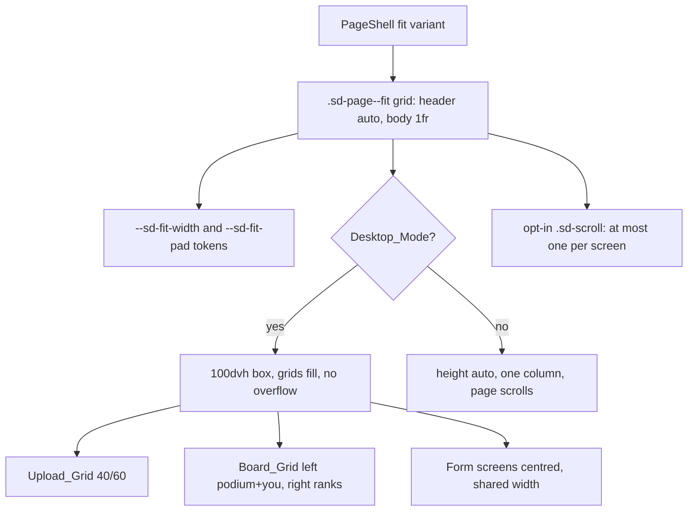

# Design Document: frontend-11-layout-fixes

## Overview

Presentation-only fix pass for the Fit_Screens. Step 0 (this document) is the audit. It found that the symptoms (inner scrollbars, clipped text, page scrollbar, uneven widths) have a small number of shared causes in the Fit_Shell plus screen-specific causes in `upload.css` and `leaderboard.css`. The fix removes the causes. It does not hide scrollbars with `overflow: hidden`.

Principles:

1. Content sizes to content. Cards, panels and notices have no `overflow`, no `max-height` and no fixed `height`.
2. A Fit_Screen is a CSS grid whose rows are `auto` (header, toolbar) and `minmax(0, 1fr)` (the main area). The main area is a grid or flex box whose children are `min-height: 0` and fill it.
3. At most one Designated_Scroller per screen, opt-in through the class `sd-scroll`, only below about 1100x560.
4. One width: `--sd-fit-width` and `--sd-fit-pad` on `.sd-page--fit`. Children fill it. No `max-width: 32rem/34rem/40rem/42rem/48rem/52rem` on structural blocks (form cards may stay narrow inside the shared width and be centred).
5. Compact_Mode (width under 1100 px, or `pointer: coarse`, or `html[data-touch]`) releases the fixed height for every Fit_Screen: single column and normal page scroll.
6. Only `frontend/**` CSS and TSX markup change. Data hooks, props of data components, API, zod, adapters and routing are not touched.

Files read for Step 0: `components/PageShell.tsx`, `styles/{pages,haunted,live,landing,auth,campaign,leaderboard,upload}.css`, `upload/{UploadPage,UploadWizard,Dropzone,QuotaPanel,AiNotice,StepList,SummonResult,FloorProgressList,PreloadedFallback,limits}`, `leaderboard/LeaderboardPage.tsx`, `board/{LiveBoard,BoardTabs,YouPanelView}.tsx`, `identity/{PathChoice,NameScreen}.tsx`, `pages/SettingsPage.tsx`, `auth/{LoginPage,RegisterPage,AuthForm}.tsx`. Not measured in a browser yet: the numbers in the findings are derived from the CSS and need the Layout_Check to confirm (marked "verify").

## Root cause findings

Selectors are in the file named. "Fix" is what the screen task changes. IDs are referenced from tasks.md.

### Shared Fit_Shell (all Fit_Screens)

| ID | File and selector | Effect | Fix |
|----|-------------------|--------|-----|
| RC1 | `styles/pages.css` `.sd-page__body` (`overflow-x: hidden; overflow-y: auto; padding: 4px; margin: -4px`) | Every fit screen body is a scroll container. Any child taller than the leftover height gives a scrollbar on the body, and the 4 px padding clips shadows and focus rings that reach further than 4 px. | Body becomes `display: grid; grid-template-rows: minmax(0, 1fr); overflow: visible`. Scrolling is opt-in with `.sd-scroll` on one inner element. Focus rings get their room from a 6 px padding on the grid, not from clipping. |
| RC2 | `styles/pages.css` `.sd-page--fit .sd-page__inner { max-width: 1600px }` (two classes) beats `.sd-page__inner--wide { max-width: 72rem }` | The `wide` prop is dead on fit screens. Every fit screen has the same 1600 px shell, but the children cap themselves at 32, 34, 40, 42, 48 or 52 rem (RC4, RC6, RC15), so widths differ from screen to screen. | One token `--sd-fit-width` (proposed `min(100%, 84rem)`, Q6) and `--sd-fit-pad`. The `wide` prop becomes a no-op on fit screens and is left in the API. |
| RC3 | `styles/live.css` last rule: `@media (max-width: 640px), (max-height: 520px) { html[data-touch] .sd-page--fit.sd-live {height: auto; ...} }` | Only screens with class `sd-live` on touch devices release the 100dvh box. Upload, leaderboard, login and register never release it, and a 768 px tablet or a narrow desktop window never does. On those the 100dvh box with `overflow: hidden` forces the nested body scrollbar. | Move the release into `pages.css` for `.sd-page--fit` under `@media (max-width: 1099px), (pointer: coarse)` and `html[data-touch]`: `height: auto; min-height: 100dvh; overflow: visible`, body `overflow: visible`, grids to one column. Remove the `sd-live`-only rule. |
| RC4 | `styles/haunted.css` `.sd-haunted .sd-page__inner { align-items: center; justify-content: center; text-align: center }`, `.sd-haunted .sd-page__body { flex: 0 1 auto; max-width: 52rem; align-items: center }`, `.sd-haunted .sd-page__body > * { width: 100% }` | The Upload page uses `sd-haunted`, so its wizard is squeezed into a centred 52 rem column with centred text. A two-column layout is impossible and every card text is centred. | Scope the centring to form screens with a new modifier class `sd-fit--center` (login, register, choose, play-as-guest, settings). Upload and leaderboard do not use it. |
| RC5 | `styles/haunted.css` `.sd-haunted .sd-live__body.sd-live__body { max-width: 32rem }` (three classes) beats `.sd-live__body--wide { max-width: 48rem }` (`live.css`) and `.sd-haunted .sd-live__body { max-width: 52rem }` | `/choose` asks for the wide 48 rem body and gets 32 rem, so its two cards are squeezed. `/play-as-guest` and `/settings` get 32 rem. Three different widths for one screen family. | Replace the three rules by one rule on `--sd-form-width` for form cards and let `.sd-live__body--wide` fill `--sd-fit-width`. Verify the cascade in the browser. |
| RC6 | `styles/haunted.css` `.sd-haunted .sd-page__header { display: contents }` and `.sd-haunted .sd-page__topbar { position: absolute; top; left }` | The back link is taken out of flow. On short windows (650 px) the absolutely placed link sits over the title block. Upload and leaderboard cannot get a header row with the back link on the left. | Header is a normal in-flow row (`display: flex; align-items: end; gap`) on Fit_Screens without `sd-fit--center`. The absolute back link stays only on centred form screens and gets `top` aligned with the title row (verify no overlap at 1366x650). |
| RC7 | `styles/pages.css` `.sd-page__atmosphere .sd-moon { top: 3%; right: 5% }` | The moon sits exactly where the top-right controls (Dashboard link, board tabs) are. It is `aria-hidden` and behind (z-index 1 content), but the controls read over a bright disc and collide visually. | On Fit_Screens move the moon to the lower right (`top: auto; bottom: 7%; right: 4%`, same as the floor map `.sd-map__atmosphere .sd-moon`) with `pointer-events: none`. |
| RC8 | `styles/pages.css` `.sd-page--fit .sd-page__title { font-size: clamp(1.6rem, 5.2vh, 3.1rem) }` with `.sd-page__header { flex: 0 0 auto }` | The title block is 90 to 120 px high at 1366x650 and is not part of the height budget of the main area, which gets what is left. Acceptable, but leaderboard and upload need that height. | Title `clamp(1.5rem, 4.2vh, 2.5rem)` on those two screens; subtitle one line. |
| RC9 | `components/PageShell.tsx` props `back` and `actions` used with the same target | Leaderboard shows "Dashboard" twice (back link and `actions` link) in both `LiveLeaderboard` and `LegacyLeaderboard`. | Remove the `actions` link there. Back link stays. |

### Upload (`/upload`)

| ID | File and selector | Effect | Fix |
|----|-------------------|--------|-----|
| RC10 | `styles/upload.css` `.sd-up > .sd-card, .sd-up > .sd-up__result { flex: 0 1 auto; min-height: 0; max-width: 42rem; margin-block: auto; overflow-y: auto }` | `QuotaPanel` and `AiNotice` are `.sd-card` direct children of `.sd-up`. They can shrink below their content (`min-height: 0` plus `flex-shrink: 1`) and then scroll inside themselves. This is the clipped privacy notice with its own scrollbar. Chosen-file, reading, verdict, topics cards have the same problem. | Remove `overflow-y`, `max-width` and `margin-block: auto`; cards `flex: 0 0 auto`. Layout moves to the Upload_Grid (RC13). |
| RC11 | `styles/upload.css` `.sd-up__drop { flex: 1 1 auto; min-height: 0; overflow-y: auto }` | The drop zone has its own scrollbar when seal (72 px), disabled reason, title, "or", button, `rulesText()` (about 3 lines at 30 rem) and `PHOTO_HINT` do not fit. Text over the dashed border is possible when it shrinks. | `overflow: visible`, `min-height: 0`, centred content, text moved out (RC14). Zone fills the right column through the grid. |
| RC12 | `styles/upload.css` `.sd-up__floors { overflow-y: auto }` inside `.sd-up__result` (itself `overflow-y: auto` by RC10) | Two nested scrollbars after a successful summon with several floors. | Result uses a responsive grid of floors (`repeat(auto-fill, minmax(12rem, 1fr))`). If still too tall it becomes the one Designated_Scroller of the screen (`sd-scroll`) and the result card loses its overflow. |
| RC13 | `upload/UploadWizard.tsx` order `{picking && intro}` then `<StepList/>` then `<Dropzone/>` in one flex column `.sd-up` | Four blocks stack vertically in a 100dvh box: quota card, notice card (about 180 px with the long text), 5-column stepper (about 90 px) and the drop zone. At 650 px high the drop zone gets what is left (often under 150 px) and scrolls (RC11), and the body scrolls (RC1). | Markup change only: header row, stepper row, then `.sd-up__grid` (left: quota chip, notice, rules; right: drop zone or the active state card). `intro` stays a prop (the page still builds it) but is rendered in the left column. |
| RC14 | `upload/Dropzone.tsx` renders `rulesText()` and `PHOTO_HINT` inside the zone; `disabledReason` is a muted `<p>` between the seal and the title | The zone is tall because of the rules text. The locked message is not centred and reads like help text, not like a state. | Rules move to a new `FileRules` list in the left column (built from `limits.ts`: `FORMAT_LABELS`, `UPLOAD_LIMITS`, `PHOTO_HINT`). The zone keeps a one-line hint. Locked state: lock icon and message centred in the zone, `aria-disabled`, button disabled. |
| RC15 | `styles/upload.css` `.sd-up__steps { grid-template-columns: repeat(5, minmax(0, 1fr)) }` with `.sd-up__step` grid areas `mark label` / `. state`, and `@media (max-width: 720px)` stacking to three rows | The "slim" stepper is two lines per step, 70 to 90 px high, and three lines under 720 px. Labels such as "Check relevance" wrap in 1366 px windows. | One row: `display: flex; flex-wrap: nowrap`, mark + label in one line, state text becomes `sr-only` (icon shape carries the state, the active step shows a progress bar or percentage), connectors between steps. Compact_Mode: icon strip with `aria-label`. |
| RC16 | `upload/AiNotice.tsx` class `sd-up__notice-check` | The class has no CSS rule anywhere (`grep` finds it only in the TSX). The checkbox is the browser default, unaligned with the text, no clear focus ring, small hit area. | New rules: `display: flex; gap; min-height: 44px` (touch), a 20 px accent-coloured box (`accent-color`), `:focus-within` ring, label text inherits ink colour. |
| RC17 | `upload/AiNotice.tsx` `AI_NOTICE_LABEL = 'I understand and want to upload my notes'` and long `AI_NOTICE_TEXT` | Longer than the new copy; the old copy is the visible reason the card exceeds its box. | Text as in the brief (same meaning). Constants stay exported. Tests that assert the old strings are updated to the constants. See Q3. |
| RC18 | `styles/haunted.css` `.sd-haunted .sd-card__h { justify-content: center }` and RC4 centring | "Before you upload" heading and card text are centred on a left-aligned form. | Left align inside the Upload_Grid cards. |

### Leaderboard (`/leaderboard`)

| ID | File and selector | Effect | Fix |
|----|-------------------|--------|-----|
| RC19 | `styles/leaderboard.css` `.sd-lb__tablewrap { min-height: 5.5rem; overflow-y: auto }`, `@media (max-height: 700px) .sd-lb__panel > .sd-lb__tablewrap { min-height: 7rem }` | The ranks table scrolls inside its own box (the inner scrollbar) and its minimum height pushes the panel taller than the body, so the body scrolls as well: two scrollbars. | Remove `overflow` and the minimum heights. Rows become a CSS grid sized by the Board_Grid. |
| RC20 | `styles/leaderboard.css` `.sd-lb__row > * { padding: 0.45rem 0.5rem }`, `.sd-lb__table { border-spacing: 0 0.3rem }`, `.sd-lb__rank { font-size: 1.35rem }`, `Avatar` default size | A row is about 52 px. 17 rows are about 880 px. They cannot fit under the header, Podium and You panel at any size up to 1080 px high. | Compact rows 36 to 44 px: `height: clamp(2.25rem, calc((100dvh - 15rem) / 9), 2.75rem)`, 28 px avatar, rank 1rem. Two columns (4 to 12, 13 to 20) so 9 rows per column. |
| RC21 | `board/LiveBoard.tsx` and `LiveLeaderboard` order: `BoardTabs`, Podium, table, `YouPanel`, `Footer` in `.sd-lb__panel` (flex column) with `.sd-lb__panel > * { flex-shrink: 0 }` | Everything is stacked and nothing may shrink except the table wrap. Podium (avatar 52 + name + score + meta + pedestal up to 4.75 rem, about 230 px), You panel and a three-line footer take the height, the table gets the remainder and scrolls. | Markup change: `.sd-lb__grid` with left column (Podium, You panel) and right column (Rank_Rows). Footer lines merge into the You panel and the caption. |
| RC22 | `board/BoardTabs.tsx` + `.sd-lb__tabgroup { flex-direction: column }` | Two tab rows and a hint line stack under the title (about 130 px) at the left, with the rest of the row empty. | Board tabs and period toggle in one `.sd-lb__toolbar` aligned right of the header row. Hint becomes the one-line caption (`data-testid="lb-hint"` kept). |
| RC23 | `.sd-lb__you { display: flex; flex-wrap: wrap }`, `.sd-card.sd-lb__claim` row, `board/YouPanelView.tsx` strings | You panel is a wrapped row under the table. Label "Live, can be ahead of the table" and `Rank N, X Leaderboard points`. Counts say "points" also for 1. | Vertical card in the left column: "Your live rank", rank, points, pass line, enter line, updated and next refresh, guest CTA. Strings use the existing `plural()` helper (as `quotaView.ts` does) so "1 point". Property `youPanelView` data unchanged. |
| RC24 | `styles/leaderboard.css` `@media (max-height: 700px) { .sd-lb__foot { display: none } ... .sd-podium__meta { display: none } }` | Information (updated-at, tie-break note) is hidden to make things fit. | Remove the hiding. The information moves to the You panel and the caption. |
| RC25 | `styles/leaderboard.css` `.sd-lb__name { overflow-wrap: anywhere }`, `.sd-podium__name { overflow-wrap: anywhere }` | A 30-character name without spaces wraps into several lines and changes the row height (text over the row border). | `white-space: nowrap; overflow: hidden; text-overflow: ellipsis; min-width: 0` plus `title={fullName}`. |
| RC26 | `board/LiveBoard.tsx` and `leaderboard/LeaderboardPage.tsx` `Skeleton`: inline `style={{ height: 120 - i * 18 }}` and 6 rows of 44 px | The skeleton is 400 px+ high, taller than the fit area at 650 px, and does not match the final layout. | Skeleton uses `.sd-lb__grid` and CSS classes with relative heights. |
| RC27 | `styles/leaderboard.css` `.sd-podium { max-width: 40rem; margin: auto }` and `.sd-lb__skel-podium` | Podium is centred and independent of the table width. | Podium fills the left column (about 36 percent), compact heights: pedestals `clamp(1.2rem, 4.5vh, 2.6rem)`. |
| RC28 | `leaderboard/LeaderboardPage.tsx` `LegacyLeaderboard` shares all classes | The demo or offline board (not real mode) has the same problems and renders a pinned row and a claim card. | Gets the same toolbar, grid and compact rows; its pinned row stays in the left column where the You panel is. Behaviour unchanged. |

### Other Fit_Screens (audit, to verify with the Layout_Check)

| ID | File and selector | Finding | Planned action |
|----|-------------------|---------|----------------|
| RC29 | `styles/landing.css` `.sd-landing__main { overflow-y: auto }` (title screen) | The main area is a scroll container by design. It scrolls only when hero plus three "how to play" cards plus the counter do not fit. verify at 1366x650. | If it scrolls at any Test_Size, compact the cards (hide descriptions or reduce padding) so it does not. Otherwise keep it as the Designated_Scroller below 1100x560 only. |
| RC30 | `styles/campaign.css` `.sd-map { height: 100dvh; overflow: hidden }`, `.sd-map__scroll { overflow-x: auto; overflow-y: hidden }` | The horizontal map scroller is the legitimate Designated_Scroller (floors do not fit sideways). `overflow-y: hidden` there clips floor cards that are taller than the stage: verify. | Keep as the allow-listed scroller. Check floor cards are not clipped at 1366x650. | **Fixed 2026-05 (task 10): see kiro log.** |
| RC31 | `styles/campaign.css` `.sd-topics__pop { max-height: min(40vh, 16rem); overflow-y: auto }` | The topics popover has its own vertical scrollbar. It is a popover on demand, not a card, but it is a Nested_Scrollbar by the rule. | Size the popover to content (`max-height: none`, anchored to the viewport with `position: fixed`/clamped) or accept as allow-listed popover (Q7). | **Fixed 2026-05 (task 10): see kiro log.** |
| RC32 | `styles/campaign.css` `.sd-fnode__title` (`line-clamp: 2; overflow: hidden`), `.sd-fnode__meta--boss`, `.sd-topic__name` (`nowrap; text-overflow: ellipsis`) | Clipped text by design with a tooltip. Brief says no clipped content. | Allow wrapping of the title up to 3 lines and wrap topic names (cards grow in the stage height), keep ellipsis only where a tooltip exists and the full text is in the DOM (Req 11.3). | **Fixed 2026-05 (task 10): see kiro log.** |
| RC33 | `styles/campaign.css` `@media (max-height: 480px) { .sd-map { overflow-y: auto } .sd-map__stage { min-height: 20rem } }` | Page-level nested scroll on short windows. | Replaced by the Compact_Mode release (natural page scroll). | **Fixed 2026-05 (task 10): see kiro log.** |
| RC34 | `styles/auth.css` `.sd-auth { margin: auto }` vs `styles/haunted.css` `.sd-haunted .sd-auth { margin: 0 auto }`; fit body `overflow-y: auto` (RC1) | The card is not vertically centred (the more specific rule wins). It scrolls the body if taller than the area at 650 px (sprite is hidden below 760 px; verify). | Centre through the grid (`place-content: center`). Verify card height at 1366x650 including the error line. |
| RC35 | `identity/PathChoice.tsx` `.sd-choice__card { min-height: clamp(11rem, 32vh, 16rem) }` in `haunted.css` | Two cards plus quota, error row and "more" paragraph can exceed the area at 650 px (verify), body scrolls. | Cards use `min-height: 0` and grow with content; reduce vertical gaps via `clamp()`. Width fix by RC5. |
| RC36 | `pages/SettingsPage.tsx` `className="sd-live__body sd-live__notice sd-settings"` | Reuses `.sd-live__notice` (flex column, gap) as a layout class and the 32 rem body (RC5). Two cards may exceed 650 px (verify). | Two cards side by side in Desktop_Mode inside `--sd-fit-width`; single column in Compact_Mode. |

Items marked verify cannot be proven from CSS alone because the content height depends on fonts and data. They are measured by the Layout_Check in the first task, before and after the shell change.

## Architecture



Shell CSS (sketch, final values in the task):

```css
.sd-page--fit {
  --sd-fit-width: min(100%, 84rem);
  --sd-fit-pad: clamp(16px, 3vw, 48px);
  display: grid;
  grid-template-rows: minmax(0, 1fr);
  height: 100dvh;
  overflow: hidden;           /* decoration clip only; content never overflows (Layout_Check) */
}
.sd-page--fit .sd-page__inner {
  width: min(100%, var(--sd-fit-width));
  max-width: none;
  display: grid;
  grid-template-rows: auto minmax(0, 1fr);
  padding-inline: var(--sd-fit-pad);
  min-height: 0;
}
.sd-page--fit .sd-page__body { min-height: 0; min-width: 0; overflow: visible; padding: 6px; margin: -6px; }
.sd-scroll { overflow-y: auto; min-height: 0; scrollbar-width: thin; }
@media (max-width: 1099px), (pointer: coarse) {
  .sd-page--fit { height: auto; min-height: 100dvh; overflow: visible; }
  .sd-page--fit .sd-page__inner { grid-template-rows: auto auto; }
}
html[data-touch] .sd-page--fit { height: auto; min-height: 100dvh; overflow: visible; }
```

The root's `overflow: hidden` stays only to clip decorations that already live in fixed containers; the Layout_Check proves content never relies on it (it measures children, not just the document).

## Components and Interfaces

Only presentational components change. No new data hooks, no new props that carry data.

- `PageShell`: adds optional `center?: boolean` (adds `sd-fit--center`). The `wide` prop is kept and ignored on fit.
- `UploadPage` / `UploadWizard`: markup regrouped into header row, `StepList`, `.sd-up__grid` (`.sd-up__aside`, `.sd-up__main`). `intro` prop and all flow logic unchanged.
- `QuotaPanel`: renders the Quota_Chip (`<p>` with icon) in `.sd-up__quota`; blocked state keeps `PreloadedFallback` and `UpgradeOffer`. `data-testid`s kept.
- `AiNotice`: new text/label constants, styled checkbox, no `overflow`.
- New `upload/FileRules.tsx`: list built from `FORMAT_LABELS`, `UPLOAD_LIMITS`, `MAX_UPLOAD_MB`, `PHOTO_HINT` (no number literals; `limits.test.ts` lint keeps passing).
- `Dropzone`: one-line hint, locked state inside the zone. `StepList`: one-row markup, state text `sr-only`.
- `LeaderboardPage` / `LiveBoard` / `BoardTabs` / `YouPanelView` / `Podium`: toolbar, grid, compact rows, truncation with `title`, "Your live rank", `plural()`. `buildLiveBoardView` output is used as is (ranks 4 to 20 are split into two arrays in the component).

### Layout rules per screen (Desktop_Mode)

Leaderboard: header row (`grid-template-columns: 1fr auto`), caption line, `.sd-lb__grid { display: grid; grid-template-columns: minmax(18rem, 36%) minmax(0, 1fr); gap; min-height: 0 }`. Right column `.sd-lb__ranks { display: grid; grid-template-columns: repeat(2, minmax(0, 1fr)); grid-auto-flow: column; grid-template-rows: repeat(9, var(--sd-row-h)) }` when more than 9 rows, one column otherwise. `--sd-row-h: clamp(2.25rem, calc((100dvh - 14rem) / 9.5), 2.75rem)`.

Upload: header row, stepper row, `.sd-up__grid { grid-template-columns: minmax(18rem, 2fr) minmax(0, 3fr); min-height: 0 }`, both columns stretch; the Drop_Zone is `height: 100%`.

Compact_Mode order: leaderboard header, caption, Podium, You panel, ranks; upload quota, notice, drop zone, file rules, stepper strip.

## Data Models

None. No type, schema, adapter or API change.

## Testing Strategy

Property-based testing does not apply: this is CSS and markup, with no new logic. The only pure logic (singular and plural) already exists as `plural()` and gets example tests (0, 1, 2, 1000). Using fast-check for layout would not find more than the browser check does.

### Layout_Check (open question Q2)

Option A (recommended, no dependency): `frontend/scripts/layout-check.mjs`, a Node 24 script (global `WebSocket` and `fetch` exist; `node -v` is v24.15.0 here). It starts the Vite dev server or `vite preview` (user starts it, or the script spawns it), launches `C:\Program Files (x86)\Microsoft\Edge\Application\msedge.exe --headless=new --remote-debugging-port=<free> --user-data-dir=<temp>` and talks to it over the Chrome DevTools Protocol: `Emulation.setDeviceMetricsOverride` for each Test_Size, `Page.navigate` to each route in mock mode (`?mock` / the existing mock switch; guest and registered via the mock session), wait for network idle plus 500 ms, then `Runtime.evaluate` of a measuring function:

```js
const bad = [];
const doc = document.scrollingElement;
if (doc.scrollHeight > innerHeight) bad.push('page-v');
if (doc.scrollWidth > innerWidth) bad.push('page-h');
for (const el of document.querySelectorAll('*')) {
  const s = getComputedStyle(el);
  const scrolls = /(auto|scroll)/.test(s.overflowY) && el.scrollHeight > el.clientHeight + 1
               || /(auto|scroll)/.test(s.overflowX) && el.scrollWidth > el.clientWidth + 1;
  if (scrolls && !el.matches(ALLOWED)) bad.push(describe(el));
}
```

It also flags clipping: any element with `overflow: hidden` and `scrollHeight > clientHeight + 1` that contains text (excluding `.sd-page`, `.sd-page__atmosphere`, `.sd-haunted-backdrop`, `.sd-landing__sky`, `.sd-map` decoration and elements with a `title` tooltip on the ellipsis allow-list). Output is a table (route, size, result) and optional `--screenshot` per case into a temp folder (not committed). Exit code is 1 on failure. `npm run layout:check` would be a script entry in `package.json` (no dependency added; this is a script entry only, to approve in Q2).

Option B: add `@playwright/test` as a devDependency (Playwright is not installed; `frontend/package.json` has no Playwright). Not done without approval.

Option C (fallback, always provided): `msedge --headless=new --screenshot --window-size=W,H <url>` for screenshots plus the manual checklist below. It cannot assert overflow.

### Unit and component tests

Vitest and Testing Library (jsdom has no layout, so these test markup and text, not pixels): FileRules built from `limits.ts` (no literal numbers); AiNotice text, label and checkbox toggle by label click; Quota_Chip text; Dropzone locked state text and `aria-disabled`; StepList has five items and `aria-current` on the active step; "Your live rank" label, "1 point" and "2 points"; truncated name has `title`; one Dashboard link on the leaderboard; skeleton has no inline pixel heights. Existing tests that assert the renamed strings (`AI_NOTICE_LABEL`, "Live, can be ahead of the table") are updated to import the constants or the new text (Q3).

### Manual checklist (each screen, also in the STOP task)

- Window sizes: Test_Sizes plus 1100x560 and 1099x700 (Compact switch), phone portrait and landscape (DevTools device mode).
- No scrollbar except the allow-listed one; drag the window narrower and shorter and watch for clipped text, text over borders and overlapping controls.
- Tab through the screen: order matches the visual order, every control shows a focus ring that is not clipped.
- Reduced motion: set the OS or DevTools "prefers-reduced-motion: reduce" and the in-app setting; no pulsing seal, shimmer or drifting figures.
- Contrast: muted text on glass cards at least 4.5:1 (check `--color-ink-muted` on the card backgrounds), focus ring 3:1.
- Zoom 200 percent at 1366x768: content reflows to one column without horizontal scroll.

### Verification commands

`npm run typecheck`, `npm run lint`, `npm test`, `npm run test:contract`, `npm run build` in `frontend/`, recorded with real output. Last known baseline in the log: `npm test` 1473 passed, 27 skipped; `test:contract` 46 passed, 1 skipped.

## Error Handling

No new runtime errors. Display rules: an API error text stays in `role="alert"` inside its card, wraps (no clipping, no scrollbar). A load error on the leaderboard shows the card in the Board_Grid with Retry. If the Layout_Check browser is missing, the script exits with a clear message and the manual checklist applies.

## Contradictions and open questions

| ID | Question | Finding and proposal |
|----|----------|----------------------|
| Q1 | DECIDED | Keep auto-start on file choose. Show file name and size while uploading and processing. Show "Try another file" after a rejection. |
| Q2 | DECIDED | Approved: Node script driving the local headless browser, no new dependency, one layout:check entry in package.json. Browser path from env LAYOUT_BROWSER (fallback Chrome then Edge default paths, plus common macOS/Linux paths), documented in README.md (Frontend section). Includes phone portrait 360x740 and landscape 740x360. |
| Q3 | DECIDED | Exact-text assertion updates for renamed labels are OK. Every changed test is listed in the log. No assertion is weakened. |
| Q6 | DECIDED | Shared content width 96rem (1536px), centred above that (--sd-fit-width: min(100%, 96rem)). Floor map and game screen may stay full width. |
| Q4 | Where Desktop_Mode starts: 1100 px, and what a touch laptop at 1366 px does. | Proposal: Desktop_Mode is width >= 1100 and not `pointer: coarse` and no `html[data-touch]`. A touch tablet at 1180 px gets the one-column natural-scroll layout. |
| Q5 | Short desktop windows (width >= 1100, height < 560). | Proposal: leaderboard right column becomes the one Designated_Scroller (rows keep 36 px); upload releases to natural page scroll. Title, map, forms use their existing single scroller or page scroll. |
| Q7 | Floor map popover (RC31) and ellipsis (RC32). | Proposal: remove the popover scrollbar by sizing to content, and wrap names instead of ellipsis where the card has room. If the user prefers ellipsis with tooltip on the map, record it as allowed. |
| Q8 | "1 upload left today (0 of 1 used)". | Matches `quotaView` line `N uploads left today (U of L used).`; the Quota_Chip drops the trailing period. Text comes from the same function; no logic change. |
| Q9 | Real mode vs mock. | Ghost_Rivals only render from the mock board data, as now; no change. The Layout_Check runs in mock mode with 0, 1, 3, 8, 20 entries (mock switch `VITE_MOCK_*` or the leaderboard mock fixtures; the task locates the existing switch first). |
| Q10 | The legacy (demo/offline) leaderboard shares markup with the live one. | Proposal: both get the new layout (RC28); behaviour unchanged. |

## Layout_Check measurements (task 3.1 / 3.2)

Tool: `npm run layout:check`, mock mode, sizes 1366x650, 1366x768, 1536x864, 1920x960, 1920x1080, 2560x1440, 360x740, 740x360. Limit: in mock mode `/upload` as a guest only renders the "Accounts only" gate, so the wizard grid (RC10 to RC18) was not measured; it needs a registered mock session (task 4.7).

Before (unchanged code), failures only:

- /leaderboard: 1366x650, 1366x768 (root clipped 718>650, 815>768; `.sd-page__body` scroller; `.sd-lb__tablewrap` scroller), 1536x864 and 1920x960 (`.sd-lb__tablewrap` scroller), 360x740, 740x360.
- /login and /register @ 740x360: `.sd-page__body` scroller.
- / @ 360x740: `.sd-landing` clipped 386>360 horizontally.
- /campaign/demo-dungeon @ 740x360: `main.sd-map` scroller.
- All other route/size cells passed.

After the shell rewrite (3.2), failures only:

- /leaderboard: `.sd-lb__tablewrap` scroller at 1366x650, 1366x768, 1536x864; clipped 370>328 at 360x740 (internals, task 6).
- / @ 360x740: unchanged (task 8).
- /campaign/demo-dungeon @ 740x360: unchanged (task 10).
- /login and /register @ 740x360 now pass (Compact_Mode release).

Verify items:

- RC1 confirmed: `.sd-page__body` was a scroller on /leaderboard and on /login, /register at 740x360. Gone after the rewrite.
- RC3 confirmed: login/register at 740x360 did not release the fixed height; fixed by the shell release.
- RC8 not confirmed as a problem: the title block did not cause overflow on its own.
- RC19 confirmed: `.sd-lb__tablewrap` is a Nested_Scrollbar up to 1920x960. RC21 confirmed (root clipped 718>650 and 815>768).
- RC29 partly confirmed: no vertical overflow of the landing at any desktop size; horizontal clip 386>360 at 360x740.
- RC30 not confirmed at desktop sizes; the map shows a page scroller only at 740x360 (RC33 confirmed).
- RC34 not confirmed: login/register fit at 1366x650.
- RC35 not confirmed: /choose fits at 1366x650 (before and after).
- RC36 not confirmed: /settings fits at 1366x650 (before and after).
- RC31, RC32 not measured (popover is on demand; ellipsis is by design, task 10).
Upload verify items (measured with the Layout_Check, 8 sizes, 9 states, 72/72 ok):

- RC10 confirmed and fixed: the notice and quota no longer have their own scrollbars; both sit in the left column.
- RC11 confirmed and fixed: the drop zone fills the right column with no inner scroller.
- RC12 confirmed and fixed: success floors form a grid with no nested scroll (registered-success state ok at every size).
- RC13, RC14, RC15, RC16, RC17, RC18 confirmed and fixed: one-row stepper, locked message centred in the zone, 20 px checkbox with label, full notice text, left-aligned card text.
- Busy (?mockAiBusy=1) and used-up quota (?mockQuota=player_daily_limit) states fit at every size, including 360x740 and 740x360.

Leaderboard verify items (Layout_Check, 8 sizes, 11 states: 0/1/3/8/20 entries, guest, registered, week, error, loading; 88/88 ok):
- RC9, RC19, RC20, RC21, RC23, RC24, RC25, RC26 confirmed and fixed: one Dashboard link, no inner scrollbar, compact rows in two columns (4-12, 13-20) when the box is short, podium and 'Your live rank' panel on the left, no hidden information, ellipsis with title on long names, grid-shaped skeleton without inline heights.
- Dev-only mock switch ?mockBoard=<0..20>|error|slow (src/api/mock/mockBoardSwitch.ts) feeds the check; real mode never reads it.
- RC29 confirmed and fixed (task 8): .sd-landing__main only scrolls below 1100x560; header nav now wraps/compacts at narrow widths (360x740 clip 386>360 gone). Layout_Check / 8/8 ok.

## Final status (task 16.1)
- RC5, RC34, RC35, RC36: fixed (shared --sd-form-width / --sd-wide-width tokens, auth card centred by the grid, /choose cards grow with content, settings cards in a grid, .sd-live__notice no longer a layout class). Layout_Check 216/216.
