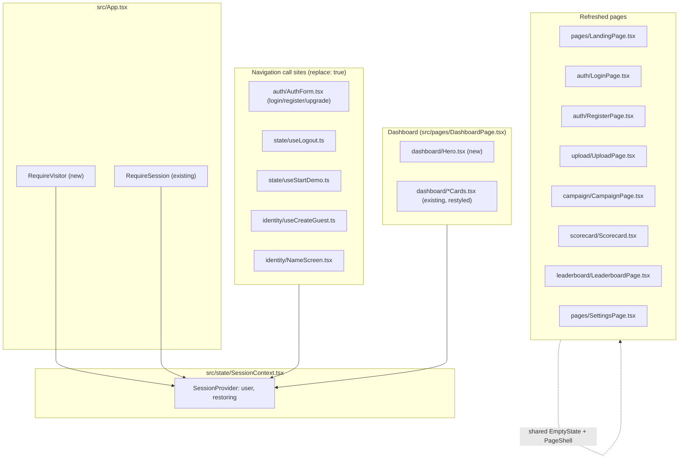

# Design Document: frontend-13-polish-and-nav

## Overview

Frontend-only change set across three areas:

1. **Entry guard** — a new `RequireVisitor` wrapper (mirroring the existing `RequireSession` in `src/App.tsx`) that redirects an Authenticated_User away from `/`, `/login` and `/register`, and holds rendering until the Session_Provider has finished restoring. All navigations that currently follow a login, register, upgrade, demo-session or guest-session success switch to `navigate(path, { replace: true })`.
2. **Dashboard redesign** — new shared card primitives in `src/styles/dashboard.css` (and a small new `src/dashboard/Hero.tsx` + `src/dashboard/heroArt.tsx` decorative layer), a new `Hero` section at the top of `DashboardPage.tsx`, and a tightened grid for the existing cards in `src/dashboard/*`.
3. **Light page refresh** — shared header/empty-state treatment applied to `LandingPage.tsx`, `auth/AuthForm.tsx` (used by Login/Register), `upload/UploadPage.tsx`, `campaign/CampaignPage.tsx`, `scorecard/Scorecard.tsx`, `leaderboard/LeaderboardPage.tsx` and `pages/SettingsPage.tsx`, reusing `PageShell`, `.sd-card`, `.sd-cta` and a new shared `EmptyState` component.

No change touches `src/game/**` (Phaser), `src/api/**` contracts, `backend/**`, `.env*`, or any file under `.kiro/steering/**`.

## Architecture



## Components and Interfaces

### 1. `RequireVisitor` (new, in `src/App.tsx`)

```tsx
function RequireVisitor({ children }: { children: ReactNode }) {
  const { user, restoring } = useSession()
  if (restoring) return <RouteSkeleton />
  if (user) return <Navigate to="/dashboard" replace />
  return <>{children}</>
}
```

- `RouteSkeleton` is a minimal, non-flashing placeholder (`<div className="sd-route-skeleton" aria-hidden="true" />`) added to `src/components/RouteSkeleton.tsx`. It renders no interactive content, so it never fails an a11y check and never needs its own route-level test id collisions.
- Applied to the three Entry_Routes:
  ```tsx
  <Route path="/" element={<RequireVisitor><LandingPage /></RequireVisitor>} />
  <Route path="/login" element={<RequireVisitor><LoginPage /></RequireVisitor>} />
  <Route path="/register" element={<RequireVisitor><RegisterPage /></RequireVisitor>} />
  ```
- `restoring` already exists on `SessionContextValue` (`src/state/SessionContext.tsx`); no API change there.

### 2. Replace-navigation call sites

| File | Current call | New call |
|---|---|---|
| `src/auth/AuthForm.tsx` (`onSubmit`) | `navigate('/dashboard')` | `navigate('/dashboard', { replace: true })` |
| `src/state/useStartDemo.ts` (`onSuccess`) | `navigate(\`/campaign/${id}\`)` | `navigate(\`/campaign/${id}\`, { replace: true })` |
| `src/identity/useCreateGuest.ts` (two call sites) | `navigate('/choose', { replace: true })` | unchanged (already correct — confirms the pattern) |
| `src/identity/NameScreen.tsx` (two call sites) | `navigate('/choose', { replace: true })` | unchanged (already correct) |
| `src/state/useLogout.ts` | `navigate('/')` | `navigate('/', { replace: true })` |

Only `AuthForm.tsx`, `useStartDemo.ts` and `useLogout.ts` need an edit; `useCreateGuest.ts` and `NameScreen.tsx` already pass `replace: true` and are left alone except for test coverage.

### 3. Dashboard guest exit link (Requirement 1.10)

`DashboardPage.tsx`'s `back` prop currently points to `/` with label "Title screen", which `RequireVisitor` would immediately bounce back to `/dashboard` for a live guest. Replace that back link with an explicit "Leave session" action that calls `clearSession()` then `navigate('/', { replace: true })`, reusing the existing `useLogout`-style pattern but available to guests too (today `useLogout` is only wired to the non-guest branch). Add a small `useLeaveSession` hook in `src/state/useLeaveSession.ts`:

```ts
export function useLeaveSession(): { leaving: boolean; leave: () => Promise<void> } {
  const navigate = useNavigate()
  const { user, clearSession } = useSession()
  const [leaving, setLeaving] = useState(false)
  const leave = useCallback(async () => {
    if (leaving) return
    setLeaving(true)
    try {
      const api = await getApi()
      if (user) await api.logout()
    } catch {
      // Already gone server-side; still leave locally.
    } finally {
      clearSession()
      navigate('/', { replace: true })
    }
  }, [leaving, user, clearSession, navigate])
  return { leaving, leave }
}
```

`useLogout` (non-guest "Log out" button) can keep its own copy or be refactored to call `useLeaveSession` internally; the design keeps both hooks to avoid behavior changes outside Requirement 1 scope, but `DashboardPage.tsx` uses `useLeaveSession` for its `back` slot for both guest and non-guest viewers.

### 4. `Hero` (new, `src/dashboard/Hero.tsx`)

```tsx
export interface HeroProps {
  isGuest: boolean
  displayName: string
  progress: ProgressInfo | null
  progressStatus: ProgressStatus
  dungeon: DashboardDungeon
  dailyHauntSlot?: ReactNode
  onPlayDemo: () => void
  demoPending: boolean
  onCreateAccount: () => void
}

export function Hero(props: HeroProps): JSX.Element
```

Renders:
- `<h2>` with the display name (reuses `displayHandle(user)` already computed in `DashboardPage.tsx`).
- Level badge and an XP bar (`<ProgressBar>` from `src/components/ProgressBar.tsx`, already used elsewhere) with visible numeric text (`"{xp} / {xpToNext} XP"`), or a `CardSkeleton`-style placeholder (`role="status"`, `aria-live="polite"`, `aria-label="Loading your level"`) while `progressStatus === 'loading'`.
- Exactly one `Primary_CTA` `<button>`/`<Link>` with `className="sd-cta sd-hero__cta"`:
  - Guest: "Play the Demo" (`onPlayDemo`), plus a secondary "Create account" (`onCreateAccount`).
  - Player with a next floor: "Continue the Dungeon" linking to the map/next floor path already computed by `useDashboardDungeon`.
  - Player with a Daily Haunt slot and no next floor: renders `dailyHauntSlot` as the CTA slot.
  - While the next-floor lookup is loading: a `CardSkeleton`-shaped button placeholder with `aria-busy="true"` and an accessible label "Loading your next room".
- Decorative layer (`aria-hidden="true"`): fog gradient, a vignette, and a rune-divider SVG, gated by `useReducedMotion()` — when reduced motion is on, these render with a `data-reduced="true"` attribute that the CSS uses to drop animation classes (same convention `PageShell` already uses for `data-reduced`).

`DashboardPage.tsx` renders `<Hero .../>` immediately under `PageShell`'s children, above the existing `sd-dash` grid, for both the player and guest branches.

### 5. Card primitives (`src/styles/dashboard.css`)

Add, without renaming existing classes used by tests:

```css
.sd-dash { grid-template-columns: minmax(0, 1fr); }
@media (min-width: 640px) { .sd-dash { grid-template-columns: repeat(2, minmax(0, 1fr)); } }
@media (min-width: 1100px) { .sd-dash { grid-template-columns: repeat(3, minmax(0, 1fr)); } }

.sd-card { /* existing base kept; add: */
  transition: border-color var(--sd-dur-base) ease, box-shadow var(--sd-dur-base) ease, transform var(--sd-dur-fast) ease;
}
.sd-card:hover, .sd-card:focus-within {
  border-color: color-mix(in srgb, var(--color-gold) 55%, transparent);
  box-shadow: var(--sd-elev-2), 0 0 16px color-mix(in srgb, var(--color-gold) 30%, transparent);
}
[data-reduced='true'] .sd-card,
[data-reduced='true'] .sd-hero * { transition: none; animation: none; }

.sd-hero { /* new hero section: padding, border, backdrop gradient reusing existing tokens only */ }
.sd-rune-divider { /* decorative inline svg wrapper, aria-hidden */ }
```

All new rules reuse existing tokens (`--sd-elev-*`, `--color-gold`, `--sd-dur-*`); no new color or font is introduced (Requirement 4.4).

### 6. Shared `EmptyState` (new, `src/components/EmptyState.tsx`)

```tsx
export interface EmptyStateProps {
  icon: LucideIcon
  title: string
  message: string
  action?: { label: string; onClick?: () => void; to?: string }
  testId?: string
}
export function EmptyState({ icon: Icon, title, message, action, testId }: EmptyStateProps): JSX.Element
```

Renders an `.sd-card` with an icon, a heading, a muted message paragraph, and an optional `sd-cta`/`Link` action. Used by: Upload's empty file list, My Notes empty state (`src/dashboard/MyNotesCard.tsx`), reviews-due empty state (`src/dashboard/ProgressCards.tsx` `HauntCard`), and Leaderboard's empty board state — each existing empty-state branch is swapped to use `EmptyState`, keeping the same test ids and copy where tests assert them (verified file-by-file in Tasks).

### 7. Page refresh touches (no new components beyond `EmptyState`)

- `LandingPage.tsx`: header/nav spacing tightened to match the Hero's spacing scale (`--sd-space-*`); no structural or route change.
- `auth/AuthForm.tsx`: `StoneFrame` card padding and heading sizes aligned to the `--sd-text-*` scale; no field, label or test id changes.
- `upload/UploadPage.tsx`: wraps its empty/initial state in `EmptyState`; step list and dropzone untouched.
- `campaign/CampaignPage.tsx`: page header padding/spacing aligned; `FloorMap` (Phaser-free SVG/DOM component) untouched structurally.
- `scorecard/Scorecard.tsx`: card spacing and headings aligned to `.sd-card` conventions.
- `leaderboard/LeaderboardPage.tsx`: header area (title/subtitle/back link) aligned with `PageShell` conventions already used elsewhere; `Podium`/`Row` untouched.
- `pages/SettingsPage.tsx`: section spacing aligned to the shared scale; existing `DeleteAccountDialog` untouched.

## Data Models

No new persisted data model. Two new local-only view types:

```ts
// src/dashboard/Hero.tsx
export type HeroCta =
  | { kind: 'continue'; to: string; label: string }
  | { kind: 'daily-haunt'; slot: ReactNode }
  | { kind: 'play-demo'; label: string; onClick: () => void; pending: boolean }
  | { kind: 'loading' }
```

This is a pure derivation from existing props (`dungeon`, `dailyHauntSlot`, `isGuest`, `demo.pending`) computed in a small pure function `chooseHeroCta(...)` in `src/dashboard/heroCta.ts`, so it can be unit/property tested without rendering React.

## Error Handling

- `RequireVisitor` never throws: `restoring` and `user` are always defined on `SessionContextValue`; the branch is exhaustive (restoring → skeleton, user → redirect, else → children).
- `useLeaveSession.leave()` swallows a failed `api.logout()` call (session may already be gone server-side) and still clears local state and navigates, matching the existing `useLogout` behavior.
- `chooseHeroCta` has an exhaustive return type (`HeroCta` union); `Hero.tsx` has a default `never` branch that TypeScript enforces at compile time, so an unhandled case fails `npm run typecheck` rather than rendering nothing silently.
- `EmptyState` requires `title` and `message`; omitting `action` is valid and renders no button, so pages that cannot offer a next action (e.g., read-only empty board for an unsupported backend) still render correctly.

## Correctness Properties

*A property is a characteristic or behavior that should hold true across all valid executions of a system—essentially, a formal statement about what the system should do. Properties serve as the bridge between human-readable specifications and machine-verifiable correctness guarantees.*

### Property 1: Authenticated users never see an Entry_Route

For any Authenticated_User (registered or guest, with any valid display name) and for any of the three Entry_Routes (`/`, `/login`, `/register`), rendering that route through `RequireVisitor` with `restoring = false` results in a redirect to `/dashboard` with `replace: true`, and the wrapped Entry_Route content is never rendered.

**Validates: Requirements 1.4**

### Property 2: Restoring state shows a neutral placeholder on every Entry_Route

For any of the three Entry_Routes, rendering that route through `RequireVisitor` with `restoring = true` (regardless of the value of `user`) renders the loading placeholder and not the Entry_Route content and not a redirect.

**Validates: Requirements 1.5**

### Property 3: A settled Visitor sees the requested Entry_Route

For any of the three Entry_Routes, rendering that route through `RequireVisitor` with `restoring = false` and `user = null` renders the Entry_Route's own content.

**Validates: Requirements 1.6, 1.9**

### Property 4: The Hero always shows the current name, level and numeric XP

For any valid `ProgressInfo` (level, total_xp, xp_to_next within their valid ranges) and any display name, the rendered Hero text contains that display name, that level number, and the XP values as digits.

**Validates: Requirements 2.1**

### Property 5: The Hero exposes exactly one Primary_CTA

For any combination of `isGuest`, `demo.pending`, presence of a next floor, and presence of a `dailyHauntSlot`, the rendered Hero contains exactly one element carrying the `sd-hero__cta` primary-action role.

**Validates: Requirements 2.2**

### Property 6: Guest Hero always offers demo and account-creation actions

For any guest display name, the rendered Hero text contains that display name and contains both a "Play the Demo" control and a "Create account" control.

**Validates: Requirements 2.4**

### Property 7: Every dashboard card section shares the card primitive

For any of the card sections rendered on the Dashboard (player view or guest view, any data state), each top-level card section element carries the shared `sd-card` class.

**Validates: Requirements 2.6**

### Property 8: Reduced motion disables animation on every new decorative element

For any new Dashboard or page-refresh decorative element (Hero fog/vignette/rune divider), when `useReducedMotion()` reports `true`, the element is rendered with `data-reduced="true"` and carries no running animation class.

**Validates: Requirements 3.1**

### Property 9: Card state is always conveyed through descriptive text

For any card on the Dashboard or a Refreshed_Page rendered in a `loading`, `error`, or empty state, the rendered text content for that card is non-empty and includes a word describing the state (e.g. "loading", "error", "no ...").

**Validates: Requirements 3.5**

## Testing Strategy

- **Unit tests** cover the specific navigation call sites (login/register/upgrade success, demo/guest start, logout, leave-session), the Hero's loading-skeleton rendering, the guest-specific CTA copy, the decorative-elements presence with `aria-hidden`, and one example test per Refreshed_Page confirming it still renders its existing test id and headings after the style pass.
- **Property tests** (Hypothesis-style via the project's existing property-test tooling, ≥100 iterations) implement Properties 1–9 above against `RequireVisitor`, `Hero`/`chooseHeroCta`, and the Dashboard's card-section list.
- **Regression**: the full existing Vitest suite (`DashboardPage.test.tsx`, `LandingPage.test.tsx`, `AuthPages.test.tsx`, `LeaderboardPage.test.tsx`, `Upload.test.tsx`, `UploadLayout.test.tsx`, `SettingsPage.test.tsx`, `Scorecard.test.tsx`, `CampaignFlow.test.tsx`, `useCreateGuest.test.ts`, `NameScreen.test.tsx`) must keep passing unmodified in behavior, updated only where markup intentionally changed.
- **Layout_Check**: `node scripts/layout-check.mjs` run for every changed route at `1366x768` and `360x740`, with headless browser cleanup and output redirection as operationally required; no findings expected.
