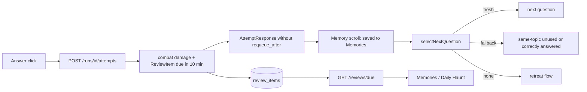

# Design Document

## Overview

Part A fixes a frontend-driven re-ask. The Backend already stores a `ReviewItem` due in 10 minutes on a wrong answer, but it also returns `requeue_after: 3`. The Frontend uses that value to bring the question back (`pendingRequeue` and `chooseQuestion` in `usePlaySession.ts`), offers "Quick retry" in the Memory scroll, and `pickQuestionId` wraps its modulo rotation so an exhausted pool asks the same question again. The fix removes all three paths and adds a selector that never repeats a missed question. The Backend stops sending `requeue_after`. Part B is an audit with small fixes and a deployment guide. Language: TypeScript (frontend) and Python (backend).

## Architecture



Decision: the re-ask lives in the Frontend, so the main fix is there. The Backend change is limited to omitting `requeue_after`, which keeps the response shape valid because the field is already optional (`Optional[int] = None`, `response_model_exclude_none=True`). The Offline_Module and mock adapter apply the same rule so demo and live play match.

## Components and Interfaces

### Frontend

- `frontend/src/state/questionSelector.ts`: add a pure function.

```ts
export interface SelectInput {
  monsterPool: readonly string[]      // monster.question_ids, in rotation order
  topicPool: readonly string[]        // all question ids of the same topic in the dungeon
  answered: ReadonlySet<string>       // answered in this Encounter
  missed: ReadonlySet<string>         // wrong anywhere in this Run
  correct: ReadonlySet<string>        // right anywhere in this Run
}
export type Selection =
  | { kind: 'fresh' | 'topic' | 'recycled'; id: string }
  | { kind: 'none' }

export function selectNextQuestion(i: SelectInput): Selection
```

Order: first unanswered, non-missed id in `monsterPool`; then an unused, non-missed id in `topicPool`; then an id in `correct` (recycled); otherwise `none`. A missed id is never returned. `pickQuestionId` stays for existing callers and tests.

- `usePlaySession.ts`: `chooseQuestion` calls `selectNextQuestion` and drops the `duePending` branch. The session keeps `missedRef` and `correctRef` sets, updated from `result.correct` only (the server value). `none` sets a retreat through the existing `retreat` action. `quickRetry` and `setSecondChance` are removed.
- `runReducer.ts`: `result-received` no longer adds to `pendingRequeue`. The `pendingRequeue` field and `requeue-*` actions are removed only if no other code uses them; otherwise the field stays always empty. Removal of unused code stays small.
- `learning/MemoryScroll.tsx` and `EncounterPopup.tsx`: drop the retry button and `RequeueNotice`; add the line "Saved to Memories. You will meet it again in the Daily Haunt." The scroll still shows the correct answer and evidence quote from the response.
- `dashboard/ProgressCards.tsx`, `haunt/HauntPage.tsx`: label the surface "Memories" and keep the Daily Haunt button.
- `offline/adapter.ts` and `api/mock/mockAdapter.ts`: stop re-inserting wrong questions in the queue and stop setting `requeue_after`; `learning/requeue.ts` keeps its API but is no longer called for presentation.

### Backend

- `backend/app/api/runs.py`: remove `requeue_after=3` in the fresh response and `cached_requeue = 3` in the replay branch. No schema change.
- `backend/tests/test_floor_campaign_e2e.py`: replace the `requeue_after == 3` assertion with an absence assertion.
- New tests: wrong attempt creates a `ReviewItem` with `due_at` about 10 minutes ahead; `GET /reviews/due` lists it once due.

### Audit areas (Part B)

| Area | Files |
|---|---|
| Secrets | `git ls-files`, `git log -p`, `.gitignore`, `.env.example` (root, backend, frontend), `frontend/dist` |
| Config | `backend/app/core/config.py` (default `SECRET_KEY` is insecure), `main.py`, `security.py` |
| Database | `core/db_url.py`, `core/database.py`, `migrations/`, `alembic.ini` |
| Security | `api/*.py` queries, `core/rate_limit*`, upload service, `ai/` prompts, `core/errors.py` |
| Deploy | `backend/Dockerfile`, `backend/render.yaml`, `frontend/vercel.json`, `package.json` |

Known items to verify or fix from exploration:
- `config.py` ships a default `SECRET_KEY`; add a production validator (Requirement 7.2).
- The Dockerfile `CMD` runs `uvicorn` without `--proxy-headers` and `--forwarded-allow-ips`; add them so `X-Forwarded-For` reaches the rate limiter. `PORT` is defaulted in the image and Render overrides it.
- `render.yaml` sits in `backend/`; Render reads it from the repo root for blueprints, so the guide must say either to move it or to create the service manually. `dockerfilePath: backend/Dockerfile` implies a root-level file.
- `database.py` sets `statement_cache_size=0` for Postgres; confirm `pool_pre_ping=True` and a small pool for Neon.
- `db_url.py` drops `sslmode`; confirm SSL arguments are re-added for asyncpg.
- `docs/DEPLOY_CHECKLIST.md` exists; extend it.

## Data Models

No schema changes. `ReviewItem(user_id, question_id, due_at, repetition, interval_days, last_result)` is reused. A new Alembic migration is not required.

## Error Handling

- `selectNextQuestion` returns `none` instead of throwing; the Play_Session retreats and shows "No fresh questions left here. Your missed questions are waiting in Memories."
- Network failure on an attempt keeps the existing `answerError` path; the missed set is updated only after a server result.
- Production settings validator raises a `ValueError` at startup naming the setting and never printing its value.

## Testing Strategy

- Unit tests: selector fallback cases, MemoryScroll copy, Memories label, backend ReviewItem and omitted-field tests, settings validator, `normalize_database_url` examples.
- Property tests (Hypothesis for Python, fast-check for TypeScript, 100 or more iterations each, tagged `Feature: frontend-14-no-retry-and-predeploy-audit, Property N`): Properties 1 to 5.
- Audit items use commands and review, not property tests.
- Frontend commands first clear the env: `Remove-Item Env:VITE_CONTRACT_LIVE,Env:VITE_API_BASE,Env:VITE_USE_MOCKS,Env:VITE_CONTRACT_UPLOADS -ErrorAction SilentlyContinue`.

## Correctness Properties

*A property is a characteristic or behavior that should hold true across all valid executions of a system-essentially, a formal statement about what the system should do. Properties serve as the bridge between human-readable specifications and machine-verifiable correctness guarantees.*

### Property 1: A missed question is never selected again

For any monster pool, topic pool, and answer history, and any sequence of selections, `selectNextQuestion` never returns an id in the missed set.

**Validates: Requirements 1.1, 1.2, 2.4**

### Property 2: Selection fallback order

For any inputs, the selection kind follows the order fresh, topic, recycled, none: a later kind is returned only when all earlier kinds have no candidate, and `none` is returned only when no non-missed candidate exists.

**Validates: Requirements 2.1, 2.2, 2.3**

### Property 3: Wrong answers cost HP and deal no damage

For any weapon, difficulty, streak and room type, a wrong answer yields `damage_dealt = 0` and `damage_taken = 10`, or `12` for a boss room; the resulting player HP is `max(0, hp - damage_taken)`.

**Validates: Requirements 3.1**

### Property 4: Wrong answers schedule a review in 10 minutes

For any question difficulty and prior repetition count, a wrong answer yields a next review time 10 minutes after the attempt and a repetition of 0.

**Validates: Requirements 3.3**

### Property 5: Database URL normalization

For any PostgreSQL URL using `postgres://`, `postgresql://` or `postgresql+asyncpg://` with any combination of `sslmode`, `channel_binding` and other query parameters, the normalized async URL starts with `postgresql+asyncpg://`, contains no `sslmode` or `channel_binding` parameter, and keeps the user, host, port and database name.

**Validates: Requirements 8.1**

### Property 6: Attempt replay is idempotent

For any attempt submitted twice with the same `attempt_id`, the second response equals the first and the number of `ReviewItem` rows for that user and question is unchanged.

**Validates: Requirements 3.4**
