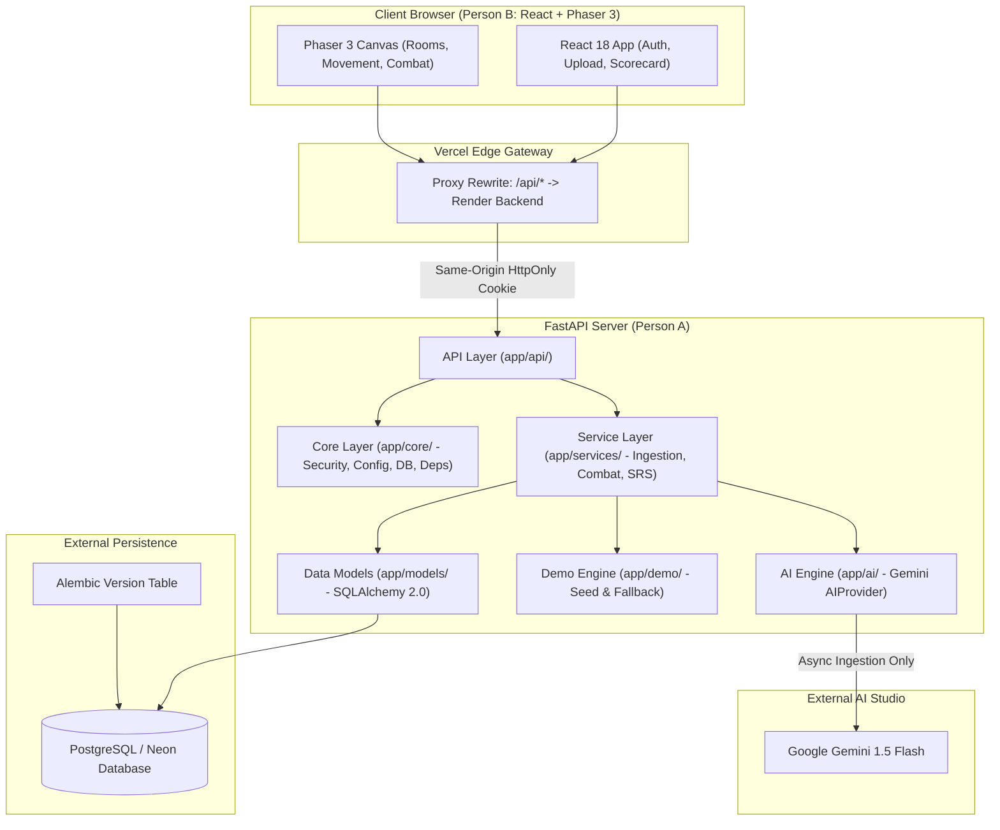
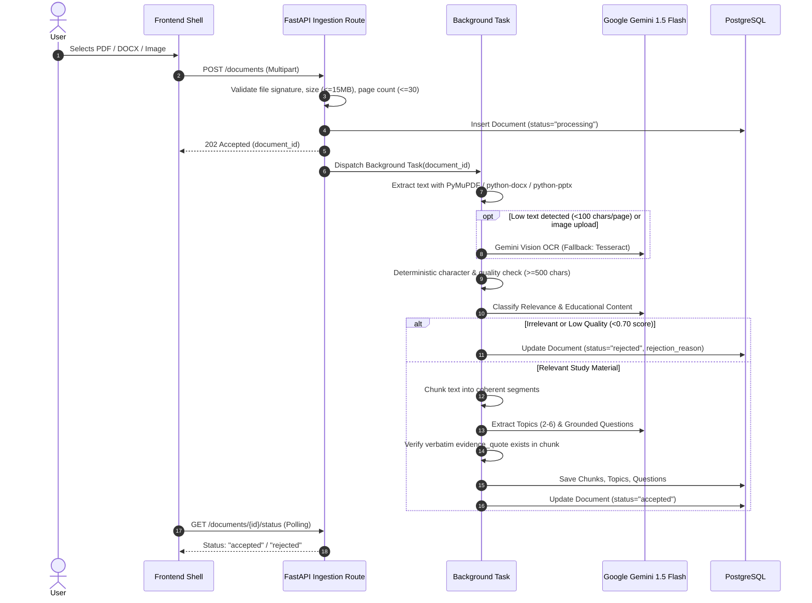

# StudyDungeon — System Architecture & Component Specification

## 1. Architectural Overview & Design Philosophy

StudyDungeon separates responsibilities cleanly between the interactive browser presentation layer (React shell + Phaser 2D game engine) and an authoritative Python backend (FastAPI + PostgreSQL + Gemini AI).

The backend operates under three immutable architectural principles:
1. **Authoritative Game State:** The client browser is an animation and user-input terminal. It submits intent (`selected_option` for a `question_id` with an idempotent `attempt_id`). The backend computes correctness, player HP, monster HP, critical damage multipliers, level XP, scores, and spaced repetition (SM-2) schedules.
2. **Zero In-Combat AI Latency:** AI generation occurs strictly during asynchronous document ingestion. Active combat queries local database records to ensure sub-50ms round-trip latency.
3. **Data Scoping & Tenant Isolation:** Every private database operation is bound to the authenticated `user_id`. Cross-user data leaks are prevented by construction.



---

## 2. Real Current Architecture vs. Planned Components

| Layer / Component | Current Implementation Status | Planned Extension |
|---|---|---|
| **FastAPI Core (`app/main.py`)** | App factory, CORS middleware, centralized error handlers, Alembic migration wiring | Additional modular routers for documents, dungeons, runs, reviews, progress |
| **Settings & Security (`app/core/`)** | `pydantic-settings` (.env parsing), Argon2 password hashing, HMAC session tokens | DB-backed rate limiting with `X-Forwarded-For` support |
| **Authentication (`app/api/auth.py`)** | `POST /register`, `POST /login`, `POST /logout`, `GET /me`, `POST /demo/session` | `DELETE /auth/me` with cascading deletion |
| **Data Models (`app/models/all_models.py`)** | 11 SQLAlchemy 2.0 async models with foreign keys & cascades | DB migration for rate-limiting log table |
| **Database Engine (`app/core/database.py`)** | Async engine + sessionmaker (SQLite aiosqlite for tests; PostgreSQL for prod) | Connection pooling optimization for Neon serverless |
| **Ingestion Pipeline (`app/services/ingestion.py`)** | Text normalization & deterministic character quality check | Asynchronous background worker, PyMuPDF, DOCX/PPTX parsers, Gemini OCR |
| **AI Provider (`app/ai/`)** | Schemas for question items and topic batches | `AIProvider` Protocol, Gemini 1.5 Flash client, prompt-injection guardrails |
| **Combat & SRS Service (`app/services/combat.py`)** | Deterministic weapon damage, critical hits, monster counter-damage, SM-2 math | Dedicated endpoints `POST /runs`, `POST /runs/{id}/attempts`, `GET /reviews/due` |
| **Demo Seed (`app/demo/seed.py`)** | 4-room "How a Computer Works" synthetic dataset seed function | Lazy expiration cleanup routine & CLI runner |

---

## 3. Directory Layout & Layer Responsibilities

```text
backend/
├── app/
│   ├── api/             # HTTP Route Handlers
│   │   ├── auth.py      # Registration, login, logout, profile, demo session
│   │   ├── documents.py # [Planned] Upload, status polling, topic preview, deletion
│   │   ├── dungeons.py  # [Planned] Dungeon listing and room layout endpoints
│   │   ├── runs.py      # [Planned] Run lifecycle, attempt verification, room clears
│   │   ├── progress.py  # [Planned] Account-wide XP, levels, weapon unlocks
│   │   ├── reviews.py   # [Planned] SRS due concepts retrieval
│   │   └── health.py    # Public health check
│   ├── core/            # Infrastructure & Cross-Cutting Concerns
│   │   ├── config.py    # Environment variables via Pydantic
│   │   ├── database.py  # Async SQLAlchemy sessionmaker
│   │   ├── deps.py      # Dependency injection: user authentication, ownership enforcement
│   │   ├── errors.py    # Unified JSON error responses
│   │   └── security.py  # Argon2 password hashing & HMAC session cookie management
│   ├── models/          # SQLAlchemy Declarative Models
│   │   └── all_models.py# Users, Documents, Chunks, Topics, Questions, Dungeons, Runs...
│   ├── schemas/         # Pydantic Schemas
│   │   ├── auth.py      # Login, registration, guest session payloads
│   │   ├── documents.py # [Planned] Upload metadata, status responses
│   │   ├── dungeons.py  # [Planned] Room layouts, monster stats
│   │   └── runs.py      # [Planned] Attempt submission & combat result payload
│   ├── services/        # Pure Business Logic
│   │   ├── ingestion.py # File parsers, chunking, deterministic character validation
│   │   ├── combat.py    # Authoritative damage calculation, weapon unlocking
│   │   └── srs.py       # [Planned] SM-2 review date scheduler & scorecard calculator
│   ├── ai/              # AI Orchestration
│   │   ├── schemas.py   # Grounded question and relevance result schemas
│   │   ├── provider.py  # [Planned] AIProvider Protocol (classify, topic_map, generate)
│   │   └── gemini.py    # [Planned] Gemini 1.5 Flash adapter with prompt protection
│   └── demo/            # Seed Data & Fallback
│       └── seed.py      # Synthetic "How a Computer Works" seed script
├── migrations/          # Alembic schema versions
├── scripts/             # CLI utilities (export_sample.py, purge_guests.py)
└── tests/               # pytest test suite
```

---

## 4. Request Flow & Session Lifecycle

### 4.1 Cookie-Only Authentication & Proxy Integration
To prevent Cross-Site Scripting (XSS) credential theft, access tokens are never placed in client `localStorage`. Authentication uses strictly `HttpOnly`, `SameSite=Lax`, `Secure` cookies.

- **Vercel Rewrite Strategy:** The frontend on Vercel proxies all `/api/*` requests directly to the Render backend service:
  ```json
  // vercel.json rewrite rule:
  {
    "source": "/api/:path*",
    "destination": "https://studydungeon-api.onrender.com/api/:path*"
  }
  ```
- Because the browser communicates exclusively with its own domain, cookies are treated as first-party (Same-Origin). This eliminates third-party cookie blocking issues in modern browsers (Chrome, Safari, Firefox).

### 4.2 Rate Limiting via `X-Forwarded-For`
Behind the Vercel proxy, the client's real IP address is passed via the `X-Forwarded-For` header. The backend parses the leftmost public IP and enforces database-backed rate limiting for:
- `POST /auth/login` (max 10 requests / minute)
- `POST /demo/session` (max 60 requests / hour)

---

## 5. Ingestion Pipeline & Multimodal OCR Architecture



- **Per-User Quotas:** Maximum 5 stored documents per registered user.
- **Retryability:** If extraction fails due to temporary network issues or provider throttling, the document status is marked `failed` with an actionable error and can be retried without re-uploading.

---

## 6. Authoritative Combat & Game State Mechanics

Combat is strictly turn-based and authoritative:
1. When entering a room, the frontend requests room questions.
2. The player selects an option. The browser submits:
   ```json
   {
     "attempt_id": "client-generated-uuid-for-idempotency",
     "question_id": "question-uuid",
     "selected_option": 1,
     "response_time_ms": 2400
   }
   ```
3. The server queries the pre-stored `Question.correct_option`:
   - **If Correct:** Calculates damage = `Base Weapon Damage * Difficulty Multiplier (1.25x if Hard) * Streak Multiplier (1.50x on 3rd streak)`. Deducts HP from the room monster. Player HP remains unchanged.
   - **If Incorrect:** Monster counter-attacks dealing `10 HP` (or `12 HP` for Boss). Monster takes 0 damage. The question is scheduled for SM-2 review in **10 minutes**.
4. The server records the `Attempt` row append-only and returns updated snapshots of `player_hp_remaining`, `monster_hp_remaining`, `score_delta`, and verbatim `evidence_quote`.

---

## 7. Demo Engine & Seeded Access Rules

- **Zero AI Usage:** The demo dungeon (`is_public_demo=true`) is seeded from synthetic notes on *"Computer Systems & Architecture"*. It never invokes Gemini API.
- **Guest Permissions:** Guests created via `POST /demo/session` can play only dungeons with `is_public_demo == True`. Guests attempting to call `POST /documents` or `POST /documents/{id}/generate-dungeon` receive `403 Forbidden`.
- **Guest Session Cleanup:**
  1. **Lazy Purge:** Every time `POST /demo/session` is invoked, expired guests (`expires_at < now()`) are purged in a background transaction.
  2. **CLI Runner:** `python -m scripts.purge_guests` allows ad-hoc maintenance.
  3. **GitHub Action:** A scheduled cron workflow triggers the cleanup endpoint daily.

---

## 8. Deployment Target & Cold-Start Mitigation

- **Free-Tier Topology:**
  - **Frontend:** Vercel Static Web App.
  - **Backend:** Render Free Web Service running `backend/Dockerfile` (`python:3.11-slim` + system `tesseract-ocr`).
  - **Database:** Neon Serverless PostgreSQL with auto-suspend.
- **Cold-Start Handling:**
  - Free Render instances spin down after 15 minutes of inactivity. First request cold start takes ~30–50 seconds.
  - The frontend displays an interactive atmospheric spinner: *"Waking up the dungeon..."*.
  - If the backend does not respond within **8 seconds**, the frontend gracefully offers an immediate **Offline Demo Mode** utilizing the pre-bundled `demo_dungeon.sample.json`.

