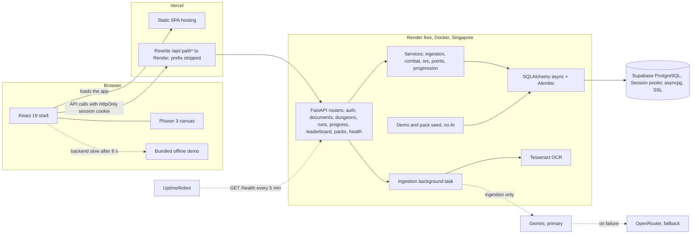

# StudyDungeon

Upload your study notes and play them as a haunted dungeon crawl. Topics become rooms, key concepts become monsters, and correct answers are your weapon.

**🎮 Play it: https://studydungeon.vercel.app — click Try the Demo, no sign-up.**

- Live app: https://studydungeon.vercel.app (API: https://studydungeon-api.onrender.com)
- Demo video: [FILL IN: public YouTube link]
- Screenshots: [FILL IN: 2-4 screenshots, e.g. title screen, combat, scorecard, leaderboard]

## 🎯 Problem and audience

Students re-read notes and call it studying, but recall practice works better and is tedious to set up. StudyDungeon turns a student's own notes into quiz questions that cite the passage they came from, and wraps them in a game so students keep playing. It is aimed at high-school and university students who have lecture notes, slides, or textbook scans.

## ✨ Features

- 📄 **Upload notes:** PDF, TXT, DOCX, PPTX, PNG, JPG/JPEG. Files pass deterministic quality checks and a Gemini relevance gate. Irrelevant or unreadable files are rejected with feedback.
- 🔍 **Grounded questions:** The AI extracts 2-6 topics and generates source-grounded questions per topic. Each question carries an `evidence_quote` that is verified against the stored chunk text, plus the page or slide.
- 🏰 **Dungeon:** Topics are themed rooms and concepts are monsters. Standard monsters have 60-100 HP, elites 120-160, bosses 220-300.
- ⚔️ **Server-authoritative combat:** The browser sends only the question, the selected option and an attempt id. The backend computes correctness, damage, HP, score and XP.
  - Player starts with 100 HP. A wrong answer costs 10 HP (12 from a boss) and deals no damage.
  - Five weapons: Rusty Dagger (20, starter), Arcane Staff (25, 100 XP), Hunter Crossbow (30, clear 2 rooms), Spectral Hammer (35, level 3), Flame Sigil (40, defeat the first boss).
  - Hard questions deal base damage x 1.25. Three correct answers in a row is a critical, x 1.5 on top.
- 🧠 **Memories and spaced repetition:** A wrong answer is not re-asked in the same fight. It goes to Memories and is scheduled with simplified SM-2 (due in 10 minutes). Correct answers move out to 1, 3, 7, 14, then 30 days.
- 👻 **Daily Haunt:** A review session built from the questions that are due.
- 📊 **Scorecard:** Accuracy and per-topic mastery: Weak (< 50%), Learning (50-79%), Strong (>= 80%).
- 🏆 **Leaderboard:** Ranks all players, including named guests.
- 🕹️ **Try the Demo:** A hand-crafted dungeon with no sign-up and no AI calls.
- 📴 **Offline demo fallback:** If the backend has not answered after 8 seconds (free-tier cold start), the app offers a bundled offline demo.
- ♿ **Accessibility:** Reduced-motion support and keyboard play.

## 🛠️ Tech stack

| Layer | Technology |
|---|---|
| Frontend | React 19 + TypeScript + Vite + Tailwind CSS, Phaser 3 (inside a `GameCanvas` component) |
| Backend | Python 3.11+, FastAPI, Pydantic v2, SQLAlchemy 2.0 (async), Alembic |
| Database | Supabase PostgreSQL |
| AI | Google Gemini; OpenRouter as a fallback provider. Used only during document ingestion |
| Auth | Argon2 password hashing, HttpOnly session cookies |
| Documents | PyMuPDF, python-docx, python-pptx, Pillow + Tesseract OCR |

## 🗺️ Architecture



- **Request flow:** The browser calls `/api/*` on the Vercel domain. Vercel strips the `/api` prefix and forwards to the Render FastAPI service, whose routes have no `/api` prefix. Routers call services, which use SQLAlchemy to reach Supabase.
- **Same-origin cookies:** Because of the rewrite, the HttpOnly session cookie is first-party to the Vercel domain.
- **AI only during ingestion:** `POST /documents` starts a background task that extracts text (Tesseract for images), runs the relevance check and generates questions with Gemini, falling back to OpenRouter when enabled. Combat reads stored questions from the database and the server computes all results.
- **Cold start:** Render's free tier sleeps when idle (an optional UptimeRobot ping of `/health` keeps it warm). If the backend has not answered after 8 seconds, the app offers the bundled offline demo.

## 📁 Repository layout

```text
backend/    FastAPI app (app/api, core, models, schemas, services, ai, demo), Alembic migrations, pytest suite
frontend/   React app, Phaser scenes, Tailwind styles, Vitest suite
.kiro/      Kiro specs, hooks and steering files
docs/       Deploy checklist, Kiro write-up, Devpost text, demo script, handoff notes, openapi.json
render.yaml Render service definition
```

## 💻 Run locally

Requires Python 3.11+ and Node.js. Open two terminals.

### Backend (port 8000)

Windows PowerShell:

```powershell
cd backend
python -m venv .venv
.venv\Scripts\Activate.ps1
pip install -r requirements.txt
Copy-Item .env.example .env
alembic upgrade head
uvicorn app.main:app --port 8000
```

macOS / Linux:

```bash
cd backend
python3 -m venv .venv
source .venv/bin/activate
pip install -r requirements.txt
cp .env.example .env
alembic upgrade head
uvicorn app.main:app --port 8000
```

Edit `backend/.env` first: set `DATABASE_URL`, `SECRET_KEY` and `GEMINI_API_KEY`. Secrets stay in backend environment variables only.

### Frontend (port 5173)

Windows PowerShell:

```powershell
cd frontend
npm install
Copy-Item .env.example .env.local
npm run dev
```

macOS / Linux:

```bash
cd frontend
npm install
cp .env.example .env.local
npm run dev
```

The default `.env.local` runs in mock mode (`VITE_USE_MOCKS=true`), so the frontend works without a backend. To use the real backend, set `VITE_USE_MOCKS=false` and `VITE_API_BASE=http://localhost:8000`, then open http://localhost:5173.

## 🧪 Tests

- Backend: 165 pytest tests, including Hypothesis property tests. Run `pytest` in `backend/` (dev dependencies are in `requirements-dev.txt`).
- Frontend: 1554 Vitest tests, including fast-check property tests. In `frontend/` run `npm test`, `npm run typecheck` and `npm run lint`.

## 🚀 Deploy

Frontend on Vercel, backend on Render (`backend/Dockerfile`, `render.yaml`), database on Supabase. `frontend/vercel.json` rewrites `/api/*` to the Render service, so session cookies stay first-party. Steps and environment variables are in [docs/DEPLOY_CHECKLIST.md](docs/DEPLOY_CHECKLIST.md).

## 🤖 Built with Kiro

The project was built spec-first with Kiro. The repository tracks `.kiro/` with:

- 20 specs in `.kiro/specs/` (8 backend, 11 frontend, 1 docs)
- 2 agent hooks in `.kiro/hooks/`: run backend tests on Python file save, and run frontend lint, typecheck and tests on TypeScript file save
- 9 steering files in `.kiro/steering/` that act as the contract between backend and frontend (API, architecture, game design, security, and more)

Property-based tests found real bugs, for example a preloaded-dungeon pick that used array position instead of `order`. Details are in [docs/KIRO_WRITEUP.md](docs/KIRO_WRITEUP.md).

## 👥 Team

- M Taha Tabassum: Person B, frontend and game (React, Phaser, UI, Vercel)
- Muhammad Abdullah: Person A, AI and backend (FastAPI, ingestion, Gemini, database, Render)

## 📜 License

MIT. See [LICENSE](LICENSE).

## Frontend

### Layout check

`npm run layout:check` (in `frontend/`) opens the fit screens in a local headless Chrome or Edge at desktop and phone sizes and fails on page scrollbars, nested scrollbars and clipped text. It starts the Vite dev server in mock mode itself and stops only what it started. No dependency is added.

- `LAYOUT_BROWSER`: path to the browser executable. Without it the script tries Chrome, then Edge, in the default Windows, macOS and Linux locations.
- `LAYOUT_URL`: use a running server instead of starting Vite.
- `-- --routes /upload,/leaderboard`, `-- --sizes 1366x768,360x740`, `-- --screenshots .layout-shots/run1` (PNG per route and size; the folder is gitignored).
- Exit code 1 on any failure.
