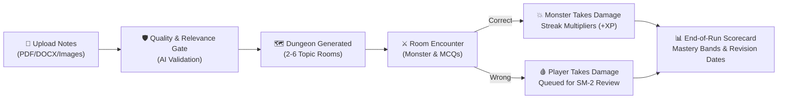
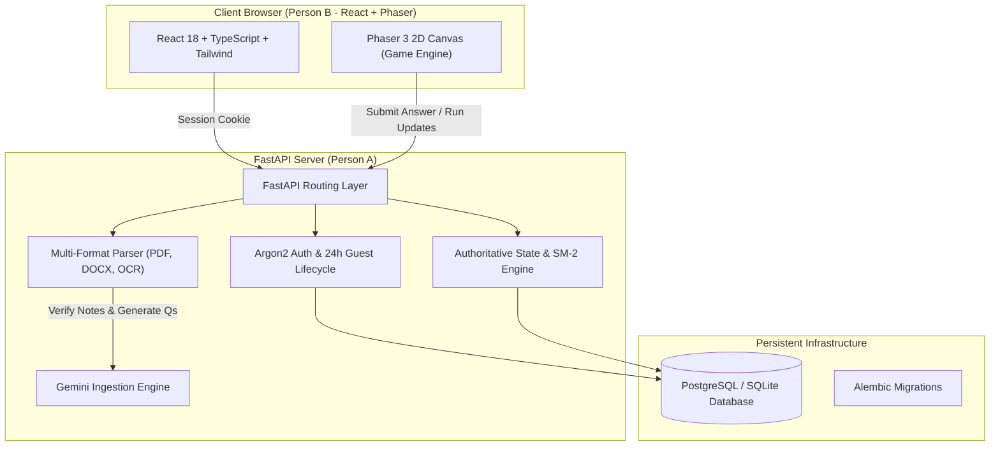

# 🏰 StudyDungeon

> **An Adaptive Learning RPG that transforms students' notes into a playable haunted 2D dungeon crawl.**  
> *Built for Kiroween 2026 Hackathon • Category: Frankenstein*

[](https://www.python.org/)
[](https://fastapi.tiangolo.com/)
[](https://www.sqlalchemy.org/)
[](https://alembic.sqlalchemy.org/)
[](https://ai.google.dev/)
[](https://phaser.io/)
[](https://opensource.org/licenses/MIT)

---

## 📖 Table of Contents
- [1. Executive Summary & Concept](#1-executive-summary--concept)
- [2. How It Works (The Gameplay Loop)](#2-how-it-works-the-gameplay-loop)
- [3. System Architecture & Tech Stack](#3-system-architecture--tech-stack)
- [4. Repository Structure & Team Ownership](#4-repository-structure--team-ownership)
- [5. Detailed Features](#5-detailed-features)
  - [5.1 Document Ingestion & Multimodal Guardrails](#51-document-ingestion--multimodal-guardrails)
  - [5.2 AI Topic & Question Engine](#52-ai-topic--question-engine)
  - [5.3 Authoritative Combat & SM-2 Spaced Repetition](#53-authoritative-combat--sm-2-spaced-repetition)
  - [5.4 "Try the Demo" Guest Experience](#54-try-the-demo-guest-experience)
- [6. API Endpoints Reference](#6-api-endpoints-reference)
- [7. Local Setup & Quickstart](#7-local-setup--quickstart)
- [8. Running Tests & Quality Checks](#8-running-tests--quality-checks)
- [9. Docker & Production Deployment](#9-docker--production-deployment)
- [10. Limitations & Zero-Cost Guardrails](#10-limitations--zero-cost-guardrails)
- [11. License](#11-license)

---

## 1. Executive Summary & Concept

Most educational quizzes are boring dashboards. **StudyDungeon** replaces flashcards with a top-down retro 2D dungeon crawler powered by your actual lecture notes.

- **Dungeon Rooms** represent extracted study topics (e.g., *CPU Registers*, *Networking Protocols*).
- **Monsters** embody concepts within that topic.
- **Combat Mechanics** turn active recall into weapon attacks:
  - **Correct Answer:** The student unleashes their weapon (Rusty Dagger, Arcane Staff, Hunter Crossbow, etc.) dealing deterministic damage to the monster.
  - **Wrong Answer:** The monster counter-attacks, depleting player HP, and the question is automatically pushed to a spaced-repetition revision queue.
- **Judges Demo:** A single-click **"Try the Demo"** button on the landing page launches an instant, fully pre-seeded dungeon without sign-up or AI quota usage.

---

## 2. How It Works (The Gameplay Loop)



1. **Upload:** Student uploads lecture notes or slides.
2. **Deterministic & AI Gate:** The system extracts raw text, inspects readable character ratios, and asks Gemini to verify educational relevance (rejecting memes, invoices, or prompt injections).
3. **Chunking & Question Generation:** Gemini extracts 2–6 topics and generates 5–8 MCQs per topic. **Every question contains an exact verbatim quote citing the page/slide in the notes.**
4. **Authoritative Combat:** In battle, the client browser only animates. The server calculates all damage, HP snapshots, and streak criticals.
5. **Scorecard:** Upon defeating the boss or exhausting HP, the student receives a mastery breakdown (Weak <50%, Learning 50-79%, Strong ≥80%) and scheduled revision intervals.

---

## 3. System Architecture & Tech Stack



### Technology Matrix
| Layer | Technology | Version | Rationale |
|---|---|---|---|
| **Backend Core** | FastAPI | >= 0.110 | Asynchronous, typed REST contracts, OpenAPI schema generation |
| **Data & ORM** | SQLAlchemy + Alembic | 2.0+ (async) | Modern async DB operations with robust migration tracking |
| **Database** | PostgreSQL / SQLite | 15+ / 3.x | PostgreSQL for cloud production (Neon); SQLite for zero-config local tests |
| **Authentication** | Argon2 (`argon2-cffi`) | 23.1+ | Memory-hard password hashing; HttpOnly SameSite secure cookie sessions |
| **AI Integration** | Google Gemini API | 1.5 Flash | Free-tier multimodal intelligence for document classification & question banking |
| **Document Parsers** | PyMuPDF, python-docx, python-pptx, Tesseract | Ingestion only | Deterministic local text extraction with OCR fallback |
| **Testing & Linting** | pytest, pytest-asyncio, httpx, ruff | Latest | High test velocity and strict static code quality |

---

## 4. Repository Structure & Team Ownership

This project follows a strict division between **Person A (Backend/AI Owner)** and **Person B (Frontend/Game Owner)** to prevent merge conflicts.

```text
studydungeon/
├── .gitignore               # Strict ignore rules (ignores .env, *.db; protects .kiro/)
├── LICENSE                  # MIT License
├── README.md                # Comprehensive documentation
├── .env.example             # Template for required environment variables
├── .kiro/                   # Kiro Hackathon Steering & Specs (NEVER ignored)
│   ├── steering/            # Shared agreements (api-contract.md, game-design.md)
│   ├── specs/               # Step-by-step feature specifications (backend-01 .. 06)
│   └── hooks/               # Automated hooks (backend-test-on-save.json)
├── docs/
│   └── handoff/             # Handoff communications & offline fallback sample JSON
│       ├── A-to-B.md        # Person A status and API updates for Person B
│       ├── B-to-A.md        # Person B requests and notes for Person A
│       └── demo_dungeon.sample.json # Offline seeded game fallback
├── backend/                 # PERSON A DOMAIN
│   ├── app/
│   │   ├── api/             # REST endpoints (auth, health)
│   │   ├── core/            # Config, security, database session, dependencies
│   │   ├── models/          # SQLAlchemy async models
│   │   ├── schemas/         # Pydantic v2 validation models
│   │   ├── services/        # Business logic (combat math, text ingestion)
│   │   ├── ai/              # Gemini AI schemas & provider interface
│   │   └── demo/            # Seed script for 0-AI demo dungeon
│   ├── migrations/          # Alembic migration scripts
│   ├── scripts/             # Utility scripts (export_sample.py)
│   ├── tests/               # Modular pytest suite (auth, demo, combat, etc.)
│   ├── Dockerfile           # Production container configuration
│   ├── pyproject.toml       # Ruff and build configuration
│   └── requirements.txt     # Locked dependencies
└── frontend/                # PERSON B DOMAIN (React UI + Phaser 3 canvas)
```

---

## 5. Detailed Features

### 5.1 Document Ingestion & Multimodal Guardrails
- **Supported Formats:** PDF (`.pdf`), Word (`.docx`), PowerPoint (`.pptx`), Plain Text (`.txt`), and Images (`.png`, `.jpg`, `.jpeg`). Legacy formats (`.doc`, `.ppt`) and archives (`.zip`, `.exe`) are rejected with actionable errors.
- **Extraction Pipeline:**
  - PDF extracted page-by-page via PyMuPDF. Pages with low text (<100 characters) trigger Tesseract OCR.
  - DOCX/PPTX parsed preserving headings, lists, tables, and slide numbers.
  - Deterministic check: Minimum 500 characters, printable character ratio ≥ 70%.
- **Gemini AI Relevance Gate:**
  - Notes are evaluated against strict thresholds: `educational_content_score >= 0.70`, `readability_score >= 0.65`.
  - Non-study files (memes, grocery receipts, bank statements) are rejected immediately.
  - Uploaded content is treated as untrusted data with strict anti-prompt-injection instructions.

### 5.2 AI Topic & Question Engine
- **Topic Clustering:** Aggregates chunks into 2–6 coherent study topics.
- **Zero Hallucination Grounding:** Every question contains:
  - A question prompt and 4 options (or 2 for True/False).
  - `source_chunk_id` and page/slide reference.
  - **`evidence_quote`**: An exact verbatim quote from the notes verified by the server.
- **Zero In-Combat AI:** Questions are pre-generated during document upload. In-game combat queries PostgreSQL locally, guaranteeing sub-50ms latency.

### 5.3 Authoritative Combat & SM-2 Spaced Repetition
- **Player & Monster Health:**
  - Player starts with **100 HP**. Standard monsters have 60–100 HP; Boss has 220–300 HP.
- **Deterministic Weapon Damage:**
  | Weapon | Unlock Level | Base Damage | Attack Profile |
  |---|---|---|---|
  | **Rusty Dagger** | Starter Weapon | 20 | Quick slash |
  | **Arcane Staff** | 100 XP | 25 | Magic bolt |
  | **Hunter Crossbow** | Clear 2 Rooms | 30 | Piercing arrow |
  | **Spectral Hammer** | Level 3 | 35 | Heavy slam |
  | **Flame Sigil** | Defeat 1st Boss | 40 | Fire burst |
- **Damage Multipliers:**
  - Hard difficulty question: `Base Damage × 1.25`
  - 3-in-a-row correct streak (Critical Hit): `Base Damage × 1.50`
  - Wrong answer: Monster deals **10 HP** to the player (Boss deals **12 HP**).
- **SM-2 Spaced Repetition Intervals:**
  - Wrong Answer: Resets streak; scheduled for review in **10 minutes**.
  - 1st Correct: Scheduled in **3 days**.
  - 2nd Correct: Scheduled in **7 days**.
  - 3rd Correct: Scheduled in **14 days**, then **30 days**.

### 5.4 "Try the Demo" Guest Experience
- **Instant Access:** `POST /demo/session` creates a 24-hour temporary guest user without requiring registration.
- **Seeded "How a Computer Works" Dungeon:**
  - Topic 1: Central Processing Unit (CPU) vs *Silicon Golem*
  - Topic 2: Primary & Secondary Storage vs *Memory Wraith*
  - Topic 3: Networking & Protocols vs *Packet Spectre*
  - Topic 4: Von Neumann Architecture vs *The Exam Warden (Boss)*
- **Offline Fallback:** Exported as [`demo_dungeon.sample.json`](file:///D:/dev-stuff/studydungeon/docs/handoff/demo_dungeon.sample.json) so the frontend can run the demo even if the backend is cold-starting.

---

## 6. API Endpoints Reference

| Method | Endpoint | Access Level | Description |
|---|---|---|---|
| `GET` | `/health` | Public | Service health & active AI provider status |
| `POST` | `/demo/session` | Public (Rate-limited) | 1-click guest session creation & seeded demo ID |
| `POST` | `/auth/register` | Public | Registers a user with Argon2 password hashing |
| `POST` | `/auth/login` | Public | Authenticates and sets HttpOnly session cookie |
| `POST` | `/auth/logout` | Authenticated | Clears session cookie |
| `GET` | `/auth/me` | Authenticated | Returns current authenticated user profile |
| `POST` | `/documents` | Registered Only | Uploads study note file (multipart/form-data) |
| `GET` | `/documents/{id}/status` | Owner Only | Returns extraction and AI relevance status |
| `GET` | `/documents/{id}/topics` | Owner Only | Returns extracted topics and chunk count |
| `POST` | `/documents/{id}/generate-dungeon` | Registered Only | Creates dungeon rooms and grounded question bank |
| `GET` | `/dungeons` | Authenticated | Lists user's dungeons + public demo dungeon |
| `GET` | `/dungeons/{id}` | Authenticated | Retrieves dungeon room layout and monsters |
| `POST` | `/runs` | Authenticated | Starts a new dungeon run |
| `POST` | `/runs/{id}/attempts` | Run Owner Only | Authoritative answer verification, combat damage, and HP snapshot |
| `POST` | `/runs/{id}/rooms/{room_id}/clear`| Run Owner Only | Awards room clearance XP and bonuses |
| `POST` | `/runs/{id}/finish` | Run Owner Only | Finalizes run and calculates end-of-dungeon scorecard |
| `GET` | `/progress` | Authenticated | Account level, total XP, unlocked weapons |
| `GET` | `/reviews/due` | Authenticated | Questions currently due for spaced repetition review |

---

## 7. Local Setup & Quickstart

### Prerequisites
- Python 3.11 or newer
- Git

### 1. Clone & Enter Directory
```bash
git clone https://github.com/your-username/studydungeon.git
cd studydungeon/backend
```

### 2. Create Virtual Environment & Install Dependencies
```bash
python -m venv venv

# On Windows:
.\venv\Scripts\activate

# On Linux / macOS:
source venv/bin/activate

pip install -r requirements.txt
```

### 3. Configure Environment Variables
Copy `.env.example` to `.env`:
```bash
cp .env.example .env
```
Key settings:
```ini
DATABASE_URL=sqlite+aiosqlite:///./studydungeon.db
AI_PROVIDER=gemini
GEMINI_API_KEY=your-gemini-api-key-here
SECRET_KEY=a-long-random-secret-key-at-least-32-characters
```

### 4. Run Database Migrations
Apply Alembic migrations to generate tables:
```bash
alembic upgrade head
```

### 5. Start the Development Server
```bash
uvicorn app.main:app --reload --port 8000
```
- API is running at: `http://localhost:8000`
- Interactive OpenAPI Docs: `http://localhost:8000/docs`
- ReDoc Docs: `http://localhost:8000/redoc`

---

## 8. Running Tests & Quality Checks

The backend includes a comprehensive, modularized test suite covering authentication, tenant isolation, combat calculations, spaced repetition intervals, and ingestion quality:

```bash
# Run full test suite
pytest -v

# Run linter checks
ruff check .
```

Expected output:
```text
tests/test_auth.py::test_user_registration_and_login PASSED
tests/test_auth.py::test_auth_me_endpoint PASSED
tests/test_combat.py::test_combat_damage_calculation PASSED
tests/test_combat.py::test_srs_intervals PASSED
tests/test_demo.py::test_demo_guest_session PASSED
tests/test_demo.py::test_guest_me_endpoint PASSED
tests/test_health.py::test_health_endpoint PASSED
tests/test_ingestion.py::test_text_normalization PASSED
tests/test_ingestion.py::test_text_quality_checks PASSED
tests/test_isolation.py::test_cross_user_isolation PASSED

============================= 10 passed in 0.88s ==============================
```

---

## 9. Docker & Production Deployment

A production-ready `Dockerfile` is provided in `backend/`:

```bash
# Build Docker image
docker build -t studydungeon-backend backend/

# Run Docker container
docker run -p 8000:8000 --env-file backend/.env studydungeon-backend
```

### Free-Tier Hosting Topology
- **Backend:** Render / Fly.io / Koyeb (Python container web service).
- **Database:** Neon Serverless PostgreSQL free tier.
- **Frontend:** Vercel / Netlify static hosting.

---

## 10. Limitations & Zero-Cost Guardrails

1. **Cold Starts:** Free Python web hosts (e.g., Render) spin down on idle; the initial request may take ~30–45 seconds. The frontend features an 8-second waking screen before gracefully falling back to the bundled offline demo.
2. **AI Quota Protection:** Guests are strictly forbidden from uploading files or triggering LLM generation. Only registered accounts can ingest documents.
3. **Upload Size Limit:** Capped at 15 MB to prevent server resource exhaustion.

---

## 11. License

This project is licensed under the terms of the **MIT License**.  
See the [`LICENSE`](file:///D:/dev-stuff/studydungeon/LICENSE) file for complete details.  
Copyright (c) 2026 StudyDungeon contributors.
