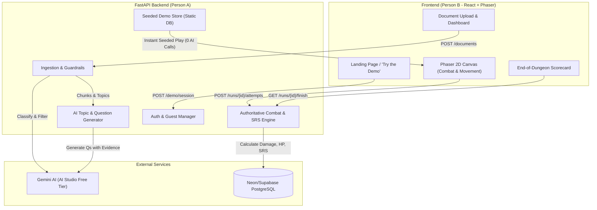
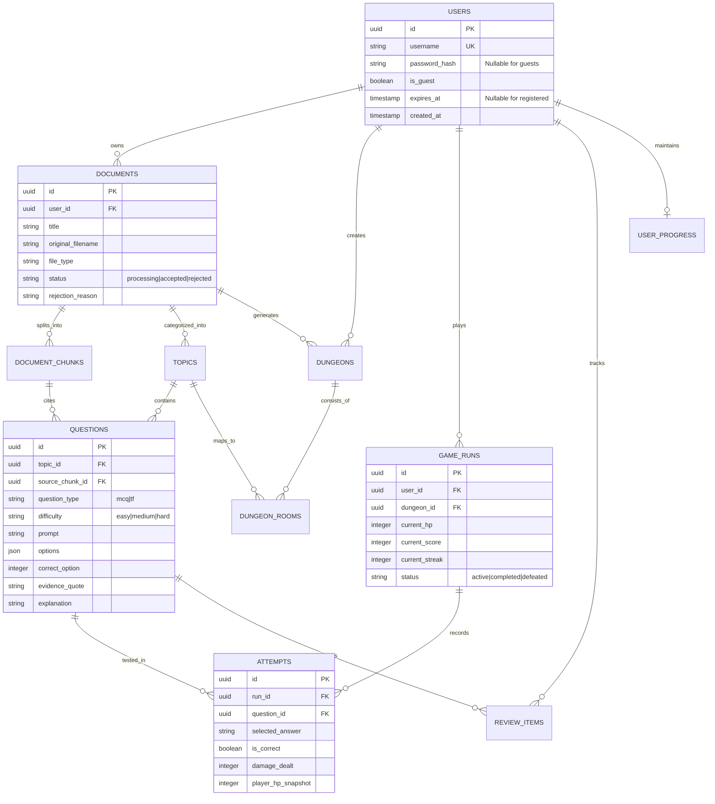

# Product Requirements Document (PRD)
## Project: StudyDungeon — AI & Backend System (Person A Scope)
**Event:** Kiroween 2026 Hackathon (Frankenstein Category)  
**Document Version:** 1.0  
**Target Completion:** 14–18 Days  
**Cost Constraint:** $0 (Strictly Free-Tier Services)

---

## 1. Executive Summary & Objective

**StudyDungeon** is a browser-based adaptive learning 2D RPG that transforms students' raw study notes (PDF, TXT, DOCX, PPTX, Images) into an interactive haunted dungeon crawl.

- **Dungeon Rooms** represent extracted study topics.
- **Monsters** represent specific concepts within that topic.
- **Combat Mechanics** are fueled by answering source-grounded questions. Correct answers deal deterministic weapon damage to monsters; incorrect answers deduct player HP and enter a spaced-repetition review queue.
- **Primary Hackathon Differentiator:** A single-click **"Try the Demo"** experience allowing judges to immediately play a pre-seeded, curated dungeon without registration or consuming AI quota.

This PRD defines the complete technical, operational, and architectural requirements for **Person A (Backend + AI Owner)**, ensuring clean integration with **Person B (Frontend + Phaser Game Owner)**.

---

## 2. Person A (Backend/AI) vs Person B (Frontend/Game) Boundaries

> Strict boundaries are enforced to prevent merge conflicts and duplicated work.

### Person A Scope (What we build)
- **FastAPI Core App:** Modular architecture (`app/api`, `app/core`, `app/models`, `app/schemas`, `app/services`, `app/ai`, `app/demo`).
- **Data Layer:** PostgreSQL models & Alembic migrations for users, documents, chunks, topics, questions, dungeons, rooms, runs, attempts, reviews, and progress.
- **Auth & Access Control:** Argon2 username/password authentication, HttpOnly secure cookies, and guest session lifecycle.
- **Ingestion & Guardrails:** Multi-format parser (PDF, DOCX, PPTX, TXT, Images/OCR) + Gemini AI relevance and quality gate.
- **AI Question Engine:** Source-grounded MCQ/TF generation with exact verbatim chunk evidence quotes.
- **Authoritative Game State Engine:** Server-verified combat calculations, HP, damage multipliers, scoring, and SM-2 spaced repetition scheduling.
- **Demo Engine:** Pre-seeded synthetic "How a computer works" dungeon (0 AI cost) + IP-rate-limited guest sessions.

### Person B Scope (Strictly Forbidden for Person A)
- No frontend React, Tailwind, Vite, or CSS code.
- No Phaser 3 game canvas, animations, audio, sprites, or scenes.
- No client-side visual design decisions or frontend hosting setup.
- Any contract adjustments must be proposed via `docs/handoff/A-to-B.md`.

---

## 3. Technology Stack & Free-Tier Specifications

| Layer | Technology | Version / Specification | Rationale & Free-Tier Guardrails |
|---|---|---|---|
| **Runtime** | Python | 3.11+ | High performance, typed async FastAPI |
| **Framework** | FastAPI | >= 0.110 | Asynchronous OpenAPI generation, Pydantic v2 support |
| **ORM & Migrations**| SQLAlchemy + Alembic | 2.0+ (asyncpg/psycopg) | Strict relational integrity, async DB driver |
| **Database** | PostgreSQL | 15+ (Neon / Supabase) | Serverless free-tier with connection pooling |
| **Password Hashing**| Argon2 | `argon2-cffi` | State-of-the-art security without plaintext storage |
| **Primary AI Provider**| Google Gemini API | `gemini-1.5-flash` / `gemini-pro` | High rate limits, multimodal capability on AI Studio free tier |
| **Fallback AI Provider**| OpenRouter | Manual switch only | Emergency testing only; NEVER auto-triggered on error |
| **Document Parsers**| PyMuPDF, python-docx, python-pptx, Pillow, Tesseract | Ingestion only | Deterministic, local text/metadata extraction |
| **Testing** | pytest, pytest-asyncio, httpx | Strict automated tests | >85% test coverage on business logic |

---

## 4. System Architecture & Information Flow

---

## 5. Detailed Feature Specifications

### 5.1 Foundation, Authentication & Guest Sessions
1. **User Types:**
   - **Registered User:** Unique case-insensitive username, Argon2 password hash, persistent access.
   - **Guest User:** `is_guest=true`, auto-generated username (`guest_xxxx`), `expires_at = now + 24h`, `password_hash = NULL`.
2. **Session Handling:** HttpOnly, Secure, `SameSite=Lax` cookies containing a signed session identifier. No tokens in `localStorage`.
3. **Data Ownership & Isolation Rule:**
   - Every single private DB query MUST filter by `user_id == current_user.id`.
   - Never trust client-supplied IDs. Cross-user access returns `404 Not Found` (or `403 Forbidden`).
4. **Guest Restrictions:**
   - Guests CANNOT call `POST /documents` or `POST /documents/{id}/generate-dungeon`.
   - Guests CAN play the seeded demo dungeon, save private run attempts, and inspect their own scorecards.
5. **Periodic Cleanup:** Automated scheduled job to purge expired guests (`expires_at < now`) and their cascading runs/attempts.

---

### 5.2 Document Ingestion & Multimodal Guardrails
Supported formats: **PDF, TXT, DOCX, PPTX, PNG, JPG, JPEG**. All legacy formats (`.doc`, `.ppt`) or archives (`.zip`, `.exe`) are rejected immediately with descriptive errors.

1. **Safety Checks:**
   - Max file size: 15 MB (configurable via `MAX_UPLOAD_MB`).
   - Magic bytes / file signature validation (not just file extensions).
   - Random internal UUID filename in temp directory; never trust user filenames.
2. **Extraction Engine:**
   - **PDF:** PyMuPDF page-by-page. Pages with <100 characters trigger Tesseract OCR.
   - **DOCX / PPTX:** Structured extraction preserving headings, paragraphs, tables, and slide numbers.
   - **Images:** Dimension validation + Tesseract OCR.
3. **Deterministic Quality Gate:**
   - Minimum extracted character length: 500 characters.
   - Readable ASCII/Unicode ratio check.
4. **AI Relevance Guardrail (Gemini):**
   - Uploaded text is treated as **untrusted data**. System prompts instruct Gemini to ignore prompt-injection attempts inside user notes.
   - Gemini evaluates: `educational_content_score` (>=0.70 threshold) and `readability_score` (>=0.65 threshold).
   - Rejects non-study material (memes, invoices, receipts, chat logs) with actionable error reasons.
   - Deletes temporary raw upload files immediately after chunking.

---

### 5.3 AI Topic Extraction & Grounded Question Generation
1. **Topic Identification:** Identifies 2 to 6 coherent topics per document. Chunks are tagged and stored with exact page/slide/character boundaries.
2. **Question Generation Rules:**
   - 5 to 8 questions per topic (MCQ and True/False).
   - Strict Pydantic validation for structured JSON output.
   - **Mandatory Source Citation:** Each question MUST include:
     - `source_chunk_id`
     - `page_or_slide_reference`
     - `evidence_quote` (Must appear verbatim in the extracted chunk; verified deterministically by backend code).
3. **Zero AI In-Combat:** The question bank is generated and saved to PostgreSQL at ingestion time. **No LLM calls are made during game attacks**, guaranteeing sub-50ms combat latency.

---

### 5.4 Authoritative Game State, Combat & SRS Engine
> The browser/client never dictates damage or game progress. All calculations are executed on the server.

1. **Player & Monster Health:**
   - Player starts with **100 HP**.
   - Standard monsters: 60–100 HP. Boss monster: 220–300 HP.
2. **Weapons & Combat Calculations:**
   | Weapon | Unlock Requirement | Base Damage |
   |---|---|---|
   | **Rusty Dagger** | Starting Weapon | 20 |
   | **Arcane Staff** | 100 XP | 25 |
   | **Hunter Crossbow** | Clear 2 Rooms | 30 |
   | **Spectral Hammer** | Reach Level 3 | 35 |
   | **Flame Sigil** | Defeat 1st Boss | 40 |
3. **Damage Multipliers:**
   - Standard Correct: `Base Damage`
   - Hard Difficulty Question Correct: `Base Damage × 1.25`
   - 3-in-a-row Critical Hit: `Base Damage × 1.5`
   - Wrong Answer: Player loses `10 HP` (Boss: `12 HP`). Monster takes 0 damage.
4. **Idempotency:** Client passes `attempt_id`. Duplicate attempts return previous results without re-applying damage or score.
5. **Spaced Repetition Algorithm (SM-2 Simplified):**
   - Incorrect: Next review in **10 minutes** (streak reset to 0).
   - Correct (hard marked): Next review in **1 day**.
   - Correct (normal): Next review in **3 days**.
   - Repeated Correct: **7 days**, **14 days**, **30 days**.

---

### 5.5 Pre-Seeded Demo Dungeon ("Try the Demo")
1. **Public Endpoint:** `POST /demo/session` (Rate-limited: 60 requests/hour/IP).
   - Returns a guest session cookie + pre-seeded demo `dungeon_id`.
2. **Seeded Content:**
   - Subject: *"How a Computer Works"* (Topics: CPU, Memory, Storage, Networking, Boss).
   - 100% hand-crafted synthetic questions with exact citations.
   - **Zero AI calls** needed to serve or play the demo dungeon.
3. **Demo Export:** Hand-crafted content exported to `docs/handoff/demo_dungeon.sample.json` for Person B's offline fallback mode.

---

## 6. Complete API Specifications

| Method | Endpoint | Access Level | Description |
|---|---|---|---|
| `GET` | `/health` | Public | Healthcheck endpoint returning service & DB status |
| `POST` | `/demo/session` | Public (Rate-limited) | Creates guest session & returns seeded demo dungeon |
| `POST` | `/auth/register` | Public | Registers a new user with username & password |
| `POST` | `/auth/login` | Public | Logs in user and returns HttpOnly session cookie |
| `POST` | `/auth/logout` | Authenticated | Clears session cookie and invalidates session |
| `GET` | `/auth/me` | Authenticated | Returns current user profile and summary |
| `POST` | `/documents` | Registered Only | Uploads study note file (multipart/form-data) |
| `GET` | `/documents/{id}/status` | Owner Only | Polls extraction & AI guardrail status |
| `GET` | `/documents/{id}/topics` | Owner Only | Fetches detected topics and chunk counts |
| `POST` | `/documents/{id}/generate-dungeon` | Registered Only | Triggers AI question bank and dungeon room creation |
| `GET` | `/dungeons` | Authenticated | Lists user's dungeons (+ public demo dungeon) |
| `GET` | `/dungeons/{id}` | Authenticated | Gets dungeon layout, rooms, and monsters |
| `POST` | `/runs` | Authenticated | Starts a new gameplay run |
| `POST` | `/runs/{id}/attempts` | Run Owner Only | Submits answer, applies authoritative damage/score |
| `POST` | `/runs/{id}/rooms/{room_id}/clear` | Run Owner Only | Records room clear & grants room clear XP bonus |
| `POST` | `/runs/{id}/finish` | Run Owner Only | Finalizes run, calculates scorecard & SRS dates |
| `GET` | `/progress` | Authenticated | Fetches player level, XP, weapon unlocks, mastery |
| `GET` | `/reviews/due` | Authenticated | Returns questions due for spaced-repetition review |
| `DELETE` | `/documents/{id}` | Owner Only | Cascades deletion of document, chunks, and generated rooms |

---

## 7. Database Entity Relationship Model

---

## 8. Implementation Roadmap (Prompts A1 – A9)

- [ ] **Phase 1 (Prompts A1–A2):** Specifications, shared steering docs (`.kiro/steering/`), project layout, FastAPI factory, configuration, and `/health`.
- [ ] **Phase 2 (Prompt A3):** PostgreSQL schema, Alembic migrations, Argon2 auth, guest session management, and ownership dependencies.
- [ ] **Phase 3 (Prompt A4):** File ingestion pipeline (PDF, DOCX, PPTX, Images/OCR), deterministic checks, and Gemini relevance guardrails.
- [ ] **Phase 4 (Prompt A5):** AI topic clustering, Pydantic question generation, and chunk evidence quote verification.
- [ ] **Phase 5 (Prompt A6):** Authoritative combat engine, damage scaling, weapon unlocks, HP updates, and SM-2 review scheduler.
- [ ] **Phase 6 (Prompt A7):** Static demo dungeon seed ("How a Computer Works"), `POST /demo/session`, and guest expiration purge.
- [ ] **Phase 7 (Prompts A8–A9):** OpenAPI schema generation, end-to-end smoke testing, security auditing, and deployment readiness on free hosting.

